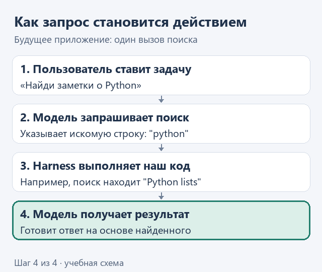

# ИИ-агенты на практике: от запроса к управляемой задаче

Этот курс можно проходить без цели стать разработчиком. Если вы анализируете процессы, руководите работой команды или хотите применять ИИ в своей предметной области, наша практика поможет разобраться, как агент получает данные, выполняет действия и проверяет результат. Python будет способом увидеть это своими руками. Подробнее о задачах читателя - в разделе [для кого эти уроки](who-this-is-for.md).

Возможно, вы уже загружали документ в ChatGPT и просили найти нужный фрагмент. Тогда начало курса выглядит подозрительно: зачем писать поиск на Python, если достаточно прикрепить файл и задать вопрос? Для получения ответа готового приложения действительно может быть достаточно. Я предлагаю разобраться в другой стороне этой истории: как собрать своё приложение вокруг модели и понимать, что происходит между просьбой и результатом.

Мы возьмём готовую модель и постепенно напишем программное окружение вокруг неё. Сами определим, какие данные она получает, какими действиями может пользоваться и как программа понимает, что работа закончена. К концу курса у нас будет небольшой агент для учебного Python-проекта: он сможет прочитать задачу, воспользоваться инструментами, изменить файл и показать результат проверки.

## Где эти знания пригодятся в работе

В компании работа редко заканчивается готовым текстом. Допустим, пришла заявка клиента: нужно найти условия обслуживания, сверить сведения, подготовить ответ и передать его ответственному сотруднику. Между этими действиями оказываются документы, учётные системы и люди. Именно на таких переходах становится понятно, зачем разбираться в устройстве агентов.

Для начала можно спроектировать небольшой участок процесса: помощник получает заявку, находит относящиеся к ней материалы и готовит ответ на согласование. Здесь уже приходится решать вполне рабочие вопросы: откуда брать данные, какой источник считать действующим, что делать при нехватке сведений и кому передавать результат. Убедительный текст - только часть этой задачи.

Если вам интересна системная интеграция, понимание агентного цикла поможет разобраться, как связать модель с операциями уже существующих программ. Если вы занимаетесь аналитикой, появится возможность проверять часть своих предложений работающим прототипом: показать маршрут заявки, разобрать исключения, обсудить с коллегами конкретный результат. В обоих случаях важно видеть весь процесс, а не только отдельный ответ в чате.

Так начинается и разговор об эффективности. До внедрения стоит определить, что именно хотим изменить: время обработки заявки, количество ручных передач или долю результатов, которые приходится исправлять. Если в компании это входит в KPI, сравнивать нужно именно эти показатели. Само появление агента ещё не доказывает улучшения процесса.

У Python в этой истории своя роль. Для аналитика небольшой скрипт может сверить две выгрузки и показать расхождения. Для менеджера, который регулярно собирает отчёт, - объединить данные из нескольких файлов и отметить пропуски. Такие операции можно запускать самостоятельно, а затем поручить агенту пользоваться ими в нужный момент. Поэтому умение читать и менять Python-код пригодится далеко за пределами профессии разработчика.

Это даёт больше самостоятельности: можно проверить идею на своих данных, разобраться в расчёте, поправить правило обработки и принести коллегам работающий пример. В нашем курсе Python станет способом постепенно превращать понятный вам порядок работы в действия, которые сможет выполнять программа. Начнём с небольших файлов, чтобы весь путь данных оставался перед глазами.

## Что мы возьмём в работу

Этот учебник не обещает превратить небольшой проект в замену платформам, над которыми работают целые команды. У них свои задачи: множество пользователей, сбои, сопровождение. Наша цель скромнее и полезнее для старта - собрать систему, которую вы можете прочитать, изменить и объяснить.

Обучение самой нейросети тоже оставим за пределами первого маршрута. Здесь мы будем пользоваться готовой моделью; подробно разбирать её внутреннюю математику пока не потребуется. Нужную теорию я буду вводить там, где она помогает принять решение в коде. Если позже захочется пойти глубже, у вас уже появятся собственные вопросы, ради которых стоит это делать.

## Как передать задачу модели

Представим знакомую ситуацию: вы открыли ChatGPT, прикрепили текстовый файл с заметками и написали в поле сообщения: «Найди в этом файле заметки о Python». Вы дали приложению данные и объяснили, что хотите получить. Сама эта просьба - пример **промпта**, то есть задания для модели.

Здесь полезно различать **модель** и **готовое приложение**. GPT - название семейства моделей, а ChatGPT - продукт, через который вы ими пользуетесь. Когда вы работаете в чате, интерфейс, передача документов и доступные способы действий уже организованы приложением. В своём проекте часть этой работы мы возьмём на себя.

А теперь перенесём эту задачу в приложение, которое будем писать сами. Допустим, заметки лежат в его рабочей папке. Мы дадим модели возможность запросить поиск, а наш код выполнит его и вернёт найденные строки. Такую доступную операцию называют **инструментом**, или tool. Именно эту связь между решением модели и выполнением нашего кода мы позднее построим через [вызовы функций](https://developers.openai.com/api/docs/guides/function-calling).

Наш первый поиск будет простым и предсказуемым: найдёт строки, содержащие запрос. Мы сможем проверить его отдельно, а затем подключить к модели. Ценность упражнения - в понимании и управлении этой частью системы, а не в обещании обогнать готовый сервис несколькими строками Python.

Например, если в заметках записаны `'Python lists'` и `'Agent tools'`, поиск по слову `'python'` вернёт `'Python lists'`. Эту исходную строку приложение передаст модели, чтобы она могла использовать найденное в ответе. Устройство параметров и результата разберём на схеме в первом уроке.

## Как задать правила выполнения

Вернёмся к примеру с открытым ChatGPT и прикреплённым файлом. Допустим, вам нужны именно исходные заметки, а не пересказ с добавленными пояснениями. Тогда сообщение можно уточнить:

> Найди в прикреплённом файле заметки о Python. Покажи найденные строки целиком. Если подходящих заметок нет, так и напиши.

Теперь в сообщении есть и задача - найти заметки, и требования к результату - показать исходные строки и сообщить об отсутствии совпадений. Пока всё это обычная просьба пользователя в чате.

Когда будем собирать собственное приложение, сможем вынести повторяющиеся требования в его настройки. Например, программа будет передавать модели правило «показывай источник ответа», а пользователь - каждый раз задавать новый вопрос. Один из способов передать общие правила модели - отдельное **системное сообщение**. Так мы задаём ожидаемое поведение словами; позднее разберём, какую его часть нужно дополнительно обеспечивать кодом.

Для проекта с кодом эти правила удобно хранить в файле рядом с исходниками. В некоторых приложениях для этого принят **`AGENTS.md`**. В нём можно написать, например: «Учебные данные лежат в `data`; перед изменением функции прочитай её описание». [Codex читает такие проектные инструкции](https://learn.chatgpt.com/docs/agent-configuration/agents-md). Сам файл не становится системным сообщением: приложение должно прочитать текст и включить его в данные, передаваемые модели. В нашем будущем приложении такую загрузку тоже нужно будет реализовать.

## Как сохранить способ работы вместе с кодом

Допустим, каждую пятницу вы просите агента подготовить обзор рабочих заметок. Каждый раз приходится объяснять одно и то же: где искать записи, как выбирать нужные и в каком виде отдавать обзор. Этот порядок можно собрать в **skill** - папку с инструкцией и материалами для определённой работы. В поддерживающем skills приложении агент сможет прочитать её, когда займётся таким заданием.

Внутри может лежать не только текст для модели, но и готовый Python-скрипт. Например, инструкция объясняет, какие заметки нужны для обзора, а скрипт читает файлы и отбирает строки. Рядом можно сохранить образец готового обзора. [Формат Agent Skills](https://agentskills.io/home) предусматривает инструкции, исполняемые скрипты и дополнительные материалы; состав конкретного skill зависит от задачи.

Вот как мог бы выглядеть такой комплект. Это пример будущей упаковки, создавать эту папку сейчас не нужно:

```text
weekly-notes/
├── SKILL.md             порядок подготовки обзора
├── scripts/
│   └── search_notes.py  чтение и поиск заметок
└── assets/
    └── report.md        образец результата
```

Агент читает порядок работы и при необходимости запускает приложенный скрипт через доступный инструмент выполнения кода. Сам файл с инструкцией ничего не запускает. Так разделяется работа: в тексте мы объясняем, когда и зачем искать, а в Python задаём точные правила поиска. Позднее нашу первую функцию можно будет использовать и в таком скрипте, и в собственном агентном приложении.

## Как связать данные, решения и действия

В нашем приложении кто-то должен собрать просьбу пользователя и правила, передать их модели, выполнить запрошенный поиск и отправить результат обратно. Всё это будет делать написанная нами программа вокруг модели. Такое окружение называют **harness**. Позднее добавим в него работу с историей запросов, обработку ошибок и условия остановки. Для нашего курса удобно представлять агента как модель, работающую в этом окружении.

На схеме показан один будущий проход: модель запрашивает поиск, наша программа выполняет его, а найденные строки возвращаются модели для ответа. Если данных окажется недостаточно, приложение сможет разрешить следующий вызов; условия такого продолжения разберём позже.


<details>
<summary>Посмотреть без анимации</summary>



</details>

Сейчас от вас не требуется запомнить все названия. Важно представить общую работу: вы ставите задачу, модель участвует в выборе действий, а написанная нами программа обеспечивает их выполнение. По мере разработки у каждого нового слова появится свой конкретный участок кода.

## Почему сильной модели бывает недостаточно

Представьте, что вы подключили одну и ту же модель к двум приложениям и попросили: «Найди в наших заметках условия обслуживания клиента». В первом приложении ей передали только просьбу. Самих заметок она не получила, и способа открыть их у неё нет. Можно уточнить вопрос, предложить порядок поиска, но достоверно извлечь отсутствующие сведения неоткуда. Во втором приложении мы подключили поиск по нужной папке: теперь модель может запросить его, получить исходные строки и сослаться на них в ответе. Модель осталась прежней, а возможности приложения изменились.

Вот почему выбор модели - лишь часть работы. Имеет значение, какие данные попадут в её контекст, какие действия ей доступны и как приложение проверит их результат. Даже сильная модель может остановиться на полпути или объявить работу законченной раньше времени. В [разборе Anthropic о длительных задачах](https://www.anthropic.com/engineering/effective-harnesses-for-long-running-agents) показано, как организация окружения, сохранение состояния и проверки помогают справляться с такими сбоями. Это не делает любую задачу решаемой, но показывает, сколько зависит от устройства системы вокруг модели.

Для нас здесь начинается интересная инженерная работа. Если помощник не нашёл заметку, хочется понять причину: её нет в файле, поиск пропустил строку или модель вообще не вызвала инструмент? Собирая эти части по очереди, мы получим возможность различать такие случаи. Поэтому начнём с маленькой функции поиска, работу которой можно проверить самостоятельно, а затем дадим модели ею пользоваться.

## Маршрут практических уроков

Первым делом напишем ту самую операцию, которую можно положить в скрипт для агента: найти нужные строки в заметках. Начнём с нескольких заметок, чтобы на конкретном примере разобрать, как функция сравнивает каждую строку с запросом и какие строки возвращает. Освоенные здесь строки, списки и чтение файлов пригодятся и при обработке рабочих выгрузок, и при подготовке данных для отчёта.

Сначала запустим поиск сами и убедимся, что он возвращает нужные строки. Затем подключим модель: она сможет запросить поиск и использовать найденное в ответе. Когда появятся несколько доступных действий, соберём harness, который выполняет запросы модели, возвращает результаты и следит за условиями остановки. Эти части станут основой небольшого кодирующего агента. Так у каждого шага будет продолжение: написанный нами код постепенно превратится в возможности системы.

Для начала пройдём три связанных шага:

1. [Подготовка. Откроем проект и сделаем первый запуск](01-note-search/00-setup.md) - убедимся, что среда готова к работе.
2. [Урок 1. Напишем проверяемый поиск по заметкам](01-note-search/01-search.md) - реализуем отбор данных двумя способами и сравним результат.
3. [Урок 2. Подготовим данные из файла для поиска](01-note-search/02-read.md) - подключим источник данных к уже написанной функции.

В каждом шаге будем работать в полном каркасе проекта: находить нужную заглушку, реализовывать её и проверять результат. Новые части добавляем по мере появления задачи, сохраняя понятным общий ход работы.

Полный маршрут уже подготовлен в [оглавлении всех уроков с отдельными каркасами](README.md). Не нужно проходить его сразу: начните с первого поиска и двигайтесь после понятного результата.
