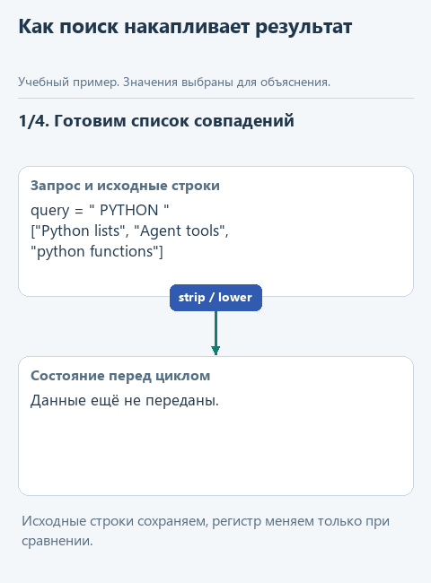
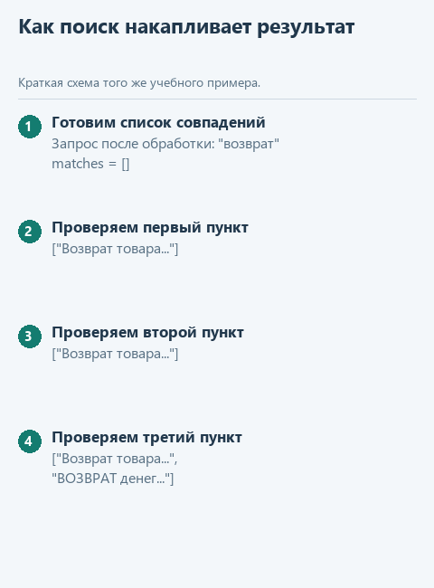

# Урок 1. Найдём пункты регламента по слову

[Открыть исходники этого урока](../../exercises/lesson-01-01-search/README.md) / [Подсказки рядом с кодом](../../exercises/lesson-01-01-search/TASK.md)

> **Где мы.** Собираем помощника, который отвечает по регламенту. Сейчас первый шаг: программа должна сама найти нужные пункты, пока без модели.
> `регламент -> [поиск] -> модель -> ответ`

Вспомним случай из вводной: помощник дал неверный совет, потому что нужный пункт до модели не дошёл. В таком разборе первым делом проверяют, нашла ли программа этот пункт. Сейчас напишем функцию, которая ищет пункты по слову, и своими глазами посмотрим, какие строки она отбирает.

## Задача

В регламенте три пункта:

```text
Возврат товара возможен в течение 14 дней.
Доставка по городу занимает 1 день.
ВОЗВРАТ денег производится на карту покупателя.
```

Клиент спрашивает о возврате. Нужно отобрать пункты, где встречается слово "возврат", причём независимо от того, написано оно маленькими буквами или большими.

**Угадайте до запуска:** сколько пунктов должна вернуть функция и какие именно? Запомните ответ, проверим его в конце урока.

## Откроем файл

Скачайте [архив урока](../../downloads/lesson-01-01-search.zip?raw=true) и распакуйте его через **Извлечь всё**. В PyCharm выберите **File -> Open** и откройте папку `lesson-01-01-search`. В дереве слева (**View -> Tool Windows -> Project**) откройте `notes.py`. В нём уже есть начало функции `find_notes`, её мы и допишем.

В коде пункты регламента хранятся в переменной `notes` - по-английски "заметки". Такое имя подходит для любых текстовых записей, поэтому функции называются `find_notes` и `read_notes`.

## Шаг 1. Приведём запрос к одному виду

Человек может набрать запрос с пробелами по краям или большими буквами: `' Возврат '`. Чтобы сравнение от этого не зависело, сначала уберём пробелы, а потом переведём буквы в нижний регистр:

```python
query = ' Возврат '
query = query.strip().casefold()
print(query)   # возврат
```

Метод `strip()` убирает пробелы по краям, `casefold()` делает буквы маленькими. Кириллицу он обрабатывает так же, как латиницу: `'ВОЗВРАТ'.casefold()` даёт `'возврат'`. Оба метода возвращают новую строку, поэтому результат снова записываем в `query`. В начале `find_notes` эта строка уже есть.

## Шаг 2. Проверим одну строку

Возьмём третий пункт и спросим Python, есть ли в нём наш запрос:

```python
note = 'ВОЗВРАТ денег производится на карту покупателя.'
'возврат' in note.casefold()   # True
```

Оператор `in` отвечает на вопрос, содержится ли левая строка в правой. Сам пункт при этом не меняется: `casefold()` создаёт новую строку только для сравнения, а в результат попадёт исходный пункт со своими большими буквами.

## Шаг 3. Пройдём по всем пунктам

Осталось проверить каждый пункт по очереди и сложить подходящие в новый список `selected`. Для этого есть цикл `for`: он берёт строки из списка `notes` по одной и для каждой выполняет код, сдвинутый под ним вправо.

```python
selected = []
for note in notes:
    if query in note.casefold():
        selected.append(note)
```

Пробелы в начале строк здесь важны. По ним Python понимает, что `if` выполняется внутри цикла, а `append` - только когда условие истинно. На каждый уровень вложенности приходится четыре пробела; сохраняйте отступы так, как в примере. Метод `append` добавляет пункт в конец списка `selected`.

На анимации видно, как список `selected` пополняется на каждом шаге цикла:



<details>
<summary>Посмотреть без анимации</summary>



</details>

## Напишите сами

В `notes.py` функция `find_notes` уже готовит запрос и создаёт пустой список `selected`. Замените строку `raise NotImplementedError(...)` циклом и заполните два пропуска `...`:

```python
    for note in notes:
        if ...:
            selected.append(...)
    return selected
```

1. В условие подставьте проверку из шага 2, только вместо `'возврат'` запишите переменную `query`.
2. В `append` передайте исходную строку `note`: клиенту нужен пункт регламента в том виде, как он написан, а не его копия маленькими буквами.

Строка `return selected` стоит после цикла, на одном уровне с `for`. Она отдаёт собранный список тому, кто вызвал функцию. Если сдвинуть её внутрь цикла, функция закончит работу на первом же пункте.

## Запустим

Откройте `demo_search.py` (он лежит рядом с `notes.py`), нажмите правой кнопкой в коде и выберите **Run 'demo_search'**. Внизу, в окне Run, под строкой `find_notes` должно появиться:

```text
['Возврат товара возможен в течение 14 дней.', 'ВОЗВРАТ денег производится на карту покупателя.']
```

Совпало с вашей догадкой? Пункт о доставке не попал в список, а "ВОЗВРАТ" большими буквами попал благодаря `casefold()`. Под строкой `find_notes_alt` пока будет сообщение "Допишите find_notes_alt": это необязательное задание из примечания в конце урока.

Если вместо списка под `find_notes` появилось "Допишите find_notes...", значит, файл не сохранён или строка `raise NotImplementedError(...)` осталась на месте. Схема окон PyCharm есть в разделе [как найти файл и запустить пример](../pycharm.md).

## Попробуйте сломать

1. Уберите `.casefold()` из условия и запустите ещё раз. Какой пункт пропал и почему?
2. В `demo_search.py` замените запрос на три пробела `'   '`. Функция остановится с ошибкой "Введите непустой запрос". Эта проверка стоит в начале функции не случайно: пустая строка содержится в любой строке, и без проверки поиск вернул бы весь регламент. Пока запрос вводит человек, ошибка кажется надуманной. Но когда поиском начнёт пользоваться модель или другая часть программы, пустое значение может прийти просто по ошибке, и лучше сразу увидеть его, чем получить весь регламент под видом найденного.

Верните код в рабочее состояние перед следующим уроком.

## Что мы получили

Теперь можно проверить первое звено цепочки из случая MWS: нашла ли программа нужный пункт. Если пункт есть в регламенте, но не попал в этот список, ошибка в поиске, и модель тут ни при чём. В третьем разделе модель сама попросит выполнить этот же поиск, а выбирать строки будет написанная вами функция.

Такой отбор данных под запрос в статьях об ИИ называют **retrieval**, по-русски "извлечение данных". Наш вариант - самый простой: поиск подстроки. Как retrieval связан с RAG, рассказано в [памятке терминов](../terms.md#%D0%B8%D0%B7%D0%B2%D0%BB%D0%B5%D1%87%D0%B5%D0%BD%D0%B8%D0%B5-%D0%B4%D0%B0%D0%BD%D0%BD%D1%8B%D1%85-%D0%B8-rag).

Хотите убедиться, что поиск работает и на других случаях (повторы, пустой результат, буквы с особым написанием)? Для этого есть [готовые проверки](extra-tests.md).

Следующий шаг: [читаем регламент из файла](02-read.md). Вернуться к [оглавлению и архивам](../README.md).

<details>
<summary>Необязательно: что значат `list[str]` и `-&gt;` в заголовке функции</summary>

`def find_notes(notes: list[str], query: str) -> list[str]:` читается так: функция принимает список строк и одну строку и возвращает список строк. Это подсказки для человека и редактора, сам Python их не проверяет. Писать их в своих функциях пока не обязательно.

</details>

<details>
<summary>Необязательно: тот же поиск одной строкой</summary>

В Python есть короткая запись, которая сразу создаёт список: `[note for note in notes if query in note.casefold()]`. Она делает то же, что цикл из шага 3: перебирает `notes` и оставляет пункты, где есть запрос. Такую запись называют list comprehension. Если хочется попробовать, откройте в `notes.py` функцию `find_notes_alt`, замените в ней `raise NotImplementedError(...)` строкой `return [note for note in notes if query in note.casefold()]` и запустите `demo_search.py`: под `find_notes_alt` появится тот же список.

</details>
