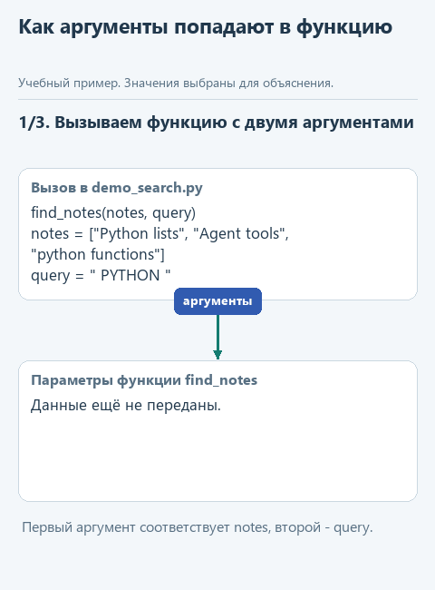
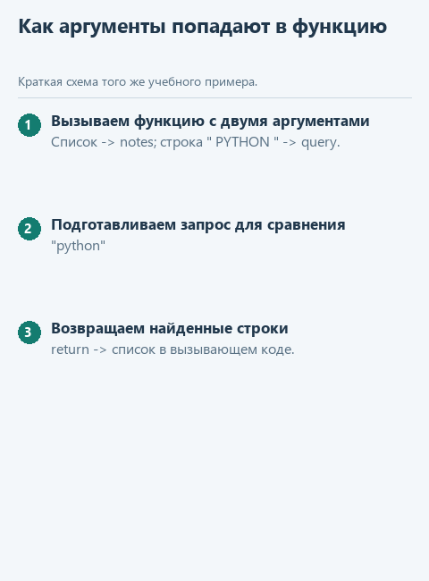
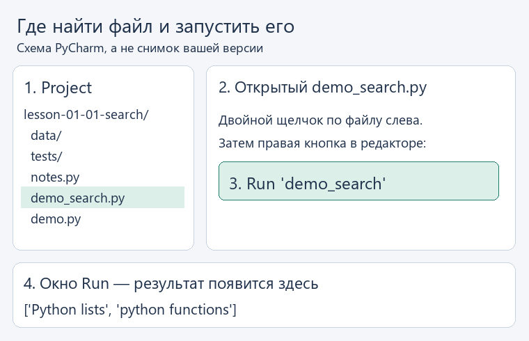

# Урок 1. Напишем проверяемый поиск по заметкам

[Открыть исходники этого урока](../../exercises/lesson-01-01-search/README.md) / [Подсказки рядом с кодом](../../exercises/lesson-01-01-search/TASK.md)

Представим, что мы просим помощника найти сведения о Python в своих заметках. Чтобы ответ опирался на эти записи, программа должна сначала получить нужные строки и передать их модели. В готовом чате этот шаг обычно скрыт, а здесь мы напишем его сами и сможем проверить, какие сведения будут доступны будущему агенту.

Начнём без модели: передадим функции `find_notes` список заметок и запрос `'python'`, а в ответ получим подходящие строки. На таком примере легко заметить ошибку отбора: нужная заметка потерялась или в результат попала посторонняя. Позднее модель сможет запросить этот поиск, но выбирать строки будет тот же проверенный код.

В вводном разделе `start.py` только подтвердил, что среда работает. Теперь мы подготовим первый инструмент помощника и заодно освоим нужные для него строки, списки и цикл. Общий замысел курса описан во [введении](../00-introduction.md); в этом уроке увидим, как он начинает складываться из конкретных действий программы.

## Каркас этого урока и файлы в PyCharm

Скачайте [отдельный каркас этого урока](../../downloads/lesson-01-01-search.zip?raw=true) и распакуйте архив. Внутри находится `lesson-01-01-search`. В PyCharm выберите **File -> Open**, укажите эту папку и откройте в новом окне. В нём подготовлены предыдущие части, а у функций текущего урока подготовлено начало, которое предстоит дописать. Свой прежний проект не перезаписывайте.

Слева откройте **View -> Tool Windows -> Project** и разверните `lesson-01-01-search`. Учебный `notes.py` и демонстрационные `.py` лежат прямо в этом корне, вне папок `tests` и `data`. Как выглядят эти шаги, показано в [схеме навигации по PyCharm](../pycharm.md).

## Найдём функцию в каркасе проекта

Открыв учебный каркас, вы увидите сразу всё приложение - включая части, до которых мы ещё не добрались. Разбираться со всем одновременно не потребуется. Сейчас откроем `notes.py` в открытой папке `lesson-01-01-search` и найдём нашу функцию:

```python
def find_notes(notes: list[str], query: str) -> list[str]:
    query = query.strip().casefold()
    if not query:
        raise ValueError('Введите непустой запрос')
    selected = []
    raise NotImplementedError('Допишите find_notes по подсказкам урока')
```

### Обратите внимание на отступы

В Python отступ определяет, к какому блоку относится строка. В показанной функции строки `query = ...`, `if not query:` и `selected = []` сдвинуты вправо на четыре пробела: они находятся внутри функции. Строка `raise ValueError(...)` сдвинута ещё на четыре: она относится к условию `if` и выполняется только при пустом запросе.

Поэтому сохраняйте отступы из примеров. Неверный сдвиг может вызвать `IndentationError` или изменить поведение программы. В наших упражнениях используем четыре пробела на каждый уровень вложенности; табуляцию с пробелами не смешиваем.

Пока функция только подготавливает запрос и сообщает, что отбор ещё не реализован. В архиве уже подготовлено начало функции; недописанное место отмечено `NotImplementedError`. Ниже разберём, как его завершить. Но сначала посмотрим, какие данные она будет получать. Вот пример вызова после реализации функции - добавлять его в `notes.py` сейчас не нужно:

```python
find_notes(
    ['Python lists', 'Agent tools', 'python functions'],
    ' PYTHON ',
)
```

Первое переданное значение, `['Python lists', 'Agent tools', 'python functions']`, внутри функции будет доступно под именем `notes`. Это список из трёх строк: квадратные скобки объединяют элементы, а запятые разделяют их. Второе значение, `' PYTHON '`, получит имя `query`: это одна строка с искомым словом и пробелами по краям. Мы добавили их намеренно, чтобы проверить подготовку запроса. Кавычки обозначают текст в коде и не являются частью самой заметки или запроса.

Анимация связывает значения в вызове с именами параметров. На последнем шаге показан ожидаемый результат готовой функции: новый список `['Python lists', 'python functions']`. Дальше будем разбирать именно этот вызов, сохраняя заметки и запрос. Это учебная схема, а не запись выполнения заглушки.



<details>
<summary>Посмотреть без анимации</summary>



</details>

На схеме записи `notes = ...` и `query = ...` показывают значения параметров при этом вызове. Вписывать эти присваивания в функцию не требуется: Python сам свяжет переданные значения с параметрами по порядку.

Записи после двоеточий описывают ожидаемые типы параметров: `notes: list[str]` - список строк, `query: str` - одна строка. Запись `-> list[str]` означает, что функция должна вернуть список строк. Это подсказки для читателя и редактора; Python не проверяет их автоматически.

Ниже разберём несколько приёмов Python, которые понадобятся для этой реализации. Полностью соединить их внутри `find_notes` будет вашей задачей.

## Подготовим запрос к сравнению

В нашем вызове параметр `query` получил строку `' PYTHON '`. Уберём пробелы по краям и подготовим её к сравнению без учёта регистра:

```python
query = query.strip().casefold()  # из ' PYTHON ' получим 'python'
```

`strip()` убирает пробельные символы по краям строки, а `casefold()` подготавливает текст к сравнению без учёта регистра. Оба метода возвращают новую строку, поэтому в показанной команде сохраняем результат обратно в `query`. Исходную заметку при таком сравнении менять не нужно.

Теперь в `query` находится строка `'python'`. Возьмём первую заметку из того же списка - `'Python lists'` - и посмотрим на сравнение:

```python
note = 'Python lists'  # первая строка из notes, для разбора сравнения
query in note.casefold()  # True
```

Оператор `in` проверяет, содержит ли строка справа текст, указанный слева. Здесь проверяем, есть ли запрос `'python'` в строке `'python lists'`. Ответ `True` означает "да". Временная переменная `note` обозначает одну заметку; ниже цикл будет по очереди передавать в неё строки из `notes`. Исходную заметку мы не меняем: `casefold()` возвращает новую строку только для сравнения.

Отдельно предусмотрим ошибочный ввод. Если вместо нашего запроса пользователь передаст три пробела `'   '`, после `strip()` получится пустая строка `''`. Выражение `'' in 'python lists'` тоже даёт `True`, поэтому без проверки такой запрос выберет все заметки. Чтобы этого не случилось, после подготовки запроса проверим:

```python
if not query:
    raise ValueError('Введите непустой запрос')
```

Условие `not query` выполнится, если в `query` находится пустая строка `''`. После `if` требуется двоеточие, а вложенный код записывается с отступом. `raise` прекращает выполнение функции с указанной ошибкой. Наш основной запрос `' PYTHON '` после подготовки становится `'python'`, поэтому эту ветку пропускает; продолжим разбирать его.

## Соберём подходящие заметки

Теперь обработаем все три строки из нашего списка `notes`. В учебной анимации показан тот же запрос `' PYTHON '` и последовательный просмотр заметок. В результате останутся первая и третья строки в исходном виде.


<details>
<summary>Посмотреть без анимации</summary>


</details>

Результат будем хранить в новом списке `selected`. В следующем фрагменте `notes` - наш список из трёх заметок, а `query` уже подготовлен и равен `'python'`:

```python
selected = []
for note in notes:
    if query in note.casefold():
        selected.append(note)
```

Сначала `note` получает строку `'Python lists'`: после `casefold()` она содержит запрос `'python'`, поэтому `append(note)` добавляет исходную строку в конец `selected`. Строку `'Agent tools'` пропускаем, а `'python functions'` тоже добавляем. После цикла в `selected` будет `['Python lists', 'python functions']`. Сам `append` возвращает `None` - значение, означающее здесь отсутствие возвращаемого результата; присваивать его обратно в `selected` не нужно.

Собранный список должен получить тот код, который вызвал `find_notes`. Для этого в конце функции понадобится `return`: он отдаёт результат и завершает выполнение функции. Разместите его после цикла, чтобы успеть проверить все заметки. Внутри функции строки `for` и `return` должны начинаться с одинакового отступа в четыре пробела. Если сдвинуть `return` внутрь цикла, функция завершится уже на первой заметке.

## Реализуем тот же поиск второй записью

Тот же отбор можно выразить через *list comprehension* - конструкцию, которая сразу создаёт список:

```python
selected = [note for note in notes if query in note.casefold()]
```

Здесь используются те же `notes` и подготовленный `query`, поэтому в `selected` снова получится `['Python lists', 'python functions']`. Запись короче, но условие осталось прежним - оставить строки, содержащие наш запрос без учёта регистра. Попробуйте найти в этой записи знакомые части нашего цикла. Для простого отбора такой способ удобен; если внутри появится несколько действий, развёрнутый цикл может читаться легче. Соревнование на самую короткую строку пока устраивать не будем.

## Соберём функцию с подсказками

В каркасе уже подготовлены запрос и пустой список для результата. Теперь нам нужно пройти по заметкам и решить, какие из них в этот список попадут. Мы не придумываем новый способ поиска: используем разобранное выше условие `query in note.casefold()`.

В файле текущего задания уже есть начало функции. Допишите её по заготовке ниже: `...` обозначает место для вашего выражения, а не готовую команду. Когда заполните пропуски, удалите строку `raise NotImplementedError(...)` из каркаса. Заголовок `def` в файле уже есть - вторую функцию с тем же именем создавать не нужно.

```python
def find_notes(notes: list[str], query: str) -> list[str]:
    query = query.strip().casefold()
    if not query:
        raise ValueError('Введите непустой запрос')
    selected = []
    for note in notes:
        if ...:
            selected.append(...)
    return selected
```

В первом пропуске нужно условие поиска: запрос `query` должен входить в `note.casefold()`. Во втором - исходная заметка `note`, чтобы в результате сохранились её буквы и регистр. `return` стоит после цикла: иначе функция вернёт результат после первой заметки.

Когда первый вариант заработает, откройте `find_notes_alt` в том же файле. Подготовка запроса там уже такая же. Вместо цикла соберите список по знакомой записи `[note for note in notes if ...]`, подставив то же условие. Затем верните этот список. Это второй способ записать тот же отбор, а не новое задание на другие данные.

Посмотрим, кто получит собранный список. После реализации вызов можно записать так:

```python
matches = find_notes(['Python lists', 'Agent tools', 'python functions'], ' PYTHON ')
```

Когда функция доходит до `return selected`, она завершает работу, а её вызов даёт значение `['Python lists', 'python functions']`. Именно этот список оператор `=` сохраняет в `matches`. `return` сам ничего не печатает: демонстрационный файл получает список и отдельно выводит его через `print`. Поэтому написанная функция пригодится и без консоли - позже программа сможет передать найденные строки модели.

Выбор подходящих данных из источника под запрос часто называют **извлечением информации**, или **retrieval**. Наша `find_notes` показывает простой вариант этого шага: отбор строк по подстроке. Когда встретите это слово в описании ИИ-системы, полезно выяснить, откуда берутся данные и как выбирается нужное. Дальше такие данные можно передать модели для ответа; связь этих шагов разберём в [памятке о retrieval и RAG](../terms.md#%D0%B8%D0%B7%D0%B2%D0%BB%D0%B5%D1%87%D0%B5%D0%BD%D0%B8%D0%B5-%D0%B4%D0%B0%D0%BD%D0%BD%D1%8B%D1%85-%D0%B8-rag).

## Проверим результат на одинаковых данных

В открытом PyCharm слева пройдите **Project -> lesson-01-01-search -> demo_search.py**. Этот файл лежит прямо в корне, рядом с `notes.py`, вне папок `tests` и `data`. Откройте его двойным щелчком. Внутри редактора нажмите правой кнопкой и выберите **Run 'demo_search'**. Внизу появится окно **Run** с результатами обеих функций. Если дерево файлов скрыто, выберите **View -> Tool Windows -> Project**.



На схеме показан результат после реализации. До неё запуск сообщит имя незаполненной функции.

Внутри `demo_search.py` уже подготовлены три строки: `'Python lists'`, `'Agent tools'` и `'python functions'`. Пример передаёт их каждой поисковой функции вместе с запросом `' PYTHON '`. В окне Run сначала появится имя первой функции и её результат, затем имя второй и её результат. Оба списка должны быть такими:

```text
['Python lists', 'python functions']
```

Если вместо этого видите сообщение, что функция ещё не реализована, проверьте, сохранили ли `notes.py` и заменили ли заглушку нужной функции. Для начала достаточно разобраться с этим примером.

Когда захотите проверить остальные условия - пустой запрос, отсутствие совпадений, сохранение порядка строк, - можно обратиться к [необязательному материалу о юнит-тестах](extra-tests.md). Там воспользуемся готовыми проверками как способом контроля: убедимся, что изменение кода не нарушило поведение, о котором мы договорились.

А пока попробуйте объяснить своими словами, какой части цикла соответствует каждая часть list comprehension. Затем перейдём к [чтению заметок из файла](02-read.md). Вернуться к подготовке среды можно во [вводном разделе](00-setup.md).

## Куда идти дальше

Следующий шаг - [читаем заметки](02-read.md). Вернуться к [оглавлению и архивам](../README.md).
