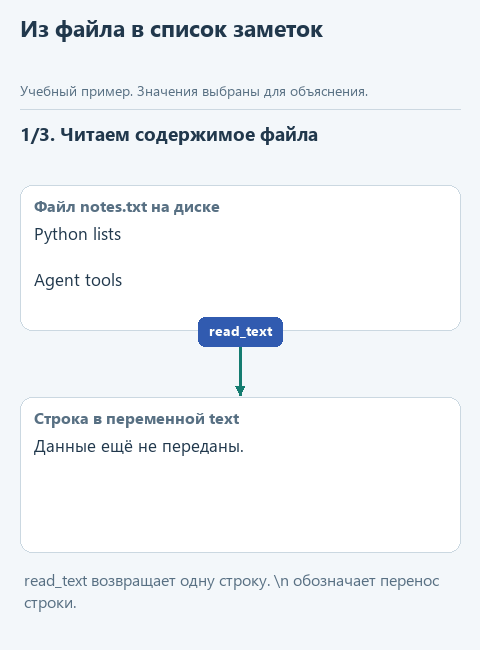
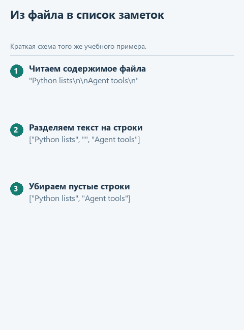
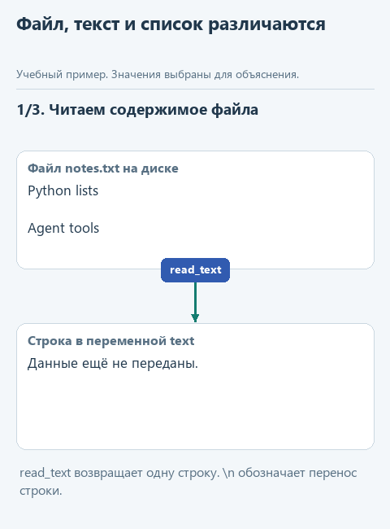
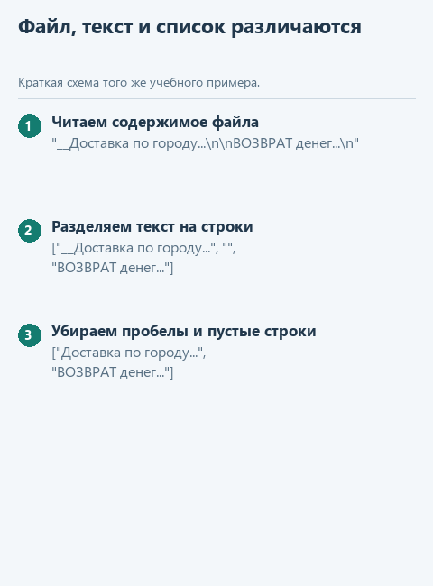

# Урок 2. Подготовим данные из файла для поиска

[Открыть исходники этого урока](../../exercises/lesson-01-02-read/README.md) / [Подсказки рядом с кодом](../../exercises/lesson-01-02-read/TASK.md)

В [первом уроке](01-search.md) готовый пример `demo_search.py` передавал поиску список, записанный прямо в коде. В открытом проекте есть и файл `data/notes.txt` с заметками. Теперь научимся получать такой же список из него: за чтение и подготовку строк будет отвечать `read_notes`, а поиск сможет использовать результат без изменений.

Например, в начале приложенного `data/notes.txt` находятся такие строки - без кавычек и квадратных скобок:

```text
Python functions return values.
Python lists keep item order.
Agents can call tools.
```

После чтения и подготовки эти три строки будут выглядеть в Python так:

```python
['Python functions return values.',
 'Python lists keep item order.',
 'Agents can call tools.']
```

Здесь показаны только первые три заметки; функция должна прочитать весь файл.

Ниже - путь данных, который нам предстоит реализовать. Файл сначала станет текстом, затем списком подготовленных строк. Сам поиск останется прежним: ему достаточно получить этот список. Анимация показывает ожидаемое поведение `read_notes`; в стартовом проекте на её месте пока заглушка.



<details>
<summary>Посмотреть без анимации</summary>



</details>

## Каркас этого урока и файлы в PyCharm

Скачайте [отдельный каркас этого урока](../../downloads/lesson-01-02-read.zip?raw=true) и распакуйте архив. Внутри находится `lesson-01-02-read`. В PyCharm выберите **File -> Open**, укажите эту папку и откройте в новом окне. В нём подготовлены предыдущие части, а у функций текущего урока подготовлено начало, которое предстоит дописать. Свой прежний проект не перезаписывайте.

Слева откройте **View -> Tool Windows -> Project** и разверните `lesson-01-02-read`. Учебный `notes.py` и демонстрационные `.py` лежат прямо в этом корне, вне папок `tests` и `data`. Как выглядят эти шаги, показано в [схеме навигации по PyCharm](../pycharm.md).

## Прочитаем данные из указанного файла

Откройте `notes.py` в нашей папке `lesson-01-02-read` и найдите заглушку `read_notes(path)`. Она получает `Path` - объект, представляющий путь к файлу. Сам текст появится после чтения:

```python
path = Path('data/notes.txt')
text = path.read_text(encoding='utf-8')
```

`Path` уже импортирован в начале `notes.py`, поэтому его можно использовать в нашей функции. Метод `read_text` возвращает всё содержимое одной строкой, включая переводы строк между заметками. Параметр `encoding` указывает, как прочитать байты файла как текст; для наших заметок используем UTF-8, чтобы кириллица читалась правильно.

В первой строке примера путь задан вручную, чтобы показать работу `Path`. В самой `read_notes` создавать его заново не требуется: вызывающая программа передаст нужный путь аргументом `path`. Для первого запуска он уже подготовлен в `demo_read.py` и ведёт к `data/notes.txt` рядом с остальными файлами проекта.

Обратите внимание на различие: `Path('data/notes.txt')` указывает, где находится файл, но ещё не содержит его текст. `read_text` читает этот файл, и только его результатом становится строка с заметками.

## Подготовим список для поиска

В файле каждая заметка занимает отдельную строку. В Python перевод строки можно записать как `\n`; в самом текстовом редакторе мы видим его как переход на следующую строку.
Чтобы разобрать ещё и очистку пробелов, мы возьмём отдельный пример: две заметки, пустая строка между ними и пробелы по краям первой (обратите внимание на `\n`). 
Далее до конца разбора будем использовать этот текст и заменять им приложенный `data/notes.txt` нет необходимости. 

В Python это выглядит так:

```python
text = '  Первая заметка  \n\nВторая заметка\n'
lines = text.splitlines()  # ['  Первая заметка  ', '', 'Вторая заметка']
```

Здесь `\n` обозначает перевод строки. Метод вызывается без аргументов и возвращает список, убирая разделители строк. 
Нам пригодятся уже изученные ранее приёмы: пройти по строкам, убрать пробелы через `strip()` и сохранить только непустые результаты. 
На этом шаге мы получаем "грязный" список: в нём остались пустые строки и пробелы по краям заметок. В настоящих файлах могут встретиться и символы табуляции (`\t`). Их ещё предстоит убрать с краёв, чтобы поиск работал с подготовленными заметками. Пробелы между словами сохраняем.

На схеме показан тот же пример: как текст с двумя заметками выглядит в файле, после чтения и после очистки строк.



<details>
<summary>Посмотреть без анимации</summary>



</details>

Между чтением и готовым результатом есть ещё промежуточный список после применения функции `splitlines()`:

```python
['  Первая заметка  ', '', 'Вторая заметка']
```

Элемент `''` - пустая строка. 
Теперь нужно очистить каждую строку и решить, добавлять ли её в результат. Если после очистки в строке ничего не осталось, пропустим её.
После удаления пробелов и отбора непустых строк останется `['Первая заметка', 'Вторая заметка']`.

## Соберём функцию с подсказками

Теперь у нас есть "грязный" список: в нём встречаются заметки с пробелами по краям и строки, где кроме пробелов ничего нет. Нужно получить новый список только с непустыми заметками. Давайте разделим эту работу на действия, каждое из которых уже можно выразить одной знакомой строкой Python.

В файле текущего задания уже есть начало функции. Допишите её по заготовке ниже: `...` обозначает место для вашего выражения, а не готовую команду. Когда заполните пропуски, удалите строку `raise NotImplementedError(...)` из каркаса. Заголовок `def` в файле уже есть - вторую функцию с тем же именем создавать не нужно.

```python
def read_notes(path: Path) -> list[str]:
    text = path.read_text(encoding='utf-8')
    lines = text.splitlines()
    cleaned_notes = []
    for line in lines:
        cleaned_line = ...
        if ...:
            cleaned_notes.append(...)
    return cleaned_notes
```

В `cleaned_line` сохраните `line.strip()`: для строки `"  Первая заметка  "` получится `"Первая заметка"`, а для `" \t"` - пустая строка `""`. Затем проверьте `if cleaned_line`: в Python непустая строка считается истинной, пустая - ложной. Если условие выполнено, добавьте именно `cleaned_line` в `cleaned_notes` через `append`.

Так первый пропуск отвечает за очистку, второй - за отбор, третий - за добавляемое значение. Пустой файл даст пустой `lines`: цикл не выполнится ни разу, и функция вернёт уже созданный `[]`. Отдельную проверку пустого файла писать не требуется.

Если хочется применить list comprehension, сначала добейтесь того же поведения циклом. В короткой записи понадобятся обе части: значение `line.strip()` перед `for` и условие `if line.strip()` после него. Одна очистка без условия оставит пустые строки в списке.

Для отсутствующего файла дополнительную проверку не добавляем. Сам вызов `path.read_text(...)` остановит функцию с `FileNotFoundError`. На практике это значит: в `demo_read.py` список не будет получен, а в окне Run появится ошибка с названием отсутствующего файла. Не заменяйте её на `ValueError` или `[]`: пустой прочитанный файл и файл, которого нет, требуют разных действий.

## Проверим подготовку данных

В левой панели PyCharm IDE раскройте визуальные ветки проекта  **Project -> lesson-01-02-read -> data -> notes.txt** , откройте файл заметок двойным щелчком. 
Затем вернитесь к корню **lesson-01-02-read**, найдите рядом с `notes.py` файл **demo_read.py** и откройте его. 
Нажмите правой кнопкой внутри редактора и выберите **Run 'demo_read'**. Внизу, в **Run**, появится список, который вернула ваша функция. Если дерево файлов скрыто, выберите **View -> Tool Windows -> Project**.

Чтобы увидеть работу очистки, добавьте в учебный текст пустую строку и пробелы вокруг одной из заметок. После сохранения повторите запуск: в результате не должно быть пустых заметок и лишних пробелов по краям. Сами слова и порядок заметок должны сохраниться.

Если файл удалён или путь неверен, в окне Run появится `FileNotFoundError`. По этому названию можно понять причину: программа не нашла указанный файл. Такой результат важно отличать от пустого списка, который означает, что файл прочитан, но непустых заметок в нём нет.

После реализации `read_notes` мы сможем получать из файла список строк - такой же, какой уже принимает `find_notes`. Дальше соединим чтение и поиск в общий запуск. Сейчас ваша задача - реализовать только `read_notes` и убедиться, что пример возвращает заметки из файла. К предыдущему шагу можно вернуться в [уроке поиска](01-search.md).

## Куда идти дальше

Следующий шаг - [сохраняем результат поиска](03-journal.md). Вернуться к [оглавлению и архивам](../README.md).
