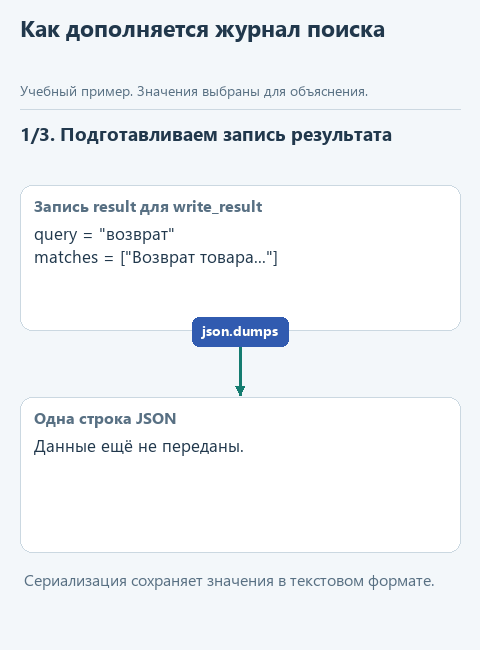
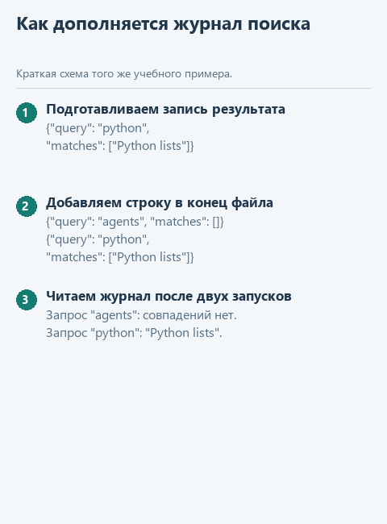

# Урок 3. Сохраняем результат поиска

[Открыть исходники этого урока](../../exercises/lesson-01-03-journal/README.md) / [Подсказки рядом с кодом](../../exercises/lesson-01-03-journal/TASK.md)

Запустим поиск дважды: сначала по слову Python, затем по другому запросу. В окне Run результат виден сразу, но после закрытия окна его легко потерять. Если позже помощник ответит иначе, нам понадобится понять, с каким запросом работал поиск и какие строки он нашёл в тот раз.

Сохраним запрос, статус поиска и найденные строки в журнал. Каждому запуску будет соответствовать одна строка JSON в обычном текстовом файле. Новую запись добавим в конец, чтобы прежние результаты оставались доступны для сравнения.

Функция `write_result` станет первым средством наблюдения за работой нашей программы. На практике мы разберём, чем возвращённое значение отличается от записи на диск и почему два способа открытия файла могут либо сохранить историю, либо стереть её. Когда поиск станет инструментом агента, такая запись поможет проверить, какие данные инструмент действительно вернул.

## Откроем каркас именно этого урока

Скачайте [каркас этого урока](../../downloads/lesson-01-03-journal.zip?raw=true) и распакуйте архив через "Извлечь всё". Внутри будет папка `lesson-01-03-journal`. В PyCharm выберите **File -> Open**, укажите эту папку и откройте её в новом окне. В каркасе уже готовы функции предыдущих уроков, поэтому сразу перейдём к текущему заданию. Ваш прежний проект останется в отдельной папке.

Слева откройте **View -> Tool Windows -> Project** и разверните `lesson-01-03-journal` стрелкой рядом с именем. Текущее задание - `write_result` в `journal.py`. Файл `demo.py` лежит прямо в этом корне, рядом с модулями, вне папок `data` и `tests`.

## Посмотрим на данные

Представим, что поиск уже нашёл строку `"Python lists"` по запросу `"python"`. Эти сведения собраны в словаре `result`: ключ `query` хранит запрос, а `matches` - список найденных строк. Чтобы записать весь результат в файл, преобразуем словарь в текст JSON, а путь к журналу передадим в параметр `path`.

```python
result = {'query': 'python', 'matches': ['Python lists']}
text = json.dumps(result, ensure_ascii=False)
# '{"query": "python", "matches": ["Python lists"]}' 
```

В примере `json.dumps` превращает словарь в одну строку текста, а `ensure_ascii=False` позволяет сохранить русские буквы в привычном виде. Каждую такую строку запишем отдельно: формат с одной JSON-записью на строку называют JSONL. Сам пример уже подготовлен в `demo.py`, поэтому переносить его в функцию не нужно.



<details>
<summary>Статичный вариант</summary>



</details>

## Соберём функцию с подсказками

В каркасе `write_result` уже вызывает `json.dumps`, поэтому переменная `text` содержит готовую запись. Осталось добавить её в конец журнала и перейти на новую строку, чтобы следующий запуск не затёр предыдущий результат.

Допишите уже начатую функцию по заготовке ниже, заполняя каждый `...` по подсказкам. Когда закончите, удалите строку `raise NotImplementedError(...)`; повторно добавлять заголовок `def` не нужно.

```python
def write_result(path: Path, result: dict) -> None:
    text = json.dumps(result, ensure_ascii=False)
    with path.open('a', encoding='utf-8') as stream:
        stream.write(...)
```

В пропуске нужно передать `text + "\n"`: сам JSON и один перевод строки после него. Без `"\n"` следующий результат приклеится к предыдущему, и отдельные записи будет трудно прочитать.

Режим `"a"` в вызове `path.open` означает добавление в конец файла; с режимом `"w"` мы бы сначала стёрли прежний журнал. Внутри блока `with` переменная `stream` обозначает открытый файл, а после выхода из блока он закрывается автоматически. Возвращать сохранённую запись из этой функции не требуется: её результатом будет изменение файла.

## Найдём файл запуска и проверим результат

В левой панели **Project -> lesson-01-03-journal -> demo.py** откройте файл двойным щелчком. Нажмите правой кнопкой внутри открытого редактора и выберите **Run 'demo'**. Внизу появится окно **Run** с выводом именно этого файла. Отдельная общая кнопка "запустить проект" нам здесь не нужна: выбираем конкретный демонстрационный файл. Если панель с файлами скрыта, вернитесь к **View -> Tool Windows -> Project**. Если Run скрыто - **View -> Tool Windows -> Run**.

До завершения функции появится сообщение "Допишите ... по подсказкам урока". После реализации ожидаем:

```text
{"query": "python", "matches": ["Python lists"]}
```

Для дополнительного контроля откройте в этом же проекте `tests/test_lesson.py`, найдите `class LessonTests`, нажмите правой кнопкой по имени класса и выберите Run. Это необязательная проверка текущего задания; внутреннее устройство тестов сейчас разбирать не нужно.

Сейчас ваша работа - `write_result` в `journal.py`; затем повторный запуск `demo.py`.

## Куда идти дальше

Следующий шаг - [соединяем чтение, поиск и журнал](04-run.md). Вернуться к [оглавлению и архивам](../README.md).
