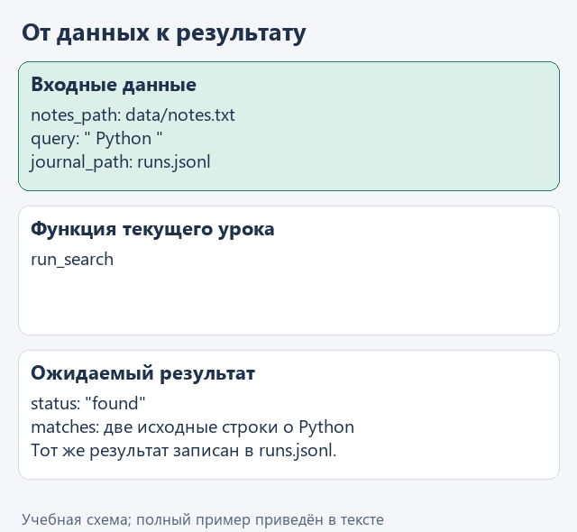
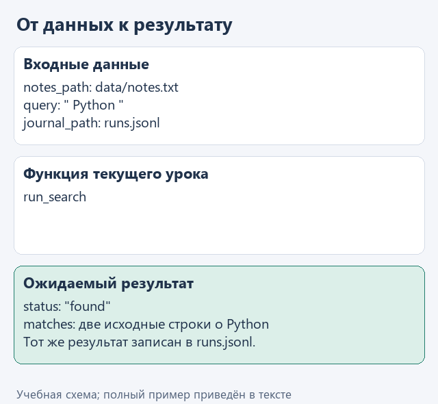

# Урок 4. Соединяем чтение, поиск и журнал

[Открыть исходники этого урока](../../exercises/lesson-01-04-run/README.md) · [Подсказки рядом с кодом](../../exercises/lesson-01-04-run/TASK.md)

До сих пор мы проверяли отдельные части. Теперь соберём понятный маршрут: прочитать заметки, выполнить поиск и сохранить результат. У будущего агента появится одна операция с готовым ответом вместо необходимости самому организовывать эти шаги.

## Откроем каркас именно этого урока

Скачайте [каркас этого урока](../../downloads/lesson-01-04-run.zip?raw=true) и распакуйте архив через «Извлечь всё». Внутри будет папка `lesson-01-04-run`. В PyCharm выберите **File → Open**, укажите эту папку и откройте её в новом окне. Предыдущие части уже подготовлены: переносить свои решения необязательно. Свой прежний проект можно оставить открытым.

Слева откройте **View → Tool Windows → Project** и разверните `lesson-01-04-run` стрелкой рядом с именем. Текущее задание — `run_search` в `app.py`. Файл `demo.py` лежит прямо в этом корне, рядом с модулями, вне папок `data` и `tests`.

## Посмотрим на данные

`run_search` получает два пути и запрос, а возвращает словарь. Для найденных строк запишем `status="found"`, для пустого результата — `status="not_found"`. Ошибка чтения файла должна оставаться ошибкой: нельзя записывать в журнал успешный запуск, если источник вообще не удалось открыть.

```python
matches = ['Python lists']
status = 'found' if matches else 'not_found'
# Для [] получится 'not_found'.
```

Этот фрагмент поясняет данные и конструкции; в учебный модуль его целиком копировать не требуется. Рабочие значения уже подготовлены в `demo.py`.



<details>
<summary>Статичный вариант</summary>



</details>

## Соберём функцию с подсказками

Теперь представьте наш запуск как последовательную передачу данных. `read_notes` отдаёт список заметок, `find_notes` отбирает из него нужные строки, а `write_result` сохраняет словарь с итогом. Первые два вызова уже стоят в каркасе. Мы добавим словарь, запись и возврат результата.

В файле текущего задания уже есть начало функции. Допишите её по заготовке ниже: `...` обозначает место для вашего выражения, а не готовую команду. Когда заполните пропуски, удалите строку `raise NotImplementedError(...)` из каркаса. Заголовок `def` в файле уже есть — вторую функцию с тем же именем создавать не нужно.

```python
def run_search(notes_path: Path, query: str, journal_path: Path) -> dict:
    notes = read_notes(notes_path)
    matches = find_notes(notes, query)
    status = 'found' if matches else 'not_found'
    result = {
        'query': ...,
        'status': ...,
        'matches': ...,
    }
    write_result(..., ...)
    return result
```

В поле `query` положите `query.strip()`, в `status` — уже вычисленную переменную `status`, в `matches` — список `matches`. Кавычки здесь обозначают имена полей словаря; значения справа могут быть переменными. Например, `result["matches"]` затем вернёт найденные строки.

Вызов `write_result` получает сначала `journal_path`, затем `result`. Расположите его после чтения и поиска: если файл не найден или запрос пуст, до сохранения дело не дойдёт. В конце `return result` передаст словарь в `demo.py`, который его напечатает.

## Найдём файл запуска и проверим результат

В левой панели **Project → lesson-01-04-run → demo.py** откройте файл двойным щелчком. Нажмите правой кнопкой внутри открытого редактора и выберите **Run 'demo'**. Внизу появится окно **Run** с выводом именно этого файла. Отдельная общая кнопка «запустить проект» нам здесь не нужна: выбираем конкретный демонстрационный файл. Если панель с файлами скрыта, вернитесь к **View → Tool Windows → Project**. Если Run скрыто — **View → Tool Windows → Run**.

До завершения функции появится сообщение «Допишите … по подсказкам урока». После реализации ожидаем:

```text
{'query': 'Python', 'status': 'found', 'matches': ['Python functions return values.', 'Python lists keep item order.']}
```

Для дополнительного контроля откройте в этом же проекте `tests/test_lesson.py`, найдите `class LessonTests`, нажмите правой кнопкой по имени класса и выберите Run. Это необязательная проверка текущего задания; внутреннее устройство тестов сейчас разбирать не нужно.

Сейчас ваша работа — `run_search` в `app.py`; затем повторный запуск `demo.py`.

## Куда идти дальше

Следующий шаг — [передаём вопрос вместе с заметками](../02-note-assistant/01-messages.md). Вернуться к [оглавлению и архивам](../README.md).
