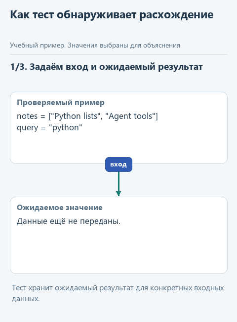
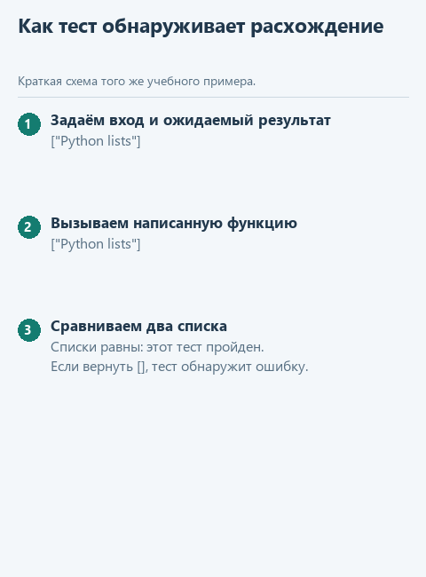

# Как проверить, что поиск продолжает работать правильно

В [первом уроке](01-search.md) мы запустили поиск на трёх заметках и увидели ожидаемый результат. Но одного удачного примера мало: что произойдёт с пустым запросом или повторяющимися строками? Проверить всё вручную можно, только после каждого изменения придётся повторять эту работу и помнить все условия.

Поэтому я предлагаю перенять у программистов практику **юнит-тестирования**. Небольшая проверка вызывает отдельную функцию с заранее выбранными данными и сравнивает ответ с ожидаемым. Например, запрос `'python'` должен найти заметку `'Python lists'`, несмотря на разный регистр. Мы один раз записываем это условие в тесте и затем можем проверять его автоматически.

Такие проверки пригодятся, когда мы напишем второй вариант поиска: короткая запись должна находить те же строки, что и обычный цикл. Если поведение изменится, тест покажет конкретный случай, где результат расходится с ожидаемым. Это помогает заметить ошибку до подключения поиска к другим частям программы, хотя успешные проверки ещё не исключают всех возможных ошибок.

Для пояснения одного теста сократим знакомый список до двух заметок - `'Python lists'` и `'Agent tools'` - и передадим запрос `'python'` без пробелов. Ожидаем результат `['Python lists']`. Тест сравнит с ним то, что действительно вернула функция. На учебной схеме значения совпадают; это пример успешной проверки, а не отчёт о запуске вашего кода.

Посмотреть без анимации

## Запустим готовые проверки

Этот шаг необязательный. Писать собственные тесты и изучать их устройство сейчас не нужно. Если хочется продолжить основную практику, можно сразу перейти к [чтению файла](02-read.md).

В открытом учебном проекте найдите `tests/test_lesson.py`, а внутри него - `class LessonTests`. В каркасе первого урока эта группа проверяет обе функции - `find_notes` и `find_notes_alt` - на одинаковых условиях. Нажмите правой кнопкой на её имя и выберите **Run** для этой группы. PyCharm позволяет [запускать отдельный класс тестов](https://www.jetbrains.com/help/pycharm/performing-tests.html), поэтому запускать всю папку пока не требуется: в ней есть проверки ещё не реализованных функций.

Внизу появится результат группы проверок. Внутри неё проверяются регистр, пробелы в запросе, повторы, отсутствие совпадений и пустой запрос. Если она прошла, обе версии поиска соответствуют этим условиям. Если есть сбой, откройте его результат: там можно увидеть ожидаемое и фактическое значение либо возникшую ошибку. Вернитесь к условию задачи и своей функции, найдите причину расхождения и повторите запуск. Менять ожидаемый ответ ради успешной проверки не нужно.

Проверки находятся в архиве именно первого урока. В архивах следующих уроков `tests/test_lesson.py` проверяет их собственное задание - чтение, запись или общий запуск. Поэтому перед запуском посмотрите имя корневой папки в Project. Разбирать устройство `unittest` пока необязательно.
