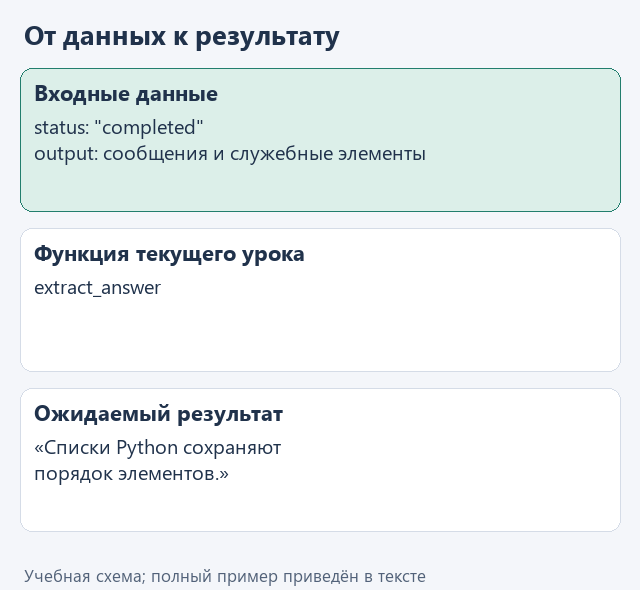
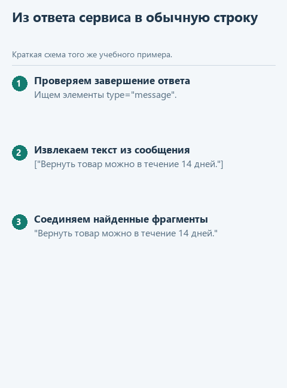

# Урок 2. Извлекаем текст из ответа сервиса

[Открыть исходники этого урока](../../exercises/lesson-02-02-response/README.md) / [Подсказки рядом с кодом](../../exercises/lesson-02-02-response/TASK.md)

Отправленный вопрос и ответ сервиса - разные структуры. Вместе с текстом ответа могут прийти служебные записи. Научимся выбирать только законченный текстовый ответ. Для разбора у нас есть небольшой подготовленный JSON-файл: интернет пока не понадобится.

## Откроем каркас именно этого урока

Скачайте [каркас этого урока](../../downloads/lesson-02-02-response.zip?raw=true) и распакуйте архив через «Извлечь всё». Внутри будет папка `lesson-02-02-response`. В PyCharm выберите **File -> Open**, укажите эту папку и откройте её в новом окне. Предыдущие части уже подготовлены: переносить свои решения необязательно. Свой прежний проект можно оставить открытым.

Слева откройте **View -> Tool Windows -> Project** и разверните `lesson-02-02-response` стрелкой рядом с именем. Текущее задание - `extract_answer` в `assistant.py`. Файл `demo.py` лежит прямо в этом корне, рядом с модулями, вне папок `data` и `tests`.

## Посмотрим на данные

В `data/response.json` поле `output` содержит элементы ответа. Нас интересуют элементы `type="message"`, а внутри них части `type="output_text"`. Подготовленный файл похож на ответ Responses API, но создан для упражнения: это не результат проведённого нами запроса к модели.

```python
part = {'type': 'output_text', 'text': 'Список сохраняет порядок.'}
part['text']  # 'Список сохраняет порядок.'
part.get('missing', '')  # '' - значение на случай отсутствия ключа
```

Этот фрагмент поясняет данные и конструкции; в учебный модуль его целиком копировать не требуется. Рабочие значения уже подготовлены в `demo.py`.



<details>
<summary>Статичный вариант</summary>



</details>

## Соберём функцию с подсказками

Откройте в Project файл `data/response.json`: это наш подготовленный ответ. Внешний список `output` может содержать разные элементы. У сообщения есть ещё один список - `content`, и нужный текст лежит внутри его частей. Поэтому здесь понадобятся два вложенных цикла, а не одно обращение к первому элементу.

В файле текущего задания уже есть начало функции. Допишите её по заготовке ниже: `...` обозначает место для вашего выражения, а не готовую команду. Когда заполните пропуски, удалите строку `raise NotImplementedError(...)` из каркаса. Заголовок `def` в файле уже есть - вторую функцию с тем же именем создавать не нужно.

```python
def extract_answer(response: dict) -> str:
    if response.get('status') != 'completed':
        raise ValueError('Ответ модели не завершён')
    parts = []
    for item in response.get('output', []):
        if item.get('type') == 'message':
            for part in item.get('content', []):
                if part.get('type') == 'output_text':
                    parts.append(...)
    answer = '\n'.join(parts).strip()
    if not answer:
        raise ValueError('В ответе нет текста')
    return ...
```

Когда мы дошли до части с `type="output_text"`, из неё нужно взять `part["text"]`. Именно это значение добавьте в `parts`. В последнем пропуске верните `answer` - уже собранную строку.

Запись `response.get("output", [])` берёт поле `output`, а если его нет - возвращает пустой список. Аналогично работает `item.get("content", [])`. Метод `"\n".join(parts)` соединяет найденные тексты, ставя между ними перевод строки. Последующий `strip()` убирает пробелы по краям всего ответа. Если текста не оказалось, мы показываем ошибку вместо выдуманного ответа.

## Найдём файл запуска и проверим результат

В левой панели **Project -> lesson-02-02-response -> demo.py** откройте файл двойным щелчком. Нажмите правой кнопкой внутри открытого редактора и выберите **Run 'demo'**. Внизу появится окно **Run** с выводом именно этого файла. Отдельная общая кнопка «запустить проект» нам здесь не нужна: выбираем конкретный демонстрационный файл. Если панель с файлами скрыта, вернитесь к **View -> Tool Windows -> Project**. Если Run скрыто - **View -> Tool Windows -> Run**.

До завершения функции появится сообщение «Допишите ... по подсказкам урока». После реализации ожидаем:

```text
Списки Python сохраняют порядок элементов.
```

Для дополнительного контроля откройте в этом же проекте `tests/test_lesson.py`, найдите `class LessonTests`, нажмите правой кнопкой по имени класса и выберите Run. Это необязательная проверка текущего задания; внутреннее устройство тестов сейчас разбирать не нужно.

Формат сообщений и ответа сверяем с [официальной документацией Responses API](https://developers.openai.com/api/docs/guides/text). Учебный `response.json` содержит только поля, нужные для нашего разбора.

Сейчас ваша работа - `extract_answer` в `assistant.py`; затем повторный запуск `demo.py`.

## Куда идти дальше

Следующий шаг - [соединяем запрос и ответ](03-answer.md). Вернуться к [оглавлению и архивам](../README.md).
