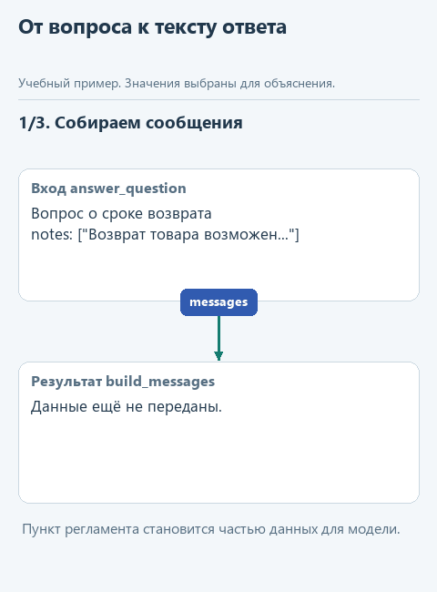
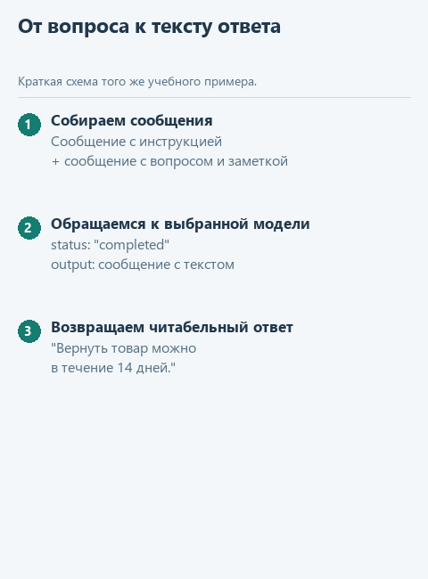

# Урок 3. Соединяем запрос и ответ

[Открыть исходники этого урока](../../exercises/lesson-02-03-answer/README.md) / [Подсказки рядом с кодом](../../exercises/lesson-02-03-answer/TASK.md)

В прошлых уроках мы подготовили сообщения для модели и научились извлекать текст из её ответа. Теперь соединим эти действия в `answer_question`. Для первого запуска возьмём готовый ответ из учебного файла: так можно проверить соединение частей без доступа к сервису. Затем заменим чтение файла обращением к модели.

## Откроем каркас именно этого урока

Скачайте [каркас этого урока](../../downloads/lesson-02-03-answer.zip?raw=true) и распакуйте архив через «Извлечь всё». Внутри будет папка `lesson-02-03-answer`. В PyCharm выберите **File -> Open**, укажите эту папку и откройте её в новом окне. Предыдущие части уже подготовлены: переносить свои решения необязательно. Свой прежний проект можно оставить открытым.

Слева откройте **View -> Tool Windows -> Project** и разверните `lesson-02-03-answer` стрелкой рядом с именем. Текущее задание - `answer_question` в `assistant.py`. Файл `demo.py` лежит прямо в этом корне, рядом с модулями, вне папок `data` и `tests`.

## Посмотрим на данные

Откройте `demo.py` в корне `lesson-02-03-answer`. Внутри `main` уже подготовлен вызов:

```python
result = answer_question(
    'Что заметки говорят о Python?',
    ['Python lists keep item order.'],
    send_fixture,
)
```

Первые два аргумента нам знакомы: вопрос попадёт в `question`, список заметок - в `notes`. Третий аргумент, `send_fixture`, - готовая функция из соседнего файла `transport.py`. Она читает `data/response.json` и возвращает словарь с учебным ответом, похожий на тот, который мы разбирали в прошлом уроке. В сеть этот запуск не обращается; текст ответа берётся из файла и сам по себе не меняется при изменении вопроса.

Зачем передавать функцию? Внутри `answer_question` нужно получить ответ, но читать файл и обращаться к сервису приходится по-разному. Мы передаём готовый способ получения ответа в параметр `send`. Когда напишем `send(messages)`, Python выполнит переданную функцию; в этом запуске ею будет `send_fixture`. Само имя `send_fixture` без скобок передаёт функцию, а не запускает её.



<details>
<summary>Статичный вариант</summary>



</details>

## Соберём функцию с подсказками

Здесь соединяются уже знакомые функции. `build_messages` подготавливает обращение, переданный `send` получает ответ, а `extract_answer` выбирает его текст. В этой функции не нужно заново писать ни правила сообщений, ни разбор JSON.

В файле текущего задания уже есть начало функции. Допишите её по заготовке ниже: `...` обозначает место для вашего выражения, а не готовую команду. Когда заполните пропуски, удалите строку `raise NotImplementedError(...)` из каркаса. Заголовок `def` в файле уже есть - вторую функцию с тем же именем создавать не нужно.

```python
def answer_question(question: str, notes: list[str], send) -> str:
    if not notes:
        return 'Подходящих заметок нет.'
    messages = build_messages(question, notes)
    response = ...
    answer = ...
    return answer
```

В первом пропуске вызовите `send(messages)`: в `send` уже находится функция, переданная из `demo.py`. Во втором передайте полученный `response` в `extract_answer`. Обратите внимание на порядок: передача функции как аргумента ещё не выполняет её; скобки с `messages` выполняют.

Если `notes` пуст, функция вернёт короткое сообщение раньше и `send` не вызовется. Так мы не обращаемся к модели без найденных источников. Для учебного запуска `send` читает `response.json`; способ получения ответа меняется снаружи, а эти строки остаются прежними.

## Найдём файл запуска и проверим результат

В левой панели **Project -> lesson-02-03-answer -> demo.py** откройте файл двойным щелчком. Нажмите правой кнопкой внутри открытого редактора и выберите **Run 'demo'**. Внизу появится окно **Run** с выводом именно этого файла. Отдельная общая кнопка «запустить проект» нам здесь не нужна: выбираем конкретный демонстрационный файл. Если панель с файлами скрыта, вернитесь к **View -> Tool Windows -> Project**. Если Run скрыто - **View -> Tool Windows -> Run**.

До завершения функции появится сообщение «Допишите ... по подсказкам урока». После реализации ожидаем:

```text
Списки Python сохраняют порядок элементов.
```

Для дополнительного контроля откройте в этом же проекте `tests/test_lesson.py`, найдите `class LessonTests`, нажмите правой кнопкой по имени класса и выберите Run. Это необязательная проверка текущего задания; внутреннее устройство тестов сейчас разбирать не нужно.

Формат сообщений и ответа сверяем с [официальной документацией Responses API](https://developers.openai.com/api/docs/guides/text). Учебный `response.json` содержит только поля, нужные для нашего разбора.

## До настоящего запуска

Здесь мы проверяем отдельную часть на подготовленных данных. После соединения функций завершим этот подпроект в [уроке подключения модели](04-connect.md): выберем API или локальную модель и получим настоящий ответ. Этот шаг входит в основной маршрут, а не остаётся необязательным приложением.

## Куда идти дальше

Следующий шаг - [подключение настоящей модели](04-connect.md). Сначала получим настоящий ответ, затем перейдём к инструментам агента. Вернуться к [оглавлению и архивам](../README.md).
