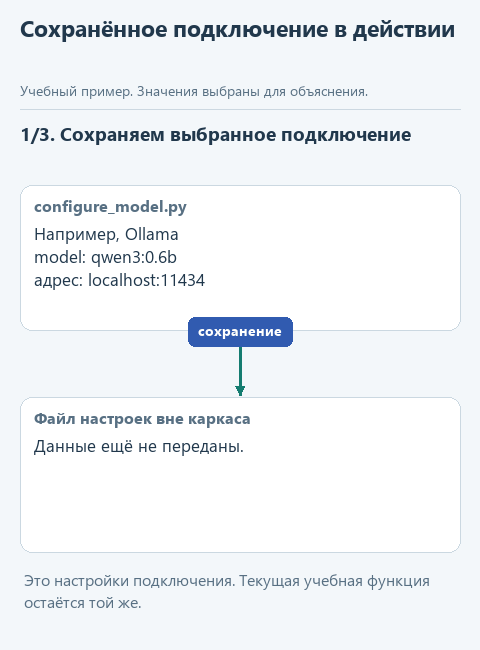
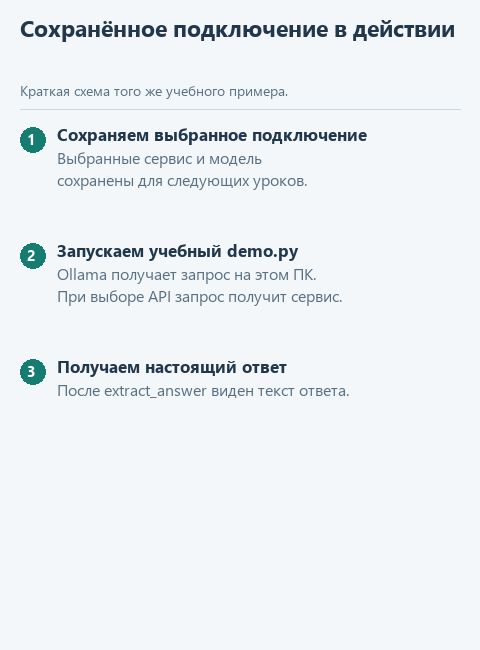

# Урок 4. Подключаем настоящую модель

[Открыть исходники этого урока](../../exercises/lesson-02-04-connect/README.md) / [Подсказки рядом с кодом](../../exercises/lesson-02-04-connect/TASK.md)

До сих пор наша программа отвечала словами, заранее записанными в файл. Это помогло собрать и проверить функции, но разговора с моделью ещё не было. Если поменять вопрос, учебный файл всё равно вернёт прежний текст. Пора убрать эту подстановку и увидеть, ради чего мы соединяли сообщения, получение ответа и его разбор.

В этом уроке наша программа впервые задаст вопрос настоящей модели. Выберите один способ подключения: через сервис в интернете или через модель на своём компьютере. Проходить все варианты не нужно. В конце должны получить ответ в окне Run и убедиться, что он меняется вместе с переданными данными. С этого момента следующие уроки предполагают, что подключение уже работает.

Для знакомства я бы начал с третьего варианта: запустил небольшую модель прямо на своём ноутбуке. Для такого опыта обычно достаточно обычного современного ноутбука без отдельной видеокарты. Установим Ollama, скачаем модель и зададим ей вопрос из нашей программы. Можно обойтись без регистрации в облачном сервисе и оплаты запросов, а заодно увидеть, как устроено собственное подключение.

## Сначала откроем готовый проект

Скачайте [каркас подключения](../../downloads/lesson-02-04-connect.zip?raw=true), распакуйте через «Извлечь всё». В PyCharm выберите **File -> Open**, откройте папку `lesson-02-04-connect` в новом окне.

В левой панели **Project** разверните эту папку. Здесь нет новой функции с пропусками: предыдущие три функции уже подготовлены. Сегодня задача - наладить настоящее соединение, а не одновременно изучить устройство сетевой библиотеки.

| Файл в корне проекта | Для чего откроем |
|---|---|
| `configure_model.py` | Один раз выберем сервис, модель и сохраним доступ |
| `demo.py` | Зададим модели вопрос из нашей программы |
| `transport.py` | Здесь уже написано получение ответа от выбранного сервиса |
| `assistant.py` | Наши знакомые `build_messages`, `answer_question`, `extract_answer` |
| `demo_check.py` | Проверим соединение функций на учебном файле, если потребуется найти ошибку |

В `demo.py` подготовлены те же данные, с которыми мы работали раньше:

```python
question = 'Что заметки говорят о Python?'
notes = ['Python lists keep item order.']
answer = answer_question(question, notes, send_live)
```

В `question` находится вопрос, а в `notes` - одна заметка о порядке элементов списка. Разница с прошлым уроком в третьем аргументе: теперь передаём `send_live`, которая действительно получает ответ от модели. Исходный файл заметок не загружается на сервис целиком: отправляется содержимое сообщений, которое подготовит `build_messages`.



<details>
<summary>Статичная схема</summary>



</details>

На схеме показан порядок действий, а не запись выполненного сетевого запроса.

## Где будет работать модель

В привычном чате вы вводите вопрос в браузере. Здесь вопрос отправит Python-программа. Сервис принимает такие обращения через API - программный интерфейс. Для него нужны адрес сервиса, имя модели и API-ключ, по которому сервис узнаёт ваш аккаунт. Ключ похож на пароль доступа программы; вставлять его в сообщение модели не нужно.

Локальный вариант устроен похожим образом: программа обращается к Ollama на вашем компьютере, а та запускает скачанную модель. Ollama - приложение для запуска моделей, Qwen - сама модель. Адрес `127.0.0.1` означает этот же компьютер. Платный облачный аккаунт в таком варианте не нужен.

| Вариант | Когда выбрать | Что учитывать |
|---|---|---|
| OpenRouter | Хотите попробовать несколько моделей через один API | Есть бесплатные варианты; действуют лимиты и условия доступности |
| VseGPT | Нужен сервис с оплатой в рублях | Сервис заявляет пробные API-кредиты; затем действует его тариф |
| Ollama + Qwen | Я бы начал здесь: модель работает прямо на вашем ноутбуке | Небольшую модель запустим на обычном процессоре, без отдельной видеокарты |

Подробности сервисов проверены 21.10.2026. Тарифы, каталог и условия доступа меняются; перед оплатой смотрите страницу выбранного сервиса. Для первого опыта достаточно пробного доступа или локального запуска.

## Вариант 1. OpenRouter

OpenRouter объединяет модели разных поставщиков под одним API. Зарегистрируйтесь на [сайте OpenRouter](https://openrouter.ai/) и откройте [страницу API-ключей](https://openrouter.ai/settings/keys). Создайте отдельный ключ для учебного проекта и скопируйте его секретное значение.

Для первого запроса можно указать имя `openrouter/free`: этот маршрутизатор выбирает доступную бесплатную модель. Поэтому ответы разных запусков могут приходить от разных моделей. Когда соединение заработает, для последующих сравнений лучше выбрать конкретную модель в [каталоге](https://openrouter.ai/models), проверить нулевую цену входа и выхода и скопировать её точный ID, например с окончанием `:free`. Не все бесплатные модели постоянно доступны. Условия бесплатных запросов описаны в [лимитах API](https://openrouter.ai/docs/api-reference/limits), а способ обращения - в [быстром старте](https://openrouter.ai/docs/quickstart).

Если сайт не открывается, проверьте соединение. При использовании VPN убедитесь, что через него проходит и запрос из Python: расширение браузера обычно меняет соединение только в браузере. Доступ к отдельным моделям зависит также от аккаунта и условий поставщика; одна работающая модель не означает доступ ко всему каталогу. Подробности есть в [условиях OpenRouter](https://openrouter.ai/terms).

Теперь в PyCharm откройте **Project -> lesson-02-04-connect -> configure_model.py**, нажмите правой кнопкой внутри редактора и выберите **Run 'configure_model'**. Откроется небольшое окно с тремя полями:

| Поле | Что указать |
|---|---|
| Сервис | `openrouter` |
| Имя модели | `openrouter/free` для первого опыта или точный ID выбранной модели |
| API-ключ | Секретное значение созданного ключа |

Нажмите **Сохранить**. Переходите к разделу «Получим первый ответ» ниже.

## Вариант 2. Сервис с оплатой в рублях

Для этого маршрута в каркас добавлен VseGPT. На [сайте сервиса](https://vsegpt.ru/) заявлены доступ из России, оплата российскими картами и СБП, а также пробные кредиты после регистрации, включая API. Это пробный доступ, а не обещание постоянно бесплатного API. Перед пополнением проверьте [действующий тариф](https://vsegpt.ru/Docs/Tariffs), включая условия доступа к API и стоимость выбранной модели.

Зарегистрируйтесь и подтвердите почту. Откройте [раздел API-ключей](https://vsegpt.ru/User/API), создайте ключ. В каталоге сервиса выберите недорогую текстовую модель для диалога и скопируйте её **Model ID**. Название на карточке и технический ID могут отличаться; нам нужен ID. Подробности совместимого интерфейса есть в [документации API](https://vsegpt.ru/Docs/API).

В PyCharm запустите `configure_model.py` через Run, как описано в предыдущем варианте. Выберите `vsegpt`, вставьте скопированный Model ID в поле модели, ключ - в поле API-ключа. Нажмите **Сохранить**. Ключ OpenRouter для этого сервиса не подходит: у каждого сервиса свой аккаунт и ключ.

Если пробные кредиты не выданы или закончились, сначала посмотрите условия в личном кабинете. Для прохождения курса оплачивать именно этот сервис необязательно: ниже есть локальный маршрут.

## Вариант 3. Маленькая модель на CPU

Особенно интересно получить ответ от модели, которая работает на вашем же компьютере. Наша программа передаст ей вопрос, а вычисления выполнит процессор ноутбука. Именно это означает CPU. Для первого знакомства нам не нужна большая модель или специальная видеокарта.

Возьмём `qwen3:0.6b` - небольшую модель семейства Qwen. Её файл занимает около 523 МБ по [каталогу Ollama](https://ollama.com/library/qwen3:0.6b). Ollama поможет скачать её и будет принимать вопросы от нашего Python-кода. После скачивания для ответов этой модели интернет уже не нужен.

### Шаг 1. Установим Ollama

На сайте предложено несколько способов установки. Мы выберем знакомый вариант: скачаем файл и откроем его, как при установке обычной программы.

1. Откройте [страницу загрузки Ollama](https://ollama.com/download/windows). Под заголовком **Install** найдите переключатель **macOS / Linux / Windows** и выберите **Windows**, если он ещё не выбран.
2. Ниже появится серый блок с командой `irm ...`. **Под этим блоком справа нажмите ссылку Download manually** («Скачать вручную»). В нашем маршруте именно она скачивает установщик; команду из серого блока вводить не требуется.
3. Дождитесь скачивания файла **OllamaSetup.exe**. Откройте список загрузок браузера: в Chrome и Edge для этого можно нажать **Ctrl+J**. Найдите там `OllamaSetup.exe` и нажмите **Открыть файл** или щёлкните по его имени. Ещё один путь - открыть в Проводнике папку **Загрузки** и дважды щёлкнуть по скачанному файлу.
4. В открывшемся окне установщика нажмите **Install** («Установить»), если эта кнопка предложена, и дождитесь завершения установки. Затем откройте меню **Пуск**, введите `Ollama` и запустите найденное приложение.

Теперь Ollama установлена. Она может работать в фоне: открытое окно чата для нашего проекта не требуется. Следующим действием скачаем саму модель.

### Шаг 2. Скачаем модель

Вернитесь в PyCharm и откройте **View -> Tool Windows -> Terminal**. Внизу появится терминал - окно, куда можно вводить команды для установленных программ. Введите:

```powershell
ollama pull qwen3:0.6b
```

Нажмите **Enter** и дождитесь завершения загрузки. Здесь `ollama` - имя приложения, `pull` - просьба скачать модель, а `qwen3:0.6b` - какую именно. Подробности команд есть в [справке Ollama](https://docs.ollama.com/cli).

Если терминал пишет, что команда `ollama` не найдена, перезапустите PyCharm после установки и повторите команду. Так редактор увидит только что установленную программу.

<details>
<summary>Если хотите хранить модели на диске D</summary>

Этот шаг нужен только при нехватке места на C. Для установки самой Ollama и скачанной модели потребуется несколько гигабайт; размер файла модели не равен всему занятому месту.

До скачивания модели найдите в Windows «Изменение переменных среды текущего пользователя». Создайте переменную `OLLAMA_MODELS` со значением `D:\Models\Ollama`. Закройте Ollama через значок у часов и снова запустите из «Пуска». Теперь скачиваемые модели будут храниться в указанной папке. Подробности - в [инструкции для Windows](https://docs.ollama.com/windows).

</details>

### Шаг 3. Выберем модель для нашего проекта

В левой панели PyCharm откройте **Project -> lesson-02-04-connect -> configure_model.py**. Нажмите правой кнопкой внутри редактора и выберите **Run 'configure_model'**.

В появившемся окне выберите сервис `ollama`. Имя модели заполнится автоматически: `qwen3:0.6b`. Поле API-ключа оставьте пустым. Нажмите **Сохранить**.

Подключение подготовлено. Теперь перейдём к следующему разделу и попросим модель ответить на нашу заметку.

## Получим первый ответ

Откройте **Project -> lesson-02-04-connect -> demo.py**, нажмите правой кнопкой в редакторе и выберите **Run 'demo'**. Вывод появится внизу, в панели **Run**. Программа покажет вопрос, заметки и полученный текст. Если панель скрыта, откройте **View -> Tool Windows -> Run**.

По нашей заметке модель должна сказать, что списки Python сохраняют порядок элементов. Точная формулировка заранее неизвестна. Убедитесь, что ответ соответствует переданной заметке; сам факт появления текста ещё не означает правильность ответа.

Теперь в этом же `demo.py` измените **только вопрос** на `'Что заметки говорят о работе с файлами?'`, а список `notes` оставьте прежним. Запустите ещё раз. В заметке ничего нет о файлах, поэтому ожидаем сообщение о нехватке сведений. Если модель начинает объяснять работу с файлами по своим знаниям, она нарушила нашу инструкцию отвечать по источнику. Это полезное наблюдение: просьба в сообщении направляет модель, но сама по себе не гарантирует поведение.

После опыта верните исходный вопрос о Python. Мы впервые проверили не только исправность программы, но и поведение модели на наших данных.

## Что модель видела, когда отвечала

Оставим перед глазами тот же пример. В программу мы передали вопрос о Python и строку `'Python lists keep item order.'`. `build_messages` добавила к ним правило отвечать по заметкам. Всё это вместе составляет контекст данного обращения: сведения, на которые модель может опираться при ответе. Других файлов нашего проекта она через этот запрос не получила.

Представьте, что перед ответом вам положили на стол вопрос и одну выписку из документа. Примерно такую роль здесь выполняет контекст. Он не хранит всю историю работы сам по себе: если мы захотим напомнить модели прошлый вопрос или результат поиска, программа должна будет передать их в новом обращении. Это пригодится уже в уроках об инструментах.

У рабочего контекста есть вместимость. Её измеряют в **токенах**, небольших фрагментах текста: иногда это слово, иногда часть слова. Токены не совпадают ни с числом строк Python, ни с количеством букв. Чем больше материалов передаём, тем больше места они занимают; при локальном запуске большему контексту обычно требуется больше памяти.

Для выбранной Qwen в `transport.py` уже подготовлены три настройки. Сейчас менять их не нужно, но полезно понимать, на что мы влияем:

| Настройка | Что означает в нашем запуске |
|---|---|
| `num_ctx=4096` | Размер рабочего контекста в токенах. В нём должны поместиться сообщения и формирующийся ответ; для нашей короткой заметки запас большой |
| `num_predict=1200` | Верхняя граница длины генерируемого ответа. Модель может закончить раньше; это не требование написать 1200 токенов |
| `num_gpu=0` | Выполняем вычисления на CPU, без переноса слоёв модели на видеокарту |

Это настройки запуска. А `0.6b` в имени модели относится к другому: примерно 0,6 миллиарда параметров самой обученной модели. Здесь параметрами называют числовые значения, полученные при обучении. Мы скачиваем их готовыми; смена `num_ctx` не переобучает модель и не превращает её в более крупную.

Небольшая модель удобна для знакомства. Когда дойдём до более сложных команд, можно попробовать [Qwen3 1.7B](https://ollama.com/library/qwen3:1.7b): скачать её через `ollama pull qwen3:1.7b` и выбрать это имя в `configure_model.py`. Более крупный вариант займёт больше ресурсов, а правильность его ответов мы по-прежнему проверяем. Наша программа при такой замене остаётся той же.

<details>
<summary>Подробнее о настройках и работе на CPU</summary>

После ответа можно в Terminal выполнить `ollama ps`. В столбце PROCESSOR значение `100% CPU` означает выполнение на процессоре. Столбец разобран в [FAQ Ollama](https://docs.ollama.com/faq), настройки контекста и длины ответа - в [справке параметров](https://docs.ollama.com/modelfile), а `num_gpu` есть в [исходнике настроек](https://github.com/ollama/ollama/blob/main/api/types.go). Готовый адаптер также использует `stream=False`, чтобы получить ответ целиком, и `think=False`, чтобы не запрашивать отдельный вывод рассуждений; они описаны в [API Ollama](https://docs.ollama.com/api/chat).

</details>

## Как ответ попадает в знакомые функции

В прошлом уроке `send_fixture` читала учебный JSON. Теперь `send_live` читает выбранное подключение, отправляет сообщения и возвращает ответ. Наша `answer_question` использует её через тот же параметр `send`.

Сервисы отвечают в разных форматах. Например, Chat Completions возвращает текст внутри `choices`, а Ollama - внутри `message`. Готовый `transport.py` извлекает текст и собирает знакомые нам `status` и `output`, чтобы `extract_answer` могла работать дальше. Это внутренний формат курса, а не утверждение, что все API возвращают одинаковый JSON. Незавершённый или пустой ответ адаптер отклоняет с ошибкой.

Сегодня сетевой код уже подготовлен. Достаточно проследить цепочку: `demo.py` передаёт вопрос -> `build_messages` собирает сообщения -> `send_live` обращается к модели -> `extract_answer` возвращает текст. Писать HTTP-запрос самостоятельно для продолжения курса не требуется.

## Если ответ не появился

| Что видим в Run | Что проверим |
|---|---|
| «Подключение не настроено» | Запущен ли `configure_model.py`, нажата ли кнопка «Сохранить» |
| HTTP 401 | Ключ относится к выбранному сервису, скопирован без пропусков |
| HTTP 402 | В кабинете есть пробные кредиты или баланс |
| HTTP 403 | Доступна ли модель аккаунту и региону |
| HTTP 404 | Правильно ли скопирован Model ID; скачана ли локальная модель |
| HTTP 429 | Не исчерпан ли лимит и не перегружен ли сервис; повторим позже |
| Нет соединения с Ollama | Запущено ли приложение из меню «Пуск» |
| Ответ пустой или оборван | Подходит ли модель для короткого текстового запроса, хватает ли лимита ответа |
| Текст есть, но не по заметкам | Соединение работает; теперь проверяем соблюдение инструкции моделью |

Для отделения ошибки нашей программы от проблемы подключения есть `demo_check.py`: откройте его в Project и запустите через **Run 'demo_check'**. Он использует учебный файл и не подтверждает работу настоящей модели. Результат реального запуска и результат такой проверки не стоит смешивать.

## Что сохраняется для следующих уроков

На Windows окно настройки сохраняет подключение в `%LOCALAPPDATA%\AgentHarnessWorkshop\connection.json`, вне папок упражнений. `%LOCALAPPDATA%` - пользовательская папка Windows; её адрес можно вставить в строку Проводника. Все следующие каркасы читают этот же файл под вашей учётной записью. Повторно переносить ключ в каждый проект не нужно. Для смены модели снова запустите `configure_model.py`, поменяйте выбор и сохраните.

В этом локальном JSON ключ хранится как обычный текст, не в зашифрованном хранилище. Не отправляйте файл вместе с проектом и не добавляйте его в GitHub. Папка каркаса ключа не содержит. Облачные обращения расходуют квоту или баланс выбранного сервиса; локальный запуск использует ресурсы компьютера.

Урок завершён, когда `demo.py` получил реальный ответ и вы сравнили два вопроса на одной заметке. Если подключение ещё не работает, сначала разберём его, а не будем незаметно подменять модель готовыми ответами.

## Куда идти дальше

Теперь модель отвечает на переданные данные. В следующем уроке она сможет запросить недостающие данные сама: [выполняем команду поиска](../03-tool-agent/01-tools.md). Вернуться к [оглавлению и архивам](../README.md).
