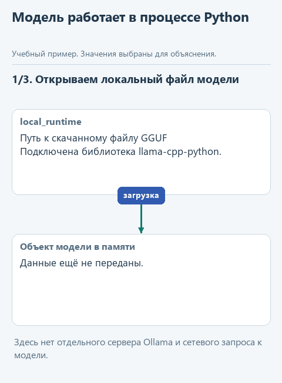
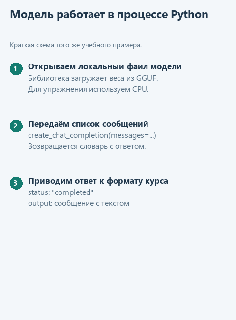

# Запускаем модель прямо из Python

[Открыть исходники этого урока](../../exercises/lesson-02-extra-local/README.md) / [Подсказки рядом с кодом](../../exercises/lesson-02-extra-local/TASK.md)

В основном уроке наша программа отправляла сообщения Ollama, а та запускала модель и возвращала ответ. Можно устроить иначе: загрузить файл модели в самой программе Python. Тогда за загрузку, обращение к модели и освобождение её ресурсов будет отвечать уже наш скрипт.

Попробуем это на прежней задаче: "Что заметки говорят о Python?" Источник останется тем же - `'Python lists keep item order.'`. Так мы сможем сравнить два устройства подключения, сохранив вопрос и данные. Написанные раньше `build_messages` и `extract_answer` продолжат работать, потому что ответ приведём к знакомому формату.

Эта практика прояснит, какую работу до сих пор выполняло отдельное приложение и что понадобится программе, если взять эту работу на себя. Напишем `send_local` и увидим, как меняется способ выполнения запроса, а остальная цепочка остаётся прежней. У урока свой каркас; следующие основные уроки продолжают использовать сохранённое подключение из [урока 2.4](04-connect.md).

## Кто будет выполнять вычисления

Вычисления будет выполнять движок llama.cpp, а библиотека `llama-cpp-python` даст нам доступ к нему из Python. В готовом пакете для Windows уже есть нужная библиотека движка, поэтому после установки сможем загружать модель прямо в нашей программе.

Файл GGUF содержит обученные числовые параметры модели и служебные сведения для её загрузки. В этом опыте возьмём Qwen3-0.6B в варианте Q8_0 из официального репозитория Qwen. Название семейства нам уже знакомо по Ollama. Теперь мы явно выбираем файл; разные варианты его числового представления и настройки запуска могут давать разные ответы. [Файл и его размер в каталоге Qwen](https://huggingface.co/Qwen/Qwen3-0.6B-GGUF/tree/main).

После установки зависимостей и скачивания файла модель сможет отвечать на CPU без обращения в интернет. При загрузке ей понадобится оперативная память не только для числовых параметров, но и для обработки сообщений, поэтому размер GGUF на диске не равен общему расходу памяти программы.



<details>
<summary>Статичный вариант</summary>



</details>

Это учебная схема движения данных, а не запись настоящего запуска.

## Откроем отдельный каркас

Скачайте [архив этого упражнения](../../downloads/lesson-02-extra-local.zip?raw=true). В Проводнике нажмите правой кнопкой по ZIP и выберите **Извлечь всё**. Внутри будет папка `lesson-02-extra-local`. В PyCharm выберите **File -> Open**, укажите эту папку и откройте её в новом окне.

Слева в панели **Project** разверните папку проекта. Если панель скрыта, откройте **View -> Tool Windows -> Project**.

| Файл или папка | Зачем открываем |
|---|---|
| `local_model.py` | Здесь допишем `send_local`, которая вызывает модель |
| `local_runtime.py` | Здесь уже готовы загрузка модели и преобразование данных |
| `assistant.py` | Наши готовые функции подготовки сообщений и извлечения ответа |
| `demo_check.py` | Проверим соединение функций без настоящей модели |
| `demo.py` | Запустим настоящий ответ на CPU |
| `models` | Сюда положим скачанный GGUF-файл |

## Подготовим библиотеку и файл модели

Ниже маршрут для Windows x64 и Python 3.14. Для этого урока выбрана готовая сборка `llama-cpp-python` версии 0.3.36. Её адрес записан в `requirements.txt`, поэтому установка не должна неожиданно начать сборку C++. Сам способ установки готовых пакетов описан в [документации библиотеки](https://llama-cpp-python.readthedocs.io/en/latest/).

При открытии проекта используйте отдельное виртуальное окружение `.venv` этой папки. Если PyCharm предлагает создать его, выберите установленный Python 3.14 как основу. Виртуальное окружение хранит библиотеки проекта отдельно; основной учебный проект от этой установки не изменится.

1. Откройте **View -> Tool Windows -> Terminal**. Убедитесь, что терминал открыт в `lesson-02-extra-local`, а PyCharm выбрал интерпретатор этого проекта. Если в настройках ещё нет окружения, откройте **Settings -> Project -> Python Interpreter -> Add Interpreter** и создайте локальное Virtualenv в `.venv`.
2. Введите команду ниже. Она установит зависимости из подготовленного файла. `--only-binary=:all:` разрешает готовые пакеты и не позволяет перейти к сборке из исходников.

```powershell
python -m pip install --only-binary=:all: -r requirements.txt
```

3. В **Project** откройте `check_install.py`, нажмите правой кнопкой внутри редактора и выберите **Run 'check_install'**. В нижней панели **Run** появятся путь к Python и строка `Библиотека загружена: 0.3.36`. Если терминал сообщил об успешной установке, а этот запуск библиотеку не находит, они используют разные интерпретаторы. Выберите `.venv` текущей папки в настройке Python Interpreter, затем повторите установку в заново открытом терминале.
4. Откройте [страницу файла Qwen3-0.6B-Q8_0.gguf](https://huggingface.co/Qwen/Qwen3-0.6B-GGUF/blob/main/Qwen3-0.6B-Q8_0.gguf). Это конкретный файл, а не общий каталог моделей. Нажмите **download** рядом с описанием файла. Его размер около 639 МБ; дождитесь завершения загрузки в браузере.
5. В Проводнике найдите скачанный `Qwen3-0.6B-Q8_0.gguf` и переместите его в `lesson-02-extra-local\models`. Имя оставьте без изменений. В **Project -> models** теперь должен появиться этот файл рядом с `README.md`.

Если установка сообщает, что подходящего пакета нет, сверьте версию и архитектуру Python со строкой выше. Этот готовый каркас рассчитан на Windows x64. Если ошибка касается соединения с GitHub или Hugging Face, сначала проверьте доступ к соответствующей странице в браузере. Устанавливать компилятор для этого упражнения не требуется.

## Посмотрим, что уже подготовлено

Откройте `local_runtime.py`. В `load_model` указано:

```python
model = Llama(
    model_path=str(path), n_ctx=2048, n_gpu_layers=0,
    seed=42, verbose=False,
)
```

`Llama` - класс библиотеки. Здесь создаётся объект, через который будем обращаться к загруженной модели. `model_path` задаёт путь к GGUF; `n_ctx` задаёт размер контекста запуска; `n_gpu_layers=0` оставляет вычисления на CPU. `verbose=False` сокращает диагностический вывод. Начальное значение генератора `seed=42` помогает повторять опыт, но не гарантирует одинаковый текст на разных сборках и компьютерах. [Параметры класса Llama](https://llama-cpp-python.readthedocs.io/en/latest/api-reference/#llama_cpp.Llama).

Загрузка выполняется один раз перед обращением. В `demo.py` объект используется внутри `with load_model(...) as model`. Наша готовая функция `load_model` устроена так, чтобы при выходе из этого блока вызвать `model.close()` и освободить ресурсы, в том числе при ошибке. Новый Run запускает новую программу и снова загружает модель. Если внутри одного `with` сделать два обращения, второй раз загружать файл не нужно. Историю первого вопроса объект сам к следующему вопросу не добавит: её по-прежнему должна передать наша программа.

Сообщения сначала собирает знакомая `build_messages`. Она возвращает инструкцию с ролью `developer` и данные с ролью `user`. Готовая `prepare_messages` копирует их, заменяет `developer` на `system` для этого подключения и добавляет короткое указание Qwen `/no_think`. Оно выбирает режим ответа без развёрнутого рассуждения; правило отвечать по заметкам остаётся в том же сообщении. Такой переключатель описан в [карточке Qwen](https://huggingface.co/Qwen/Qwen3-0.6B-GGUF#switching-between-thinking-and-non-thinking-mode).

Таким образом, в `prepared` находятся те же инструкция, вопрос и заметка, уже подготовленные для библиотеки. До этого места код каркаса готов.

## Напишем вызов модели

Откройте **Project -> lesson-02-extra-local -> local_model.py**. У `send_local` два параметра: `model` получает загруженный объект, а `messages` - список сообщений. Строка `prepared = prepare_messages(messages)` уже записана. Замените следующую за ней заглушку `NotImplementedError` этим фрагментом, заполнив два пропуска:

```python
response = model.create_chat_completion(
    messages=...,
    max_tokens=256,
    temperature=0.7,
    top_p=0.8,
    top_k=20,
    min_p=0.0,
    presence_penalty=1.5,
)
return convert_response(...)
```

В первый пропуск поставьте `prepared`. Запись `model.create_chat_completion(...)` вызывает метод загруженного объекта: он передаёт сообщения движку и возвращает словарь результата. Здесь не создаётся HTTP-запрос и не вызывается Ollama. Во второй пропуск поставьте `response`: этот словарь нужно передать в готовую функцию `convert_response`.

Вставленные команды должны находиться внутри `send_local`, с отступом четыре пробела. Параметры внутри скобок можно переносить на строки, как в примере. После закрывающей скобки `return` снова имеет тот же отступ, что `response = ...`.

`max_tokens=256` ограничивает длину создаваемого продолжения. Остальные настройки в заготовке уже подобраны для этого опыта с Qwen: сейчас их не меняем, чтобы сравнивать способы подключения на одной задаче.

<details>
<summary>Что означают настройки выбора следующего токена</summary>

`temperature` влияет на распределение вероятностей при выборе продолжения. `top_k` ограничивает число рассматриваемых кандидатов, `top_p` отбирает их по суммарной вероятности, а `min_p` задаёт относительный порог; здесь этот порог отключён значением `0.0`. `presence_penalty` меняет оценку уже встречавшихся токенов и помогает сдерживать повторения. Эти настройки влияют на генерацию текста, но не проверяют его правильность. Их описание есть в [API create_chat_completion](https://llama-cpp-python.readthedocs.io/en/latest/api-reference/#llama_cpp.Llama.create_chat_completion).

</details>

Полученный от движка `response` ещё содержит служебную структуру с `choices`. Готовая `convert_response(response)` извлекает текст и приводит его к общему формату курса с полями `status` и `output`. Именно этот словарь выражение `return` передаёт из `send_local` обратно в функцию, которая запросила ответ. Затем знакомая `extract_answer` достанет из него строку для печати. В итоге новая функция занимает то же место, что сетевое подключение: способ запуска модели другой, а остальная программа получает привычные данные.

## Проследим обратный путь

Библиотека возвращает результат в структуре `choices`. Для наглядности возьмём сокращённый пример ответа, а не обещание точных слов модели:

```python
{'choices': [{'finish_reason': 'stop', 'message': {
    'content': 'Списки Python сохраняют порядок элементов.'
}}]}
```

В нём `choices[0]` выбирает первый вариант ответа, а `message['content']` содержит текст. Функция `convert_response` проверяет причину остановки и приводит результат к знакомой структуре `status` и `output`. Затем наша функция `extract_answer` извлекает строку. Благодаря этому функцию извлечения не пришлось переписывать при смене подключения.

У Qwen перед окончательным ответом иногда остаётся служебный блок `<think>...</think>`. Подготовленный преобразователь убирает такой начальный блок. Он также отклоняет незавершённую генерацию и пустой ответ. Соответствие ответа заметке он не проверяет: это по-прежнему отдельная проверка по источнику.

## Сначала проверим код, затем получим настоящий ответ

Откройте `demo_check.py` и выберите правой кнопкой в редакторе **Run 'demo_check'**. Здесь маленький подготовленный объект отвечает вместо модели, поэтому не нужны ни файл GGUF, ни установленная библиотека. Эта проверка показывает, что наша функция передала сообщения и вернула ожидаемую структуру. После реализации в **Run** будет:

```text
Проверка без модели: Списки Python сохраняют порядок элементов.
```

Теперь откройте `demo.py` и выберите **Run 'demo'**. В нижней панели **Run** сначала появятся вопрос и заметка, затем `Загружаем модель из файла...`. Дождитесь строки `Ответ модели:`. Скорость зависит от компьютера. Точные слова ответа могут отличаться от контрольного примера: проверьте, сообщает ли модель о сохранении порядка элементов и не добавляет ли сведения, которых нет в заметке.

Если видите `Допишите send_local...`, осталась заглушка. Если программа просит положить файл модели по указанному пути, проверьте папку `models` и имя файла. Сообщение о незавершённой генерации означает, что нельзя выдать полученный фрагмент за законченный ответ; при разборе такого запуска проверим лимит и режим генерации.

Для второго опыта оставьте тот же вопрос, но замените заметку в `demo.py` на `'Python lists can be empty.'`. Теперь источник сообщает, что список может быть пустым, и ответ должен измениться вслед за ним. Предыдущий результат не подмешивается: при новом Run сообщения собираются заново. После сравнения верните исходную строку.

При проверке каркаса первая заметка дала правильный ответ: `Python lists keep item order.` Правда, просьбу ответить по-русски модель не выполнила. На второй заметке она уже исказила содержание: вместо сообщения о пустом списке стала утверждать, что пользователь не пояснил значение фразы. Если увидите похожий результат, сравните ответ с исходной строкой. Такой запуск подтверждает, что подключение работает, но показывает ошибку самой модели в выполнении задания. Получить текст и получить верный ответ - две разные проверки.

## Как это связано с будущим агентом

В этом опыте мы заменили способ выполнения одного обращения к модели: вместо Ollama файл загружает сама программа. Вопрос и заметку мы по-прежнему задаём заранее, а выбор инструментов и повторный запрос после их выполнения добавим уже при сборке агентного цикла.

Этот следующий шаг появится в [уроке об агентном цикле](../03-tool-agent/02-cycle.md). В нём программа будет возвращать модели найденные заметки и снова спрашивать, что делать дальше. Вызов через API, Ollama или библиотеку занимает внутри такого цикла одно место: получает подготовленные сообщения и возвращает очередное решение модели. Сам цикл и правила выполнения пишет наше приложение.

К основному маршруту вернитесь через [первый урок об инструментах](../03-tool-agent/01-tools.md). Самостоятельный пример этого практикума не меняет сохранённое подключение для остальных каркасов.
