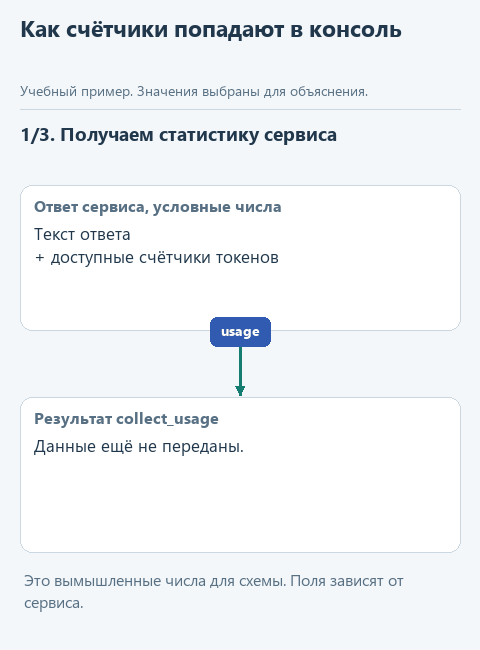
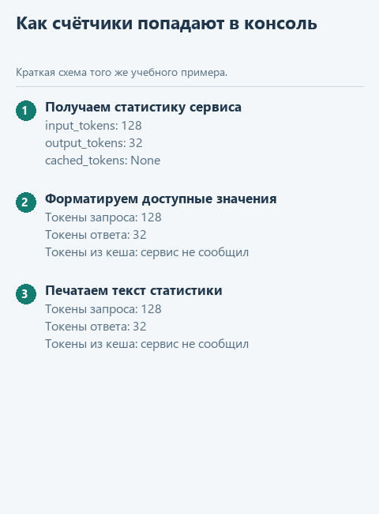

# Посмотрим статистику настоящего запроса

[Открыть исходники этого урока](../../exercises/lesson-02-extra-usage/README.md) / [Подсказки рядом с кодом](../../exercises/lesson-02-extra-usage/TASK.md)

> **Где мы.** Модель уже отвечает на вопрос по регламенту. Здесь посмотрим, сколько она при этом обработала и сколько времени заняло обращение. Урок необязательный.

Сколько текста модель получила в запросе? Что заняло время: загрузка модели, чтение запроса или создание ответа? И почему длинная переписка обходится всё дороже, хотя последний вопрос занимает одну строку? Ответы на эти вопросы нужны, когда счёт за облачный сервис оказался неожиданно большим или локальный помощник начал отвечать медленно. Обсуждать такое лучше по числам, а не по ощущениям.

Выведем показатели, которые сообщает сервис, и проведём несколько опытов на знакомом вопросе о возврате. Для этого напишем небольшую функцию, оформляющую статистику для вывода.

## Откроем отдельную папку

Скачайте [архив практикума](../../downloads/lesson-02-extra-usage.zip?raw=true), распакуйте его и откройте папку `lesson-02-extra-usage` в PyCharm через **File -> Open**.

| Файл | Что с ним делаем |
|---|---|
| `model_stats.py` | Дописываем функцию оформления показателей |
| `demo_usage.py` | Запускаем настоящий запрос и смотрим результат в Run |
| `usage_client.py` | Читаем готовое получение ответа вместе со статистикой |

Каркас использует подключение, сохранённое в уроке 2.4, так что вводить ключ или скачивать модель заново не придётся.

Модель обрабатывает текст небольшими фрагментами - токенами. Входной счётчик покажет объём правила, вопроса и пункта регламента, выходной - объём ответа. Некоторые сервисы отдельно сообщают, сколько входных токенов взято из кеша, то есть не пересчитывалось заново. Что это значит, разберём после первого запуска.

## Почему статистику нужно взять раньше

В основном `send_live` ответ сервиса превращается в знакомый словарь со `status` и `output`, и счётчики токенов в него не попадают. `answer_question` возвращает только текст. Поэтому показатели нужно прочитать из исходного ответа сервиса, до этого преобразования.

Этим занимается готовая функция `request_sample` в `usage_client.py`: она отправляет тот же запрос, что и основной урок, и передаёт исходный ответ в `collect_usage`, которая достаёт счётчики. Основной `send_live` при этом не меняется.



<details>
<summary>Статичный вариант</summary>



</details>

## Напишите сами

Функция `format_usage` получает словарь показателей и возвращает три строки для печати. Сам запрос и печать остаются в `demo_usage.py`, поэтому оформление можно проверить на известных числах ещё до обращения к модели.

Перед настоящим запросом `demo_usage.py` передаёт функции контрольный словарь:

```python
{'input_tokens': 10, 'output_tokens': 0, 'cached_tokens': None}
```

Десять нужно показать числом, ноль - нулём, а `None`, отсутствие значения, объяснить словами.

Откройте `model_stats.py`. Пары "подпись для вывода - ключ в словаре" и начало цикла уже записаны: например, `('Токены запроса', 'input_tokens')` означает, что число из `stats['input_tokens']` будет выведено с подписью "Токены запроса". Замените строку `raise NotImplementedError(...)` внутри цикла тремя строками и заполните пропуски:

```python
        if ...:
            value = ...
        lines.append(...)
```

1. В условие поставьте `value is None`.
2. В `value` - строку `'сервис не сообщил'`.
3. В `append` - строку с подписью и значением: `f'{label}: {value}'`. Буква `f` перед кавычками позволяет подставлять в строку значения переменных из фигурных скобок.

Проследим первый проход цикла. Пара `('Токены запроса', 'input_tokens')` раскладывается в переменные `label` и `key`, `stats.get(key)` находит число `10`, и в `lines` добавляется строка `Токены запроса: 10`. Остальные два показателя оформляются так же.

Условие `if not value` здесь не подойдёт: ноль Python тоже считает ложным, а для счётчика ноль - полноценный результат, который нельзя подменять словами "сервис не сообщил".

## Запустим

Откройте `demo_usage.py` и выберите **Run 'demo_usage'**. Пока функция не дописана, программа попросит её закончить и к модели не обратится.

Когда функция готова, запуск сделает одно настоящее обращение. В Run появятся ответ, три строки с токенами и время. Для Ollama дополнительно выводятся запрошенный размер контекста `num_ctx` и скорость генерации. Каждый новый Run - новый запрос; у облачного сервиса он расходует квоту или баланс.

На контрольных данных функция вернёт `['Токены запроса: 10', 'Токены ответа: 0', 'Токены из кеша: сервис не сообщил']`. Считать токены она не умеет и не должна: только переводит числа, которые прислал сервис, в понятный текст.

## Что именно считают токены

Вопрос о возврате модель разбивает на небольшие фрагменты: слова, части слов, знаки препинания. Как именно - зависит от её токенизатора, поэтому число символов в вопросе (`len(question)`) не совпадает с числом токенов.

Во вход нашего обращения входят правило, вопрос и пункт регламента, а ещё служебная разметка, которой модель оформляет сообщения. Поэтому входных токенов больше, чем видно глазами в одном вопросе. Выходные токены относятся к ответу; у некоторых моделей сюда же попадают внутренние рассуждения, так что число токенов ответа не равно числу напечатанных слов.

Для Ollama программа читает поля `prompt_eval_count` и `eval_count`, для облачных сервисов - `usage.prompt_tokens` и `usage.completion_tokens`. В учебном клиенте они переименованы в общие `input_tokens` и `output_tokens`. Если поля нет, остаётся `None`. Форматы описаны в [API Ollama](https://docs.ollama.com/api/chat) и в [учёте использования OpenRouter](https://openrouter.ai/docs/cookbook/administration/usage-accounting).

## Контекстное окно: что помещается в одно обращение

Сейчас в `notes` один пункт. Представим, что вместо него программа отправила бы весь регламент на сотню страниц, историю переписки с клиентом и результаты нескольких поисков. Всё это заняло бы место во входе, а для ответа тоже нужны токены. Контекстное окно ограничивает, сколько всего модель может обработать в одном обращении.

В локальном запросе мы задаём `num_ctx=4096`, поэтому в Run написано именно "Запрошенный num_ctx": это наша настройка, а не измерение того, насколько окно заполнено. `num_predict=1200` - верхняя граница длины ответа. Для облачного подключения размер окна в ответе сервиса не приходит, и клиент его не угадывает.

Контекст не пополняется сам оттого, что на диске лежит ещё один файл. В запрос попадает только то, что передала программа. Длинная история чата становится частью нового запроса, когда приложение снова отправляет её модели. `demo_usage.py` каждый раз собирает новый запрос с одним пунктом, прошлый запуск туда не попадает.

## Внимание: как связываются части контекста

Вопрос спрашивает о сроке возврата, а пункт регламента называет 14 дней. Чтобы ответить, модели нужно связать эти части между собой, а не смотреть только на последнее слово вопроса.

За такие связи отвечает механизм внимания, по-английски attention. При обработке каждого токена он учитывает другие токены контекста с разным весом. Этот механизм находится внутри модели, наш код его не реализует. Название описывает математическую операцию и не обещает, что модель правильно применит нужный пункт. Исходная работа - [Attention Is All You Need](https://arxiv.org/abs/1706.03762).

По счётчикам видно, сколько текста модель обработала, но не видно, какими сведениями она воспользовалась. Регламент может целиком поместиться в запрос, а модель всё равно пропустит нужное исключение и ответит по общему правилу. Поэтому ответ сверяют с пунктом регламента: то, что документ поместился, ещё ничего не говорит о правильности ответа.

## Кеш: какую работу можно не повторять

Пока модель создаёт ответ токен за токеном, уже обработанная часть запроса не меняется. KV-кеш хранит промежуточные результаты внимания для этой части, чтобы не вычислять их заново на каждом шаге. Это рабочие данные одного запуска, обученные параметры модели от них не меняются. Подробнее - в [разборе KV-кеша в Transformers](https://huggingface.co/docs/transformers/cache_explanation).

Есть и другой случай: несколько запросов начинаются с одной и той же длинной инструкции и одного документа. Сервисы, которые поддерживают prompt caching, могут не пересчитывать совпадающее начало. Условия, минимальная длина и срок хранения у провайдеров разные, а готовые ответы при этом обычно не запоминаются. Подробнее - в [описании кеширования OpenRouter](https://openrouter.ai/docs/guides/best-practices/prompt-caching).

Строка о кеше в нашем выводе показывает только то, что сообщил сервис: поле `prompt_eval_cached_count` у поддерживающих его версий Ollama или `usage.prompt_tokens_details.cached_tokens` у облачного сервиса. `0` - сервис сообщил ноль. "Сервис не сообщил" - поля в ответе нет, и о кеше по нему ничего сказать нельзя.

Кешированные токены уже входят в общее число входных, прибавлять их второй раз не нужно. А один более быстрый повтор ещё не доказывает попадания в кеш: модель могла просто остаться загруженной в памяти, или ответ оказался короче. О денежной экономии судят по тарифам и фактическим начислениям сервиса.

## Три небольших опыта

1. Запустите `demo_usage.py` без изменений и запишите из Run ответ, счётчики и время. Если какого-то показателя нет, так и запишите.
2. В `main` файла `demo_usage.py` замените список `notes` на два пункта:

```python
notes = [
    'Возврат товара возможен в течение 14 дней.',
    'Для возврата нужен чек или номер заказа.',
]
```

   Запустите снова и сравните число входных токенов. Если оно не выросло, проверьте, сохранён ли файл и тот ли файл запущен.
3. Верните список из одного пункта и повторите запрос два раза подряд. Сравните счётчик кеша, время и длину ответа.

Время обращения измеряет готовый клиент через `perf_counter`: от вызова `request_json` до получения данных. В него входят ожидание сервиса, возможная загрузка модели, вычисления и передача ответа. Скорость генерации Ollama считается отдельно, по формуле `eval_count / (eval_duration / 1_000_000_000)`: длительность приходит в наносекундах. Если разделить токены ответа на всё время обращения, получится не скорость модели, а что-то среднее между ней и загрузкой.

## Что мы получили

Вы умеете вывести настоящие счётчики запроса и различаете три вещи: сколько модель могла бы вместить, сколько обработала фактически и что сервис сообщает о кеше. Эти числа пригодятся, когда история агента начнёт расти. Основной курс продолжается [инструментами агента](../03-tool-agent/01-tools.md).

Вернуться в [урок подключения](04-connect.md) или к [оглавлению](../README.md).
