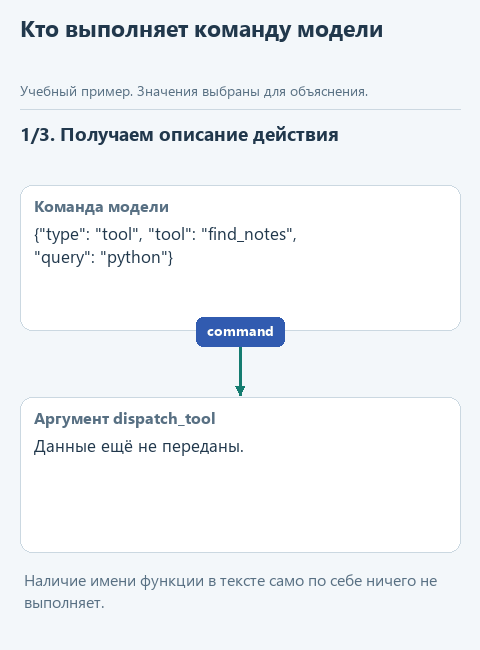
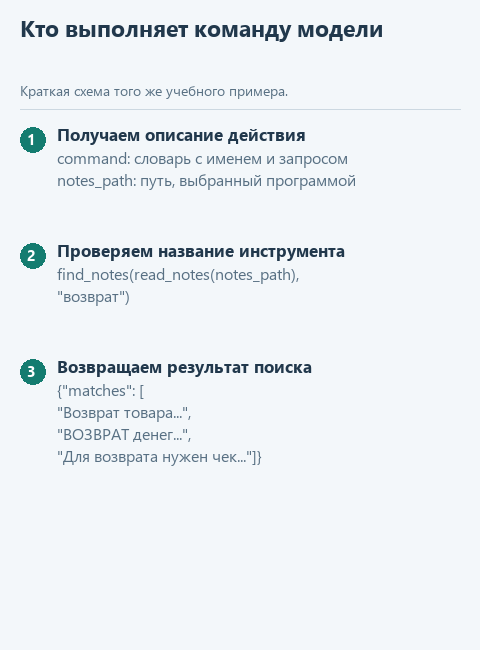

# Урок 1. Выполняем команду поиска

[Открыть исходники этого урока](../../exercises/lesson-03-01-tools/README.md) / [Подсказки рядом с кодом](../../exercises/lesson-03-01-tools/TASK.md)

Раньше порядок действий задавали мы. Теперь дадим модели возможность попросить об операции. Наш код должен понять просьбу и вызвать только известную функцию: произвольный текст ответа ещё не является разрешением исполнить любой Python-код.

## Откроем каркас именно этого урока

Скачайте [каркас этого урока](../../downloads/lesson-03-01-tools.zip?raw=true) и распакуйте архив через «Извлечь всё». Внутри будет папка `lesson-03-01-tools`. В PyCharm выберите **File -> Open**, укажите эту папку и откройте её в новом окне. Предыдущие части уже подготовлены: переносить свои решения необязательно. Свой прежний проект можно оставить открытым.

Слева откройте **View -> Tool Windows -> Project** и разверните `lesson-03-01-tools` стрелкой рядом с именем. Текущее задание - `dispatch_tool` в `agent.py`. Файл `demo.py` лежит прямо в этом корне, рядом с модулями, вне папок `data` и `tests`.

Подключение из [урока подключения модели](../02-note-assistant/04-connect.md) уже должно работать. Все каркасы читают сохранённый выбор сервиса и модели; повторно вводить ключ не нужно. Ниже разберём конкретные данные текущей функции, а после реализации запустим её в работе с моделью.

## Посмотрим на данные

В прошлом подпроекте модель получала заметку сразу. Теперь попросим её сначала запросить поиск. Готовая `decide_live` в `decisions.py` отправляет просьбу через наше подключение и разбирает текст модели как JSON. Полученная команда поступит в вашу `dispatch_tool`. В нашем учебном протоколе команда - обычный словарь. Поле `tool` называет операцию, `query` содержит запрос поиска. Поддержим только `read_notes` и `find_notes`; путь к файлу задаёт приложение через `notes_path`. Модель не выбирает произвольный файл на диске.

```python
command = {'type': 'tool', 'tool': 'find_notes', 'query': 'python'}
command.get('tool')  # 'find_notes' 
```

Этот фрагмент поясняет данные и конструкции; в учебный модуль его целиком копировать не требуется. Такой фиксированный пример используется в `demo_check.py`; в основном `demo.py` данные поступают из настоящего запуска. Их фактические значения увидим в Run.



<details>
<summary>Статичный вариант</summary>



</details>

## Соберём функцию с подсказками

Значение `"find_notes"` в команде - пока просто текст. Python не должен выполнять его сам по себе. Мы явно сравним имя с двумя разрешёнными вариантами и вызовем соответствующую готовую функцию. Такой выбор по имени программисты называют диспетчеризацией.

В файле текущего задания уже есть начало функции. Допишите её по заготовке ниже: `...` обозначает место для вашего выражения, а не готовую команду. Когда заполните пропуски, удалите строку `raise NotImplementedError(...)` из каркаса. Заголовок `def` в файле уже есть - вторую функцию с тем же именем создавать не нужно.

```python
def dispatch_tool(command: dict, notes_path: Path) -> dict:
    name = command.get('tool')
    if name == 'read_notes':
        return {'notes': ...}
    if name == 'find_notes':
        query = command.get('query')
        if not isinstance(query, str):
            raise ValueError('Для поиска нужна строка query')
        notes = read_notes(notes_path)
        return {'matches': ...}
    raise ValueError('Неизвестный инструмент: ' + str(name))
```

В ветке `read_notes` подставьте вызов `read_notes(notes_path)`. В ветке поиска заметки уже прочитаны в `notes`; передайте их вместе с `query` в `find_notes`. Мы используем существующие функции, а не дублируем их код.

`command.get("tool")` достаёт имя операции; если ключа нет, получится `None`, и команда попадёт в последнюю ошибку. `isinstance(query, str)` проверяет, что вместо запроса нам не передали число или список. Имя файла берём только из `notes_path`, который задаёт приложение.

## Запустим с нашей моделью

После реализации откройте **Project -> lesson-03-01-tools -> demo.py**, щёлкните правой кнопкой внутри редактора и выберите **Run 'demo'**. Результат появится в панели **Run**; её можно открыть через **View -> Tool Windows -> Run**.

Модель получает просьбу найти заметки о Python и возвращает команду. `demo.py` покажет её в Run, затем передаст вашей `dispatch_tool`. Ожидаем команду `find_notes` с запросом о Python и словарь найденных строк. Если модель отвечает сразу или выбирает другой инструмент, сравните её команду с просьбой; программа не заменяет решение модели готовым ответом. В этом уроке выполним одну команду; возврат её результата модели добавим в следующем.

Если настройки ещё не сохранены или перестали работать, вернитесь к [уроку подключения модели](../02-note-assistant/04-connect.md). В этом запуске модель не подменяется ответом из файла. Маленькая локальная модель может плохо соблюдать формат JSON; сначала отличите ошибку разбора её ответа от ошибки вашей функции. Если подключение работает, но возможностей модели не хватает, смените модель через `configure_model.py`, сохранив реализацию задания.

## Проверим функцию отдельно

Для воспроизводимого примера откройте **Project -> lesson-03-01-tools -> demo_check.py** и выберите **Run 'demo_check'**. Этот файл обращается к подготовленным данным без модели. До завершения текущей функции он показывает «Допишите ...», после реализации ожидаем:

```text
{'matches': ['Python functions return values.', 'Python lists keep item order.']}
```

Дополнительно можно запустить `tests/test_lesson.py` через Run по классу `LessonTests`. Эти проверки помогают обнаружить ошибку функции независимо от поведения модели.


## Куда идти дальше

Следующий шаг - [возвращаем результат модели](02-cycle.md). Вернуться к [оглавлению и архивам](../README.md).
