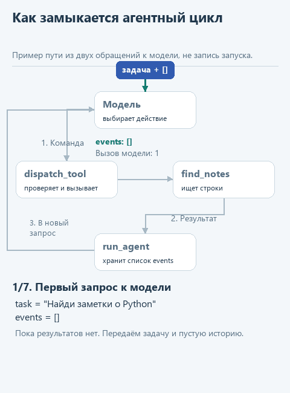
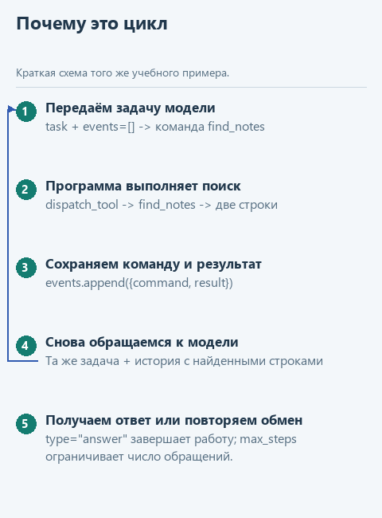

# Урок 2. Возвращаем результат модели

[Открыть исходники этого урока](../../exercises/lesson-03-02-cycle/README.md) / [Подсказки рядом с кодом](../../exercises/lesson-03-02-cycle/TASK.md)

В прошлом уроке программа нашла заметки о Python, но ещё не передала их модели. Добавим найденные строки к следующему запросу вместе с исходной задачей, чтобы модель могла использовать их в ответе. Если снова отправить только просьбу найти заметки, модель не получит результата предыдущего поиска и может запросить его повторно.

В функции `run_agent` соединим этот обмен. Сначала модель выбирает действие, программа выполняет его и сохраняет команду вместе с результатом. Затем снова передаёт модели исходную задачу и уже дополненную историю. Теперь модель может использовать найденное в ответе или запросить ещё один инструмент.

Так мы соберём агентный цикл и увидим, чем он отличается от одного запроса к модели. Продолжение работы зависит не только от её ответа, но и от того, какие данные программа возвращает на следующий шаг. Число шагов ограничим, чтобы завершение запуска оставалось под нашим контролем.

## Откроем каркас именно этого урока

Скачайте [каркас этого урока](../../downloads/lesson-03-02-cycle.zip?raw=true) и распакуйте архив через "Извлечь всё". Внутри будет папка `lesson-03-02-cycle`. В PyCharm выберите **File -> Open**, укажите эту папку и откройте её в новом окне. В каркасе уже готовы функции предыдущих уроков, поэтому сразу перейдём к текущему заданию. Ваш прежний проект останется в отдельной папке.

Слева откройте **View -> Tool Windows -> Project** и разверните `lesson-03-02-cycle` стрелкой рядом с именем. Текущее задание - `run_agent` в `agent.py`. Файл `demo.py` лежит прямо в этом корне, рядом с модулями, вне папок `data` и `tests`.

Подключение из [урока подключения модели](../02-note-assistant/04-connect.md) уже должно работать. Все каркасы читают сохранённый выбор сервиса и модели; повторно вводить ключ не нужно. Ниже разберём конкретные данные текущей функции, а после реализации запустим её в работе с моделью.

## Где появляется агентный цикл

В разделе 2 мы сами передавали модели заметку вместе с вопросом и получали ответ. Теперь запускаем задачу "Найди заметки о Python" без заранее выбранных строк. Модель может запросить поиск; программа выполнит его, запишет найденные строки в историю и снова обратится к модели. Получив результат, модель сможет ответить или запросить ещё одно действие.

```text
Задача и история -> решение модели
                       |
             +---------+---------+
             |                   |
       запрос инструмента   итоговый ответ
             |                   |
       выполнение поиска       завершение
             |
       результат в историю
             |
       новое решение модели
```

Повторение этого обмена и называется агентным циклом. Его организует наша функция `run_agent`: она вызывает `decide`, передаёт команду в функцию `dispatch_tool` для выполнения и добавляет событие в список `events`. Если пришёл итоговый ответ, функция завершает работу. Лимит `max_steps` останавливает повторение, когда модель не заканчивает задачу сама.

## Посмотрим на данные

На каждом шаге функция `decide` получает исходную задачу `task` и список событий `events`, где мы сохраняем команды вместе с результатами. В ответ она возвращает следующую команду или итоговый ответ. В `demo.py` эту роль выполняет функция `decide_live`, которая обращается к модели, а в `demo_check.py` её заменяет `decide_fixture` с заранее известным поведением.

```python
events = []
events.append({'command': {'tool': 'find_notes', 'query': 'python'},
               'result': {'matches': ['Python lists']}})
```

Этот фрагмент поясняет данные и конструкции; в учебный модуль его целиком копировать не требуется. В `demo_check.py` значения заданы заранее для проверки функции, а в основном `demo.py` они зависят от ответа модели; фактические данные увидим в Run.

В коротком примере выше в событии сохранена одна строка. В анимации покажем поиск по файлу из каркаса: там две заметки о Python. Проследите обратный путь от истории к модели: после поиска в новый запрос уходят исходная задача, команда и обе найденные строки. Счётчик обращений меняется с одного на два. Показан один возможный ход работы; настоящая модель может выбрать другую последовательность действий.



<details>
<summary>Статичный вариант</summary>



</details>

## Соберём функцию с подсказками

Проследим два шага контрольного примера. Пока `events` пуст, подготовленная `decide_fixture` возвращает команду поиска. Наша программа выполняет её и добавляет команду с результатом в историю. При следующем вызове `decide_fixture` проверяет, что история уже не пуста, и возвращает заранее заданный ответ. Это проверка порядка вызовов без модели. При настоящем запуске `decide_live` включит историю в новые сообщения, и модель получит найденные заметки. Если событие не записать, в следующем запросе этих данных не будет.

Допишите уже начатую функцию по заготовке ниже, заполняя каждый `...` по подсказкам. Когда закончите, удалите строку `raise NotImplementedError(...)`; повторно добавлять заголовок `def` не нужно.

```python
def run_agent(task: str, notes_path: Path, decide, max_steps: int = 4) -> dict:
    if max_steps < 1:
        raise ValueError('Нужен хотя бы один шаг')
    events = []
    for step in range(max_steps):
        command = decide(task, events)
        if command.get('type') == 'answer':
            text = command.get('text')
            if not isinstance(text, str) or not text.strip():
                raise ValueError('Пустой ответ')
            return {'status': 'completed', 'answer': text, 'events': events}
        if command.get('type') != 'tool':
            raise ValueError('Ожидался ответ или запрос инструмента')
        result = ...
        events.append({'command': ..., 'result': ...})
    return {'status': 'step_limit', 'answer': '', 'events': events}
```

В `result` сохраните `dispatch_tool(command, notes_path)`. В событие положите переменные `command` и `result`: так следующий вызов `decide(task, events)` получит и запрос операции, и найденные данные.

`range(max_steps)` ограничивает количество повторений. При `max_steps=4` цикл сможет четыре раза запросить следующее действие. `return` внутри ветки `answer` завершает всю функцию сразу. Последний `return` расположен после цикла: он выполняется только тогда, когда шаги закончились без окончательного ответа. Проверки типов команд уже показаны в заготовке, чтобы вы могли сосредоточиться на обмене данными.

После первого поиска `result` содержит словарь с найденными строками. Запись `events.append({'command': command, 'result': result})` сохраняет его вместе с исходной командой, и следующий вызов `decide(task, events)` получает этот список аргументом. При работе с настоящей моделью `decide_live` включит историю в новые сообщения - так строки действительно попадут модели. Когда она вернёт решение с `type='answer'`, ваша функция завершит цикл и передаст демонстрации итоговый словарь с ответом и историей. Возвращение результата из `run_agent` завершает работу помощника; передача результата инструмента модели происходит раньше, через следующий вызов `decide`.

Координацию этих действий называют **оркестрацией**: код определяет, когда обратиться к модели, выполнить инструмент, передать результат и остановить работу. В нашем примере это роль `run_agent`; отдельный инструмент выполняет поиск, а модель выбирает следующий шаг. Здесь оркестрация написана обычным циклом Python. Термин поможет различать возможности модели, инструментов и управляющего приложения в описании другой агентной системы. См. [оркестрацию на нашей схеме](../terms.md#%D0%BE%D1%80%D0%BA%D0%B5%D1%81%D1%82%D1%80%D0%B0%D1%86%D0%B8%D1%8F).

## Запустим с нашей моделью

После реализации откройте **Project -> lesson-03-02-cycle -> demo.py**, щёлкните правой кнопкой внутри редактора и выберите **Run 'demo'**. Результат появится в панели **Run**; её можно открыть через **View -> Tool Windows -> Run**.

Теперь запускается весь цикл: модель выбирает действие, программа выполняет его, результат снова получает модель. В Run появятся сохранённые события и итоговый словарь. Ожидаем ответ на основе найденных заметок; точные слова и число действий могут меняться. Если запуск завершился по лимиту, это тоже результат, который нужно разобрать по истории.

Если настройки ещё не сохранены или перестали работать, вернитесь к [уроку подключения модели](../02-note-assistant/04-connect.md). В этом запуске модель не подменяется ответом из файла. Маленькая локальная модель может плохо соблюдать формат JSON; сначала отличите ошибку разбора её ответа от ошибки вашей функции. Если подключение работает, но возможностей модели не хватает, смените модель через `configure_model.py`, сохранив реализацию задания.

## Проверим функцию отдельно

Для воспроизводимого примера откройте **Project -> lesson-03-02-cycle -> demo_check.py** и выберите **Run 'demo_check'**. Этот файл обращается к подготовленным данным без модели. До завершения текущей функции он показывает "Допишите ...", после реализации ожидаем:

```text
status: completed; answer: Найдены две заметки о Python.; events: одна команда поиска и её результат.
```

Дополнительно можно запустить `tests/test_lesson.py` через Run по классу `LessonTests`. Эти проверки помогают обнаружить ошибку функции независимо от поведения модели.


## Куда идти дальше

Следующий шаг - [ограничиваем число действий](../04-run-control/01-budget.md). Вернуться к [оглавлению и архивам](../README.md).
