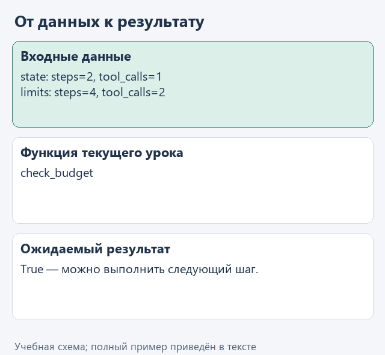
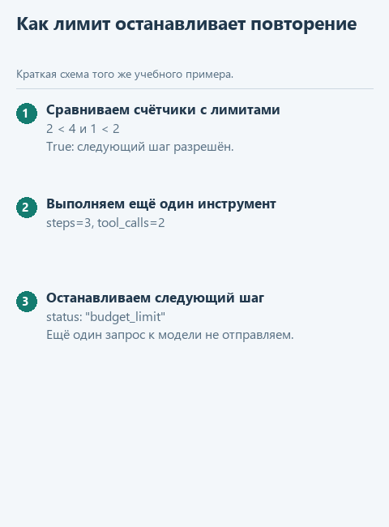

# Урок 1. Ограничиваем число действий

[Открыть исходники этого урока](../../exercises/lesson-04-01-budget/README.md) / [Подсказки рядом с кодом](../../exercises/lesson-04-01-budget/TASK.md)

Представим, что агент уже прочитал заметки, но снова просит прочитать тот же файл. Действие разрешено, поэтому проверка названия инструмента его пропустит. Однако повторение может продолжаться без полезного результата, занимая время и расходуя квоту облачного сервиса.

Одного правила "закончи, когда найдёшь ответ" для управления таким запуском недостаточно: решение об остановке не стоит целиком оставлять модели. В `check_budget` зададим проверяемые пределы количества обращений к модели и выполнений инструментов. Когда один из пределов достигнут, программа остановит дальнейшие шаги.

На этой практике мы увидим разницу между допустимым действием и допустимой продолжительностью работы. Научимся читать счётчики и понимать причину остановки: помощник завершил задачу или приложение прекратило выполнение по заданному ограничению. Здесь считаем действия, а не стоимость токенов.

## Откроем каркас именно этого урока

Скачайте [каркас этого урока](../../downloads/lesson-04-01-budget.zip?raw=true) и распакуйте архив через "Извлечь всё". Внутри будет папка `lesson-04-01-budget`. В PyCharm выберите **File -> Open**, укажите эту папку и откройте её в новом окне. В каркасе уже готовы функции предыдущих уроков, поэтому сразу перейдём к текущему заданию. Ваш прежний проект останется в отдельной папке.

Слева откройте **View -> Tool Windows -> Project** и разверните `lesson-04-01-budget` стрелкой рядом с именем. Текущее задание - `check_budget` в `control.py`. Файл `demo.py` лежит прямо в этом корне, рядом с модулями, вне папок `data` и `tests`.

Подключение из [урока подключения модели](../02-note-assistant/04-connect.md) уже должно работать. Все каркасы читают сохранённый выбор сервиса и модели; повторно вводить ключ не нужно. Ниже разберём конкретные данные текущей функции, а после реализации запустим её в работе с моделью.

## Посмотрим на данные

Допустим, программа уже дважды обращалась к модели за решением и один раз вызвала инструмент. Разрешим не больше четырёх обращений и двух вызовов инструмента. Выполненное запишем в словарь `state`, ограничения - в `limits`, а для счётчиков используем ключи `steps` и `tool_calls`:

```python
state = {'steps': 2, 'tool_calls': 1}
limits = {'steps': 4, 'tool_calls': 2}
state['steps'] < limits['steps']  # True
```

В этом примере обе проверки ещё разрешают продолжение. Как только хотя бы один счётчик достигнет предела, функция вернёт `False`, и программа остановит весь запуск. Дополнительного обращения к модели после исчерпания лимита инструментов в нашей учебной версии нет. Такие значения подготовлены для контрольного запуска; с настоящей моделью счётчики будут зависеть от её действий.



<details>
<summary>Статичный вариант</summary>



</details>

## Соберём функцию с подсказками

Функция должна разрешить следующий шаг только при двух условиях одновременно: обращения к модели ещё не закончились и инструменты ещё можно вызывать. Поэтому сравним каждый счётчик с его пределом и объединим результаты через `and`.

Допишите уже начатую функцию по заготовке ниже, заполняя каждый `...` по подсказкам. Когда закончите, удалите строку `raise NotImplementedError(...)`; повторно добавлять заголовок `def` не нужно.

```python
def check_budget(state: dict, limits: dict) -> bool:
    for name in ('steps', 'tool_calls'):
        if type(state.get(name)) is not int or state[name] < 0:
            raise ValueError('Неверный счётчик: ' + name)
        if type(limits.get(name)) is not int or limits[name] < 1:
            raise ValueError('Неверный лимит: ' + name)
    steps_available = ...
    tools_available = ...
    return steps_available and tools_available
```

Первое сравнение - `state["steps"] < limits["steps"]`, второе такое же для ключа `"tool_calls"`. Оператор `and` вернёт `True` только тогда, когда истинны оба сравнения. Если счётчик уже равен лимиту, следующего действия не разрешаем.

Начальная проверка данных приведена целиком: `type(value) is int` требует именно целое число. Это полезно потому, что в Python `True` также ведёт себя как число `1`; в счётчиках такое значение принимать не будем. В каркасе пока лишь прочитаны два счётчика - перед итоговыми сравнениями добавьте показанную проверку.

В контрольном запуске счётчики равны `steps=2` и `tool_calls=1`, а пределы - `4` и `2`. Оба сравнения истинны, поэтому вызов `result = check_budget(state, limits)` даст `True`. Функция ничего не увеличивает и сама не запускает следующий шаг: она сообщает вызывающему коду, разрешён ли он. Когда счётчик инструментов станет равен `2`, результат будет `False`, и управляющая часть программы должна остановить выполнение.

## Запустим с нашей моделью

После реализации откройте **Project -> lesson-04-01-budget -> demo.py**, щёлкните правой кнопкой внутри редактора и выберите **Run 'demo'**. Результат появится в панели **Run**; её можно открыть через **View -> Tool Windows -> Run**.

Модель выбирает следующие действия, а ваша функция `check_budget` перед каждым шагом проверяет счётчики. В Run появятся команды, результаты инструментов и ответ либо сообщение о достижении лимита. Лимиты заданы в `demo.py`: четыре шага и три вызова инструментов. Условия останавливает программа, а не обещание модели закончить вовремя.

Если настройки ещё не сохранены или перестали работать, вернитесь к [уроку подключения модели](../02-note-assistant/04-connect.md). В этом запуске модель не подменяется ответом из файла. Маленькая локальная модель может плохо соблюдать формат JSON; сначала отличите ошибку разбора её ответа от ошибки вашей функции. Если подключение работает, но возможностей модели не хватает, смените модель через `configure_model.py`, сохранив реализацию задания.

## Проверим функцию отдельно

Для воспроизводимого примера откройте **Project -> lesson-04-01-budget -> demo_check.py** и выберите **Run 'demo_check'**. Этот файл обращается к подготовленным данным без модели. До завершения текущей функции он показывает "Допишите ...", после реализации ожидаем:

```text
True
```

Дополнительно можно запустить `tests/test_lesson.py` через Run по классу `LessonTests`. Эти проверки помогают обнаружить ошибку функции независимо от поведения модели.


## Куда идти дальше

Следующий шаг - [выбираем историю для следующего шага](02-context.md). Вернуться к [оглавлению и архивам](../README.md).
