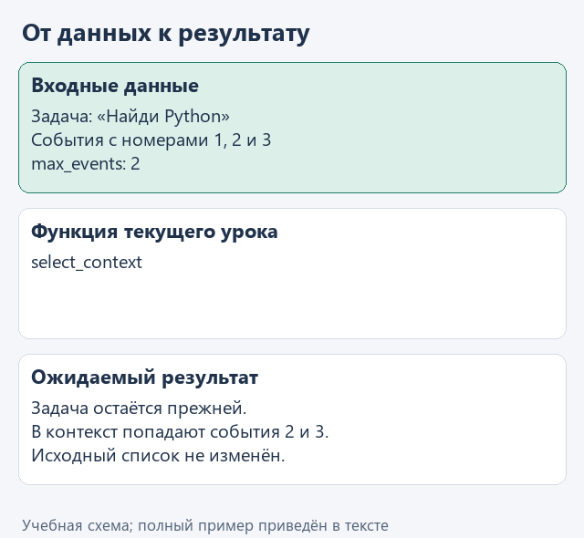
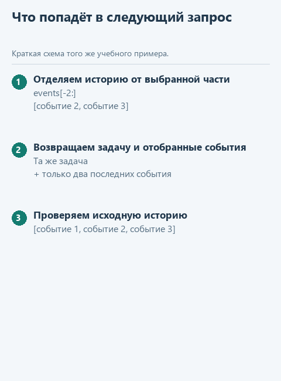

# Урок 2. Выбираем историю для следующего шага

[Открыть исходники этого урока](../../exercises/lesson-04-02-context/README.md) / [Подсказки рядом с кодом](../../exercises/lesson-04-02-context/TASK.md)

Длинная история занимает место в запросе и затрудняет разбор. Попробуем простой способ управлять её объёмом: сохранять исходную задачу и передавать только последние события. Это учебное ограничение по числу событий, а не полноценное управление токенным окном модели.

## Откроем каркас именно этого урока

Скачайте [каркас этого урока](../../downloads/lesson-04-02-context.zip?raw=true) и распакуйте архив через «Извлечь всё». Внутри будет папка `lesson-04-02-context`. В PyCharm выберите **File -> Open**, укажите эту папку и откройте её в новом окне. Предыдущие части уже подготовлены: переносить свои решения необязательно. Свой прежний проект можно оставить открытым.

Слева откройте **View -> Tool Windows -> Project** и разверните `lesson-04-02-context` стрелкой рядом с именем. Текущее задание - `select_context` в `control.py`. Файл `demo.py` лежит прямо в этом корне, рядом с модулями, вне папок `data` и `tests`.

Подключение из [урока подключения модели](../02-note-assistant/04-connect.md) уже должно работать. Все каркасы читают сохранённый выбор сервиса и модели; повторно вводить ключ не нужно. Ниже разберём конкретные данные текущей функции, а после реализации запустим её в работе с моделью.

## Посмотрим на данные

`task` остаётся неизменной просьбой пользователя. Каждый элемент `events` уже содержит целую пару «команда - результат», поэтому отбираем события целиком. `max_events=0` означает пустую историю. Старые сведения при таком отборе теряются; позже можно сравнить подход с кратким резюме.

```python
events = [{'step': 1}, {'step': 2}, {'step': 3}]
events[-2:]  # [{'step': 2}, {'step': 3}]
# Это сокращённые подписи событий только для разбора среза.
```

Этот фрагмент поясняет данные и конструкции; в учебный модуль его целиком копировать не требуется. Такой фиксированный пример используется в `demo_check.py`; в основном `demo.py` данные поступают из настоящего запуска. Их фактические значения увидим в Run.



<details>
<summary>Статичный вариант</summary>



</details>

## Соберём функцию с подсказками

Сейчас в истории три события, а следующему шагу хотим передать только два последних. При этом исходную просьбу пользователя терять нельзя. Поэтому создадим новый словарь: задача останется прежней, а список событий выберем заново.

В файле текущего задания уже есть начало функции. Допишите её по заготовке ниже: `...` обозначает место для вашего выражения, а не готовую команду. Когда заполните пропуски, удалите строку `raise NotImplementedError(...)` из каркаса. Заголовок `def` в файле уже есть - вторую функцию с тем же именем создавать не нужно.

```python
def select_context(task: str, events: list[dict], max_events: int) -> dict:
    if type(max_events) is not int or max_events < 0:
        raise ValueError('Нужен неотрицательный целый max_events')
    context = {'task': task, 'events': []}
    if max_events > 0:
        context['events'] = ...
    return context
```

В пропуске используйте `events[-max_events:]`. При `max_events=2` получатся события с номерами 2 и 3 из нашего примера. Двоеточие в квадратных скобках обозначает срез - новый список из выбранной части. Сам `events` от этого не меняется.

Нулевой случай уже обеспечен заготовкой: `context["events"]` останется `[]`. Это важно, потому что `events[-0:]` равнозначно `events[0:]` и вернуло бы всю историю. Для нашего упражнения событие содержит команду вместе с результатом; внутри отдельного события ничего не обрезаем.

## Запустим с нашей моделью

После реализации откройте **Project -> lesson-04-02-context -> demo.py**, щёлкните правой кнопкой внутри редактора и выберите **Run 'demo'**. Результат появится в панели **Run**; её можно открыть через **View -> Tool Windows -> Run**.

Основной запуск использует вашу `select_context` перед очередным обращением к подключённой модели. В Run появятся статус, ответ и история. Посмотрите, какие события оставляет выбранный `max_events`: исключённые из текущего запроса события модель в нём не видит. Формулировка ответа может измениться; сравнивать нужно переданные данные и поведение.

Если настройки ещё не сохранены или перестали работать, вернитесь к [уроку подключения модели](../02-note-assistant/04-connect.md). В этом запуске модель не подменяется ответом из файла. Маленькая локальная модель может плохо соблюдать формат JSON; сначала отличите ошибку разбора её ответа от ошибки вашей функции. Если подключение работает, но возможностей модели не хватает, смените модель через `configure_model.py`, сохранив реализацию задания.

## Проверим функцию отдельно

Для воспроизводимого примера откройте **Project -> lesson-04-02-context -> demo_check.py** и выберите **Run 'demo_check'**. Этот файл обращается к подготовленным данным без модели. До завершения текущей функции он показывает «Допишите ...», после реализации ожидаем:

```text
{'task': 'Найди Python', 'events': [{'step': 2}, {'step': 3}]}
```

Дополнительно можно запустить `tests/test_lesson.py` через Run по классу `LessonTests`. Эти проверки помогают обнаружить ошибку функции независимо от поведения модели.


## Куда идти дальше

Следующий шаг - [сохраняем историю выполнения](03-trace.md). Вернуться к [оглавлению и архивам](../README.md).
