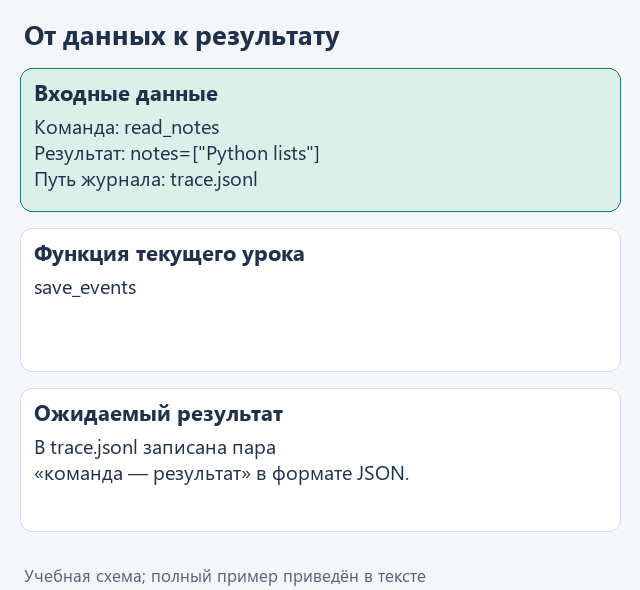
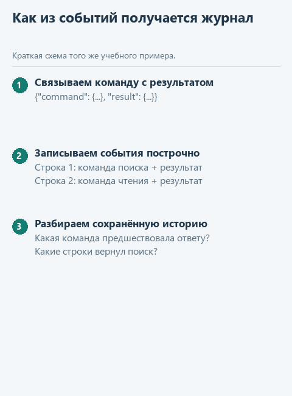

# Урок 3. Сохраняем историю выполнения

[Открыть исходники этого урока](../../exercises/lesson-04-03-trace/README.md) / [Подсказки рядом с кодом](../../exercises/lesson-04-03-trace/TASK.md)

Помощник остановился, но по итоговому сообщению неясно, что произошло до остановки. Он не получил нужные заметки, несколько раз повторил поиск или выбрал другой инструмент? Чтобы это проверить после запуска, нужно сохранить команды и результаты в том порядке, в котором они появились.

Напишем `save_events`: она запишет историю в файл, где каждое событие занимает отдельную строку JSON. Позже мы сможем открыть файл и сопоставить запрос инструмента с его результатом. Здесь сохраняется полная переданная история, даже если модель на следующем шаге получит только её часть.

Так у нас появится материал для разбора выполнения, а не только впечатление от окончательного ответа. На практике научимся различать историю, которую хранит приложение, и сведения, выбранные для модели. Эта разница особенно полезна, когда нужно выяснить, где программа располагала нужными данными, но не передала их дальше.

## Откроем каркас именно этого урока

Скачайте [каркас этого урока](../../downloads/lesson-04-03-trace.zip?raw=true) и распакуйте архив через "Извлечь всё". Внутри будет папка `lesson-04-03-trace`. В PyCharm выберите **File -> Open**, укажите эту папку и откройте её в новом окне. В каркасе уже готовы функции предыдущих уроков, поэтому сразу перейдём к текущему заданию. Ваш прежний проект останется в отдельной папке.

Слева откройте **View -> Tool Windows -> Project** и разверните `lesson-04-03-trace` стрелкой рядом с именем. Текущее задание - `save_events` в `control.py`. Файл `demo.py` лежит прямо в этом корне, рядом с модулями, вне папок `data` и `tests`.

Подключение из [урока подключения модели](../02-note-assistant/04-connect.md) уже должно работать. Все каркасы читают сохранённый выбор сервиса и модели; повторно вводить ключ не нужно. Ниже разберём конкретные данные текущей функции, а после реализации запустим её в работе с моделью.

## Посмотрим на данные

Раньше мы добавляли в журнал по одному результату поиска, а теперь в функцию `save_events` придёт сразу список событий завершённого запуска. Каждое событие содержит команду и её результат. Ниже показан один такой элемент: агент попросил прочитать заметки и получил строку `"Python lists"`.

```python
event = {'command': {'tool': 'read_notes'},
         'result': {'notes': ['Python lists']}}
json.dumps(event, ensure_ascii=False)
```

Сохраним каждое событие отдельной строкой JSON, как делали с результатами поиска. Но здесь файл будет содержать историю только одного запуска, поэтому откроем его в режиме `w` с заменой прежнего содержимого. Если нужно оставить несколько историй, для каждой следует выбрать свой путь. Пример в `demo_check.py` фиксирован, а в `demo.py` журнал заполняется событиями настоящего запуска.



<details>
<summary>Статичный вариант</summary>



</details>

## Соберём функцию с подсказками

Мы уже сохраняли один результат поиска. Здесь задача похожая, только передана сразу история запуска - список словарей. Каркас превратил каждое событие в строку JSON; теперь запишем все строки в один файл, сохранив границы событий.

Допишите уже начатую функцию по заготовке ниже, заполняя каждый `...` по подсказкам. Когда закончите, удалите строку `raise NotImplementedError(...)`; повторно добавлять заголовок `def` не нужно.

```python
def save_events(path: Path, events: list[dict]) -> None:
    serialized = [json.dumps(event, ensure_ascii=False) for event in events]
    with path.open('w', encoding='utf-8') as stream:
        for text in serialized:
            stream.write(...)
```

Как и в первом журнале, в пропуске нужны `text` и перевод строки: `text + "\n"`. Отличается режим открытия. Здесь `w` выбран намеренно: файл хранит одну полную историю запуска и при повторном сохранении заменяется. Чтобы хранить несколько запусков, приложению нужно дать каждому свой путь.

Если событий нет, `serialized` будет пустым, цикл ничего не запишет, а открытие в режиме `w` оставит пустой файл. Поэтому отдельная ветка для пустого списка не требуется. Структуру каждого события не перестраиваем - иначе по журналу будет сложнее сопоставить команду с её результатом.

Когда по записям восстанавливают путь выполнения запроса, речь идёт о **трассировке (tracing)**. Наш журнал даёт для этого простую последовательность команд и результатов. В системах трассировки обычно также связывают операции между собой и записывают их длительность; этих данных в нашем файле пока нет. Поэтому здесь мы знакомимся с задачей трассировки через журнал действий, а не подключаем готовую систему мониторинга. См. [что можно узнать из нашей истории](../terms.md#%D1%82%D1%80%D0%B0%D1%81%D1%81%D0%B8%D1%80%D0%BE%D0%B2%D0%BA%D0%B0).

## Запустим с нашей моделью

После реализации откройте **Project -> lesson-04-03-trace -> demo.py**, щёлкните правой кнопкой внутри редактора и выберите **Run 'demo'**. Результат появится в панели **Run**; её можно открыть через **View -> Tool Windows -> Run**.

После реального запуска агента программа передаёт список событий в вашу функцию `save_events`. В Run появится итог и сообщение об `events.jsonl`. Найдите файл в **Project -> корень текущего проекта -> events.jsonl**, откройте его и сопоставьте команды с результатами. Это история данного запуска, поэтому строки не обязаны совпадать с учебным примером.

Если настройки ещё не сохранены или перестали работать, вернитесь к [уроку подключения модели](../02-note-assistant/04-connect.md). В этом запуске модель не подменяется ответом из файла. Маленькая локальная модель может плохо соблюдать формат JSON; сначала отличите ошибку разбора её ответа от ошибки вашей функции. Если подключение работает, но возможностей модели не хватает, смените модель через `configure_model.py`, сохранив реализацию задания.

## Проверим функцию отдельно

Для воспроизводимого примера откройте **Project -> lesson-04-03-trace -> demo_check.py** и выберите **Run 'demo_check'**. Этот файл обращается к подготовленным данным без модели. До завершения текущей функции он показывает "Допишите ...", после реализации ожидаем:

```text
{"command": {"tool": "read_notes"}, "result": {"notes": ["Python lists"]}}
```

Дополнительно можно запустить `tests/test_lesson.py` через Run по классу `LessonTests`. Эти проверки помогают обнаружить ошибку функции независимо от поведения модели.


## Куда идти дальше

Следующий шаг - [сравниваем поведение на сценариях](04-evaluation.md). Вернуться к [оглавлению и архивам](../README.md).
