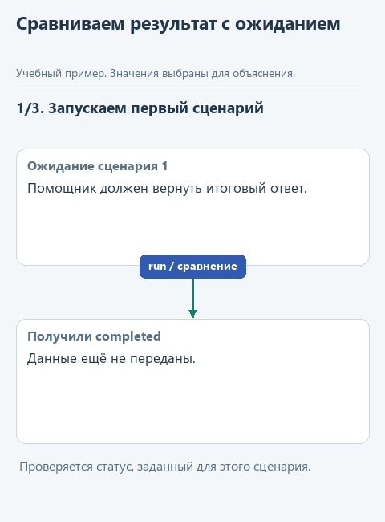
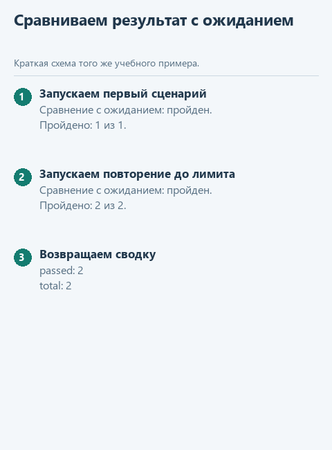

# Урок 4. Сравниваем поведение на сценариях

[Открыть исходники этого урока](../../exercises/lesson-04-04-evaluation/README.md) / [Подсказки рядом с кодом](../../exercises/lesson-04-04-evaluation/TASK.md)

Допустим, мы изменили инструкцию, и помощник стал лучше отвечать на привычный вопрос. Это ещё не показывает, что новое поведение подходит для остальных задач. Он мог перестать сообщать об отсутствии заметок или чаще останавливаться по лимиту. Один удачный ответ легко заметить, а такие изменения без повторяемой проверки можно пропустить.

Подготовим несколько сценариев и заранее определим ожидаемый результат каждого. Функция `evaluate_cases` выполнит задачи, сравнит полученные статусы и ответы с ожиданиями и соберёт отчёт. По нему будет видно, на каком сценарии поведение отличается от заданного.

Мы познакомимся с небольшим набором критериев приёмки для агента. В наших примерах ответы намеренно короткие, поэтому подходит точное сравнение. Смысл практики - договориться о проверке до запуска и оценивать изменения на одном наборе условий, а не выдавать любой связный ответ за успех.

## Откроем каркас именно этого урока

Скачайте [каркас этого урока](../../downloads/lesson-04-04-evaluation.zip?raw=true) и распакуйте архив через "Извлечь всё". Внутри будет папка `lesson-04-04-evaluation`. В PyCharm выберите **File -> Open**, укажите эту папку и откройте её в новом окне. В каркасе уже готовы функции предыдущих уроков, поэтому сразу перейдём к текущему заданию. Ваш прежний проект останется в отдельной папке.

Слева откройте **View -> Tool Windows -> Project** и разверните `lesson-04-04-evaluation` стрелкой рядом с именем. Текущее задание - `evaluate_cases` в `control.py`. Файл `demo.py` лежит прямо в этом корне, рядом с модулями, вне папок `data` и `tests`.

Подключение из [урока подключения модели](../02-note-assistant/04-connect.md) уже должно работать. Все каркасы читают сохранённый выбор сервиса и модели; повторно вводить ключ не нужно. Ниже разберём конкретные данные текущей функции, а после реализации запустим её в работе с моделью.

## Посмотрим на данные

Для начала возьмём контрольную задачу "Найди Python" и заранее подготовленный ответ "Готово" со статусом `completed`. Эти ожидания вместе с названием задачи составляют один сценарий. В коде он будет обычным словарём, а список таких словарей передадим в параметр `cases`:

```python
case = {'name': 'Обычный ответ', 'task': 'Найди Python',
        'expected_status': 'completed', 'expected_answer': 'Готово'}
```

Функция `run`, которую передадим вместе со сценариями, выполнит каждую задачу и вернёт фактический результат. Сравним его поля `status` и `answer` с ожиданиями. Для известного контрольного ответа подходит точное равенство; в основном `demo.py` используем отдельные задачи с короткими ожидаемыми ответами `found` и `missing`. Свободные формулировки настоящей модели нельзя оценивать тем же способом без заранее заданных условий ответа.



<details>
<summary>Статичный вариант</summary>



</details>

## Соберём функцию с подсказками

Сравнение станет полезным, только если мы заранее договорились, что считать успехом. В каждом сценарии есть задача и ожидаемый ответ со статусом. Получим фактический результат через `run`, сравним оба поля и сохраним итог отдельно для каждого сценария.

Допишите уже начатую функцию по заготовке ниже, заполняя каждый `...` по подсказкам. Когда закончите, удалите строку `raise NotImplementedError(...)`; повторно добавлять заголовок `def` не нужно.

```python
def evaluate_cases(cases: list[dict], run) -> dict:
    results = []
    for case in cases:
        actual = run(case['task'])
        passed = ...
        results.append({'name': case['name'], 'passed': passed})
    passed_count = sum(item['passed'] for item in results)
    return {'passed': passed_count, 'total': len(results), 'results': results}
```

Сравните `actual["status"]` с `case["expected_status"]`, а `actual["answer"]` - с `case["expected_answer"]`. Между двумя сравнениями поставьте `and`: сценарий считается пройденным, когда совпали оба поля. Знак `==` сравнивает значения; одинарный `=` присваивает значение переменной.

`run(case["task"])` - такой же вызов переданной функции, как `send(messages)` во втором подпроекте. `len(results)` считает сценарии, а `sum(...)` складывает их логические результаты: `True` даёт единицу, `False` - ноль. Эта короткая запись уже приведена целиком. Для пустого набора оба счётчика получатся нулевыми.

Например, если ожидается `{'status': 'completed', 'answer': 'Готово'}` и `run` возвращает такие же значения, обе проверки дадут `True`. В `results` добавится запись с названием сценария и `passed=True`. Если ответ изменится на другой текст, статус может остаться правильным, но общий результат сценария станет `False`. В конце функция возвращает словарь с числом успешных проверок, общим числом сценариев и результатами каждого. Демонстрация получает этот отчёт; это результат нашего сравнения, а не оценка, которую модель выставила себе сама.

Оценивание поведения ИИ по заданным критериям называют **эвалюацией (evaluation)**; часто встречается сокращение **evals**. В нашем основном запуске оцениваем результат работы агента с настоящей моделью. Тесты Python-функции отдельно проверяют, правильно ли наш код сравнивает значения и собирает отчёт. Это связанные, но разные проверки: надёжный код оценивания ещё не означает, что модель справилась с задачей. См. [пример evals и отличие от тестов](../terms.md#%D1%8D%D0%B2%D0%B0%D0%BB%D1%8E%D0%B0%D1%86%D0%B8%D1%8F).

## Запустим с нашей моделью

После реализации откройте **Project -> lesson-04-04-evaluation -> demo.py**, щёлкните правой кнопкой внутри редактора и выберите **Run 'demo'**. Результат появится в панели **Run**; её можно открыть через **View -> Tool Windows -> Run**.

В `demo.py` заданы два сценария для настоящей модели. В первом она должна найти заметки о Python и завершить ответом `found`, во втором поиск `zzz_not_in_notes` должен завершиться ответом `missing`. Ваша функция сравнит фактические статусы и ответы с ожиданиями. `passed` может оказаться меньше `total`: это результат проверки поведения модели, а не повод подменить её учебной функцией. Один сценарий может потребовать нескольких обращений к API; учитывайте квоту выбранного сервиса.

Если настройки ещё не сохранены или перестали работать, вернитесь к [уроку подключения модели](../02-note-assistant/04-connect.md). В этом запуске модель не подменяется ответом из файла. Маленькая локальная модель может плохо соблюдать формат JSON; сначала отличите ошибку разбора её ответа от ошибки вашей функции. Если подключение работает, но возможностей модели не хватает, смените модель через `configure_model.py`, сохранив реализацию задания.

## Проверим функцию отдельно

Для воспроизводимого примера откройте **Project -> lesson-04-04-evaluation -> demo_check.py** и выберите **Run 'demo_check'**. Этот файл обращается к подготовленным данным без модели. До завершения текущей функции он показывает "Допишите ...", после реализации ожидаем:

```text
{'passed': 2, 'total': 2, 'results': [{'name': 'Ответ', 'passed': True}, {'name': 'Остановка', 'passed': True}]}
```

Это напечатанный словарь отчёта: оба контрольных сценария прошли, а в `results` виден итог каждого. При настоящем запросе значения определяются поведением модели, поэтому сравнивать нужно поля отчёта, а не ждать заранее обещанного успеха.

Дополнительно можно запустить `tests/test_lesson.py` через Run по классу `LessonTests`. Эти проверки помогают обнаружить ошибку функции независимо от поведения модели.


## Куда идти дальше

Следующий шаг - [ограничиваем рабочую папку](../05-coding-harness/01-paths.md). Вернуться к [оглавлению и архивам](../README.md).
