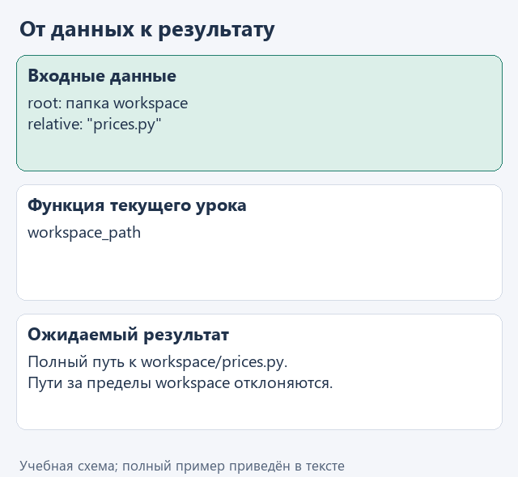
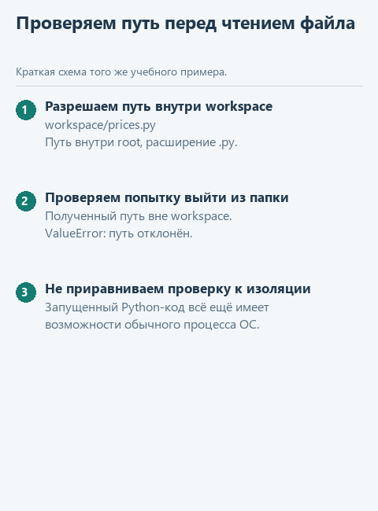

# Урок 1. Ограничиваем рабочую папку

[Открыть исходники этого урока](../../exercises/lesson-05-01-paths/README.md) / [Подсказки рядом с кодом](../../exercises/lesson-05-01-paths/TASK.md)

До сих пор агент только читал заметки. Прежде чем разрешать изменения, определим, с какими файлами он вообще может работать. Для упражнений у нас отдельная папка `workspace` с маленькой функцией расчёта цены и её тестами.

## Откроем каркас именно этого урока

Скачайте [каркас этого урока](../../downloads/lesson-05-01-paths.zip?raw=true) и распакуйте архив через «Извлечь всё». Внутри будет папка `lesson-05-01-paths`. В PyCharm выберите **File -> Open**, укажите эту папку и откройте её в новом окне. Предыдущие части уже подготовлены: переносить свои решения необязательно. Свой прежний проект можно оставить открытым.

Слева откройте **View -> Tool Windows -> Project** и разверните `lesson-05-01-paths` стрелкой рядом с именем. Текущее задание - `workspace_path` в `workspace.py`. Файл `demo.py` лежит прямо в этом корне, рядом с модулями, вне папок `data` и `tests`.

## Посмотрим на данные

`root` - разрешённая учебная папка, `relative` - относительный путь внутри неё, например `"prices.py"`. Вернём полный путь, только если он остаётся внутри `root` и ведёт к Python-файлу. Это проверка путей нашего приложения, а не изоляция операционной системы.

```python
root = ROOT / 'workspace'
relative = 'prices.py'
candidate = (root / relative).resolve()
```

Этот фрагмент поясняет данные и конструкции; в учебный модуль его целиком копировать не требуется. Рабочие значения уже подготовлены в `demo.py`.



<details>
<summary>Статичный вариант</summary>



</details>

## Соберём функцию с подсказками

Прежде чем читать или менять файл, нужно убедиться, что предложенный путь относится к учебной папке. Одного совпадения начала строки недостаточно: путь может содержать `..` или вести через ссылку в другое место. Поэтому сначала получим полный путь, а затем проверим его средствами `Path`.

В файле текущего задания уже есть начало функции. Допишите её по заготовке ниже: `...` обозначает место для вашего выражения, а не готовую команду. Когда заполните пропуски, удалите строку `raise NotImplementedError(...)` из каркаса. Заголовок `def` в файле уже есть - вторую функцию с тем же именем создавать не нужно.

```python
def workspace_path(root: Path, relative: str) -> Path:
    root = root.resolve()
    candidate = (root / relative).resolve()
    if Path(relative).is_absolute() or not candidate.is_relative_to(root):
        raise ValueError('Путь должен оставаться в учебной папке')
    if ...:
        raise ValueError('В упражнении работаем только с Python-файлами')
    return candidate
```

Первую проверку пути оставим готовой. В пропуске нужно сравнить расширение: `candidate.suffix != ".py"`. Свойство `suffix` возвращает последнюю часть имени с точкой, например `".py"`. Знак `!=` означает «не равно».

`root / relative` соединяет части пути, `resolve()` вычисляет полный путь, `is_absolute()` распознаёт абсолютный путь, а `is_relative_to(root)` проверяет принадлежность корню. На разрешённом `"prices.py"` функция вернёт путь; на `"../outside.py"` остановится с ошибкой. Это граница выбора файлов нашего приложения, а не защита от любых действий исполняемого кода.

## Найдём файл запуска и проверим результат

В левой панели **Project -> lesson-05-01-paths -> demo.py** откройте файл двойным щелчком. Нажмите правой кнопкой внутри открытого редактора и выберите **Run 'demo'**. Внизу появится окно **Run** с выводом именно этого файла. Отдельная общая кнопка «запустить проект» нам здесь не нужна: выбираем конкретный демонстрационный файл. Если панель с файлами скрыта, вернитесь к **View -> Tool Windows -> Project**. Если Run скрыто - **View -> Tool Windows -> Run**.

До завершения функции появится сообщение «Допишите ... по подсказкам урока». После реализации ожидаем:

```text
workspace/prices.py
```

Для дополнительного контроля откройте в этом же проекте `tests/test_lesson.py`, найдите `class LessonTests`, нажмите правой кнопкой по имени класса и выберите Run. Это необязательная проверка текущего задания; внутреннее устройство тестов сейчас разбирать не нужно.

Сейчас ваша работа - `workspace_path` в `workspace.py`; затем повторный запуск `demo.py`.

## Куда идти дальше

Следующий шаг - [показываем предлагаемое изменение](02-diff.md). Вернуться к [оглавлению и архивам](../README.md).
