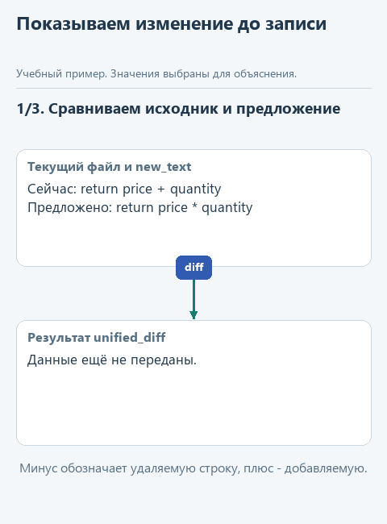
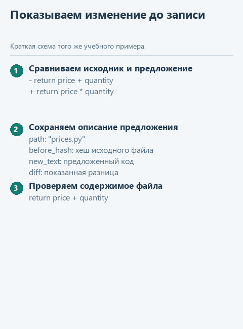

# Урок 2. Показываем предлагаемое изменение

[Открыть исходники этого урока](../../exercises/lesson-05-02-diff/README.md) / [Подсказки рядом с кодом](../../exercises/lesson-05-02-diff/TASK.md)

В учебном `prices.py` цена за единицу складывается с количеством, хотя общую стоимость нужно считать умножением. Попросим модель предложить исправление. Но даже для такой небольшой задачи полезно увидеть, что именно она собирается заменить, прежде чем разрешить запись.

Функция `preview_change` подготовит предложение: сравнит прежний и новый текст, покажет изменённые строки и запомнит состояние исходного файла. Сам файл пока останется прежним. Мы сможем заметить лишнюю правку или неверный расчёт до её применения.

В этом упражнении отделим предложение агента от изменения проекта. Человек сможет согласовать конкретный текст, а программа сохранит данные, необходимые для последующей записи. Контрольная строка исходника также позволит проверить, что за время просмотра файл не изменился и согласие всё ещё относится к показанной версии.

## Откроем каркас именно этого урока

Скачайте [каркас этого урока](../../downloads/lesson-05-02-diff.zip?raw=true) и распакуйте архив через "Извлечь всё". Внутри будет папка `lesson-05-02-diff`. В PyCharm выберите **File -> Open**, укажите эту папку и откройте её в новом окне. В каркасе уже готовы функции предыдущих уроков, поэтому сразу перейдём к текущему заданию. Ваш прежний проект останется в отдельной папке.

Слева откройте **View -> Tool Windows -> Project** и разверните `lesson-05-02-diff` стрелкой рядом с именем. Текущее задание - `preview_change` в `workspace.py`. Файл `demo.py` лежит прямо в этом корне, рядом с модулями, вне папок `data` и `tests`.

Подключение из [урока подключения модели](../02-note-assistant/04-connect.md) уже должно работать. Все каркасы читают сохранённый выбор сервиса и модели; повторно вводить ключ не нужно. Ниже разберём конкретные данные текущей функции, а после реализации запустим её в работе с моделью.

## Посмотрим на данные

Ниже для разбора подготовлены две строки: исходный расчёт со сложением и ожидаемое исправление с умножением. Функция `preview_change` получит путь к файлу и новый текст, сравнит его с исходным и вернёт описание различий. Сам файл на этом шаге останется прежним.

```python
old_text = '    return price + quantity\n'
new_text = '    return price * quantity\n'
# В diff старая строка начнётся с -, новая - с +.
```

Такое текстовое сравнение называют diff: удаляемая строка отмечается знаком `-`, добавляемая - знаком `+`. Вместе с ним сохраним хеш исходного файла, то есть контрольное значение его содержимого. В следующем уроке оно поможет заметить, если файл успели изменить после подготовки предложения. В основном запуске новый текст поступит от модели, поэтому фактический diff нужно будет проверить в Run.



<details>
<summary>Статичный вариант</summary>



</details>

## Соберём функцию с подсказками

Мы хотим увидеть предложение до записи файла. Поэтому читаем старый текст, сравниваем его с `new_text` и возвращаем описание изменения. Формирование diff - готовая возможность стандартной библиотеки; в этом упражнении не нужно придумывать алгоритм сравнения строк.

Допишите уже начатую функцию по заготовке ниже, заполняя каждый `...` по подсказкам. Когда закончите, удалите строку `raise NotImplementedError(...)`; повторно добавлять заголовок `def` не нужно.

```python
def preview_change(root: Path, relative: str, new_text: str) -> dict:
    path = workspace_path(root, relative)
    old_text = path.read_text(encoding='utf-8')
    lines = difflib.unified_diff(
        old_text.splitlines(keepends=True),
        new_text.splitlines(keepends=True),
        fromfile='before/' + relative,
        tofile='after/' + relative,
    )
    before_hash = hashlib.sha256(path.read_bytes()).hexdigest()
    return {
        'path': relative,
        'before_hash': before_hash,
        'new_text': ...,
        'diff': ...,
    }
```

В поле `new_text` положите переданный параметр `new_text`. В поле `diff` - `"".join(lines)`: библиотека отдаёт строки сравнения по одной, а нам нужен единый текст. Пустая строка перед `.join` означает, что дополнительных разделителей не добавляем - переводы уже сохранены через `keepends=True`.

`fromfile` и `tofile` задают подписи старого и нового вариантов в diff; это не команды записи файлов. Цепочка `sha256(...).hexdigest()` вычисляет контрольную строку по исходным байтам. Готовую строку сохраним в `before_hash`, чтобы следующий урок мог заметить изменение исходника. До конца этой функции ничего не записываем на диск.

Возвращаемый словарь - подготовленное предложение для следующих действий программы. Из `proposal['diff']` демонстрация берёт текст для показа человеку, `proposal['new_text']` хранит будущий исходный код, а `before_hash` связывает предложение с той версией файла, которую мы прочитали. Поэтому после `return` у программы есть данные и для показа, и для проверки перед записью. Изменение пока существует только в предложении: файл `prices.py` сохраняет прежнее содержимое.

## Запустим с нашей моделью

После реализации откройте **Project -> lesson-05-02-diff -> demo.py**, щёлкните правой кнопкой внутри редактора и выберите **Run 'demo'**. Результат появится в панели **Run**; её можно открыть через **View -> Tool Windows -> Run**.

Модель получает настоящий учебный `workspace/prices.py` и предлагает исправление расчёта. Ваша функция `preview_change` показывает разницу в Run. Ожидаем замену сложения умножением, но проверяем фактический diff: модель может предложить лишние изменения или оставить ошибку. Файл на этом шаге ещё не записывается.

Если настройки ещё не сохранены или перестали работать, вернитесь к [уроку подключения модели](../02-note-assistant/04-connect.md). В этом запуске модель не подменяется ответом из файла. Маленькая локальная модель может плохо соблюдать формат JSON; сначала отличите ошибку разбора её ответа от ошибки вашей функции. Если подключение работает, но возможностей модели не хватает, смените модель через `configure_model.py`, сохранив реализацию задания.

## Проверим функцию отдельно

Для воспроизводимого примера откройте **Project -> lesson-05-02-diff -> demo_check.py** и выберите **Run 'demo_check'**. Этот файл обращается к подготовленным данным без модели. До завершения текущей функции он показывает "Допишите ...", после реализации ожидаем:

```text
В diff видны -    return price + quantity и +    return price * quantity; исходный файл не изменён.
```

Дополнительно можно запустить `tests/test_lesson.py` через Run по классу `LessonTests`. Эти проверки помогают обнаружить ошибку функции независимо от поведения модели.


## Куда идти дальше

Следующий шаг - [применяем согласованное предложение](03-apply.md). Вернуться к [оглавлению и архивам](../README.md).
