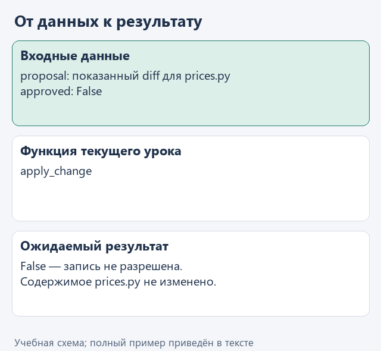
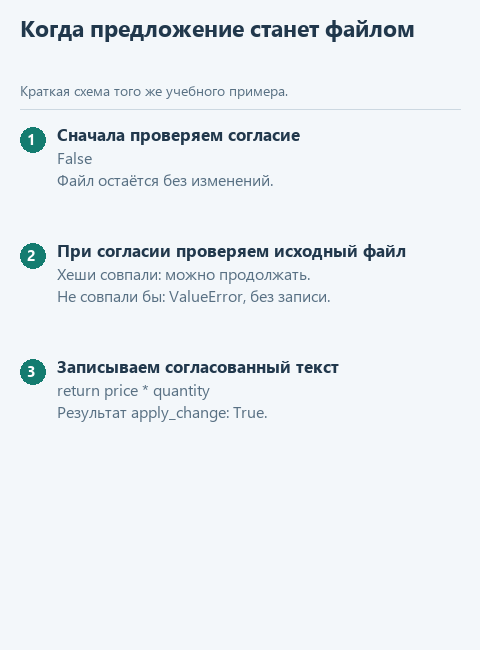

# Урок 3. Применяем согласованное предложение

[Открыть исходники этого урока](../../exercises/lesson-05-03-apply/README.md) / [Подсказки рядом с кодом](../../exercises/lesson-05-03-apply/TASK.md)

Предложение уже можно прочитать. Теперь проведём границу между «показать» и «записать»: без явного согласия учебная программа не меняет файл. Ещё проверим, что после подготовки diff исходный файл не успели отредактировать.

## Откроем каркас именно этого урока

Скачайте [каркас этого урока](../../downloads/lesson-05-03-apply.zip?raw=true) и распакуйте архив через «Извлечь всё». Внутри будет папка `lesson-05-03-apply`. В PyCharm выберите **File -> Open**, укажите эту папку и откройте её в новом окне. Предыдущие части уже подготовлены: переносить свои решения необязательно. Свой прежний проект можно оставить открытым.

Слева откройте **View -> Tool Windows -> Project** и разверните `lesson-05-03-apply` стрелкой рядом с именем. Текущее задание - `apply_change` в `workspace.py`. Файл `demo.py` лежит прямо в этом корне, рядом с модулями, вне папок `data` и `tests`.

## Посмотрим на данные

`approved` - логическое значение: `True` означает согласие, `False` - отказ. `proposal` содержит исходный хеш и предлагаемый текст. При отказе вернём `False`, при успешной записи - `True`. Если файл изменился, старое предложение применять нельзя.

```python
approved = False
# После просмотра предложения читатель сам может выбрать True в demo.py.
```

Этот фрагмент поясняет данные и конструкции; в учебный модуль его целиком копировать не требуется. Рабочие значения уже подготовлены в `demo.py`.



<details>
<summary>Статичный вариант</summary>



</details>

## Соберём функцию с подсказками

У программы есть предложение, но пока нет разрешения его применять. Начнём с отказа: если `approved` равно `False`, сразу вернём `False` и не будем писать файл. Для разрешённого изменения сначала убедимся, что исходный файл всё ещё совпадает с тем, для которого показывали diff.

В файле текущего задания уже есть начало функции. Допишите её по заготовке ниже: `...` обозначает место для вашего выражения, а не готовую команду. Когда заполните пропуски, удалите строку `raise NotImplementedError(...)` из каркаса. Заголовок `def` в файле уже есть - вторую функцию с тем же именем создавать не нужно.

```python
def apply_change(root: Path, proposal: dict, approved: bool) -> bool:
    if not approved:
        return False
    path = workspace_path(root, proposal['path'])
    current_hash = hashlib.sha256(path.read_bytes()).hexdigest()
    if current_hash != proposal['before_hash']:
        raise ValueError('Файл изменился после подготовки предложения')
    path.write_text(..., encoding='utf-8')
    return True
```

В `write_text` передайте `proposal["new_text"]` - уже показанный новый текст. Не используйте вместо него `diff`: в diff есть служебные строки, а Python-файлу нужен обычный исходный код. `write_text` заменяет всё содержимое выбранного файла, поэтому согласие и проверка хеша идут раньше.

В каркасе пока найден путь, но для полноценной функции добавьте ранний отказ перед этой строкой, как показано выше. Затем сравните хеши и допишите запись. В `demo.py` сначала оставьте `approved = False`; после просмотра diff можно осознанно выбрать `True`. Речь идёт только о приложенном учебном `workspace/prices.py`.

## Найдём файл запуска и проверим результат

В левой панели **Project -> lesson-05-03-apply -> demo.py** откройте файл двойным щелчком. Нажмите правой кнопкой внутри открытого редактора и выберите **Run 'demo'**. Внизу появится окно **Run** с выводом именно этого файла. Отдельная общая кнопка «запустить проект» нам здесь не нужна: выбираем конкретный демонстрационный файл. Если панель с файлами скрыта, вернитесь к **View -> Tool Windows -> Project**. Если Run скрыто - **View -> Tool Windows -> Run**.

До завершения функции появится сообщение «Допишите ... по подсказкам урока». После реализации ожидаем:

```text
Сначала diff, затем False: при approved = False файл не изменён. После осознанной смены на True файл получит исправление.
```

Для дополнительного контроля откройте в этом же проекте `tests/test_lesson.py`, найдите `class LessonTests`, нажмите правой кнопкой по имени класса и выберите Run. Это необязательная проверка текущего задания; внутреннее устройство тестов сейчас разбирать не нужно.

Сейчас ваша работа - `apply_change` в `workspace.py`; затем повторный запуск `demo.py`.

## Куда идти дальше

Следующий шаг - [проверяем изменённый проект](04-verify.md). Вернуться к [оглавлению и архивам](../README.md).
