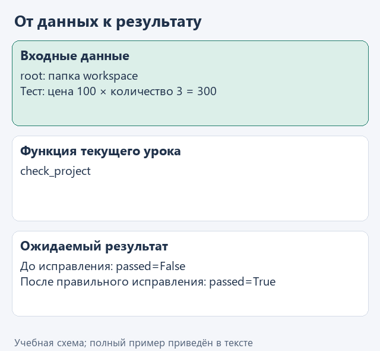
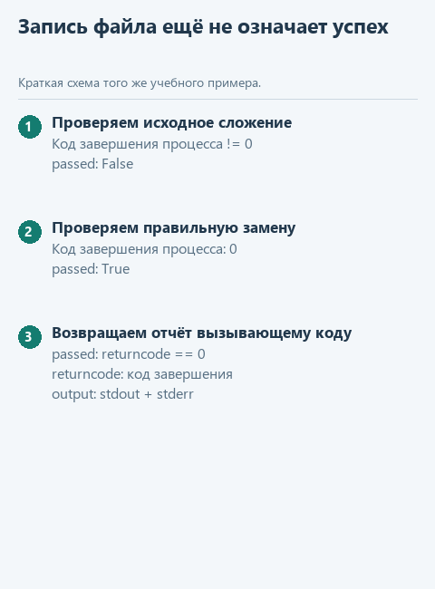

# Урок 4. Проверяем изменённый проект

[Открыть исходники этого урока](../../exercises/lesson-05-04-verify/README.md) / [Подсказки рядом с кодом](../../exercises/lesson-05-04-verify/TASK.md)

Модель предложила исправление, человек его просмотрел, а программа записала файл. Пока мы знаем только то, что изменение применено. Нужно ещё проверить сам расчёт: для заданной цены и количества он должен давать ожидаемую стоимость.

Запустим приложенные тесты из нашей программы и соберём их результат в `check_project`. На исходном ошибочном расчёте увидим отказ проверки, а после правильного исправления - успешное прохождение. Сообщения тестов помогут понять, какое условие нарушено.

Так отделим согласованную запись файла от подтверждённого поведения кода на подготовленных примерах. Для приложения появится основание сообщить об успехе проверки, а при ошибке - сохранить её результат для разбора. Набор тестов проверяет конкретные условия нашего расчёта; состав этих условий задаём мы, а не модель после внесения правки.

## Откроем каркас именно этого урока

Скачайте [каркас этого урока](../../downloads/lesson-05-04-verify.zip?raw=true) и распакуйте архив через "Извлечь всё". Внутри будет папка `lesson-05-04-verify`. В PyCharm выберите **File -> Open**, укажите эту папку и откройте её в новом окне. В каркасе уже готовы функции предыдущих уроков, поэтому сразу перейдём к текущему заданию. Ваш прежний проект останется в отдельной папке.

Слева откройте **View -> Tool Windows -> Project** и разверните `lesson-05-04-verify` стрелкой рядом с именем. Текущее задание - `check_project` в `workspace.py`. Файл `demo.py` лежит прямо в этом корне, рядом с модулями, вне папок `data` и `tests`.

Подключение из [урока подключения модели](../02-note-assistant/04-connect.md) уже должно работать. Все каркасы читают сохранённый выбор сервиса и модели; повторно вводить ключ не нужно. Ниже разберём конкретные данные текущей функции, а после реализации запустим её в работе с моделью.

## Посмотрим на данные

В папке `workspace/tests` уже лежат проверки расчёта цены. Функция `check_project` запустит их отдельным Python-процессом из учебной папки `root` и получит код завершения: `0` при успешном выполнении, другое значение при ошибке. В каркасе подготовлена такая команда:

```python
command = [sys.executable, '-B', '-m', 'unittest', 'discover', '-s', 'tests']
# sys.executable - тот же Python, которым запущен наш demo.py.
```

Здесь `sys.executable` выбирает тот же интерпретатор Python, которым запущен `demo.py`, а `-m unittest discover -s tests` запускает проверки из папки `tests`. Этот список уже записан в функции, поэтому переносить пример отдельно не нужно. Успех подтвердит именно сценарии расчёта цены, для которых написаны тесты.



<details>
<summary>Статичный вариант</summary>



</details>

## Соберём функцию с подсказками

Теперь запустим уже знакомые тесты как действие нашей программы. Команда запуска в каркасе подготовлена: её не нужно собирать строкой или передавать в командную оболочку. Получим результат отдельного процесса и преобразуем его в понятный словарь.

Допишите уже начатую функцию по заготовке ниже, заполняя каждый `...` по подсказкам. Когда закончите, удалите строку `raise NotImplementedError(...)`; повторно добавлять заголовок `def` не нужно.

```python
def check_project(root: Path) -> dict:
    command = [sys.executable, '-B', '-m', 'unittest', 'discover', '-s', 'tests']
    process = subprocess.run(
        command,
        cwd=root,
        capture_output=True,
        text=True,
        encoding='utf-8',
        errors='replace',
        timeout=5,
    )
    return {
        'passed': ...,
        'returncode': process.returncode,
        'output': ...,
    }
```

В `passed` подставьте `process.returncode == 0`. В `output` соедините `process.stdout + process.stderr`: тесты могут писать сообщения в оба потока. `subprocess.run` ждёт завершения процесса и возвращает объект с этими полями.

`cwd=root` выбирает папку запуска; `capture_output=True` собирает вывод вместо немедленной печати; `text=True` возвращает строки; `encoding` и `errors` задают чтение текста; `timeout=5` ограничивает ожидание пятью секундами. Эти настройки уже показаны готовым блоком. `-m unittest discover -s tests` означает запуск тестов из папки `tests` через текущий Python.

На исходном `prices.py` результат `passed=False` ожидаем: в нём ещё ошибочное сложение. После согласованной замены на умножение ожидаем `True`. Не превращайте любой результат запуска в успех и не запускайте здесь неизвестные проекты: наши ограничения пути не изолируют Python-процесс от операционной системы.

В исходном учебном проекте тест обнаружит ошибку расчёта, поэтому `process.returncode == 0` даст `False`. Возвращённый словарь сохранит это значение в поле `passed`, код завершения - в `returncode`, а пояснение теста - в `output`. Демонстрация получает этот словарь от `check_project` и печатает его. После правильного исправления расчёта и успешных тестов `passed` станет `True`. Таким способом программа отличает выполненную запись файла от изменения, которое прошло подготовленные проверки; сама функция проверки исходники не исправляет.

## Запустим с нашей моделью

После реализации откройте **Project -> lesson-05-04-verify -> demo.py**, щёлкните правой кнопкой внутри редактора и выберите **Run 'demo'**. Результат появится в панели **Run**; её можно открыть через **View -> Tool Windows -> Run**.

Основной запуск получает предложение модели, показывает diff, запрашивает согласие в Run, а затем вызывает вашу функцию `check_project`. Введите `да` для согласованной записи либо нажмите Enter для отказа. В Run появится результат тестов текущего `workspace/prices.py`. На исходном сложении тест должен падать, после правильного исправления - проходить. Успех нельзя обещать заранее: он зависит от предложенного и принятого кода.

Если настройки ещё не сохранены или перестали работать, вернитесь к [уроку подключения модели](../02-note-assistant/04-connect.md). В этом запуске модель не подменяется ответом из файла. Маленькая локальная модель может плохо соблюдать формат JSON; сначала отличите ошибку разбора её ответа от ошибки вашей функции. Если подключение работает, но возможностей модели не хватает, смените модель через `configure_model.py`, сохранив реализацию задания.

## Проверим функцию отдельно

Для воспроизводимого примера откройте **Project -> lesson-05-04-verify -> demo_check.py** и выберите **Run 'demo_check'**. Этот файл обращается к подготовленным данным без модели. До завершения текущей функции он показывает "Допишите ...", после реализации ожидаем:

```text
На исходном ошибочном prices.py: passed = False. После применения правильного исправления: passed = True.
```

Дополнительно можно запустить `tests/test_lesson.py` через Run по классу `LessonTests`. Эти проверки помогают обнаружить ошибку функции независимо от поведения модели.


## Что получилось

В `demo.py` теперь собран один проход: прочитать учебный файл -> получить предложение модели -> показать diff -> спросить согласие -> применить согласованное -> проверить. Автоматических повторов исправления здесь пока нет. Сохраните фактический diff и результат тестов для итогового разбора.

## Куда идти дальше

Практический маршрут завершён. Теперь можно прочитать [заключение о результатах и применении знаний](../conclusion.md). Сохраните diff и вывод проверок для разбора архитектуры. Вернуться к [оглавлению и архивам](../README.md).
