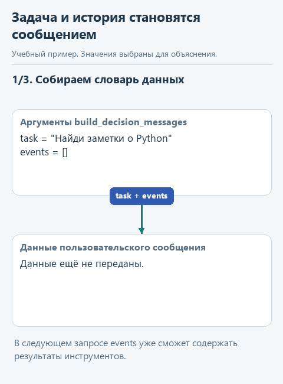
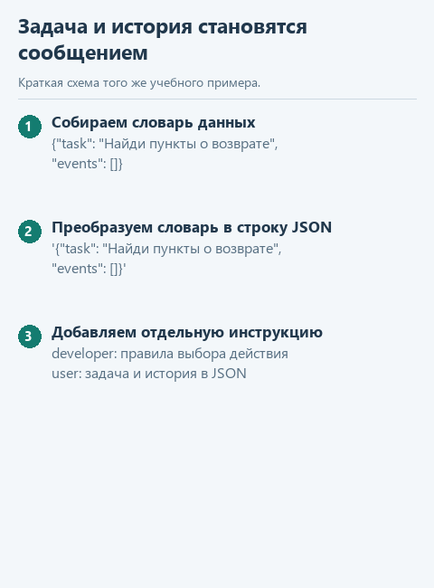

# Как подготовить задачу для модели

[Открыть исходники этого урока](../../exercises/lesson-extra-01-messages/README.md) / [Подсказки рядом с кодом](../../exercises/lesson-extra-01-messages/TASK.md)

> **Где мы.** Первый урок дополнительного учебника. Пишем функцию, которая собирает сообщения для модели перед тем, как та выберет следующее действие.
> `задача + история -> [сообщения] -> модель -> команда`

Клиент спрашивает о возврате. Модель должна решить, что делать: искать в регламенте, прочитать его целиком или сразу ответить. Одних слов клиента для этого мало. Программа должна объяснить модели, какие действия существуют, как их запросить и что уже удалось сделать. Если результат прошлого поиска не попал в сообщения, модель о нём не знает. Если названия инструментов не объяснены, модель может попросить то, чего у программы нет.

Подготовкой сообщений займётся `build_decision_messages`. Мы увидим точное содержимое будущего обращения: правила, задачу и историю. Когда агент поведёт себя странно, именно это содержимое первым делом стоит проверить.

## Откроем каркас

Скачайте [архив урока](../../downloads/lesson-extra-01-messages.zip?raw=true), распакуйте и откройте папку `lesson-extra-01-messages` через **File -> Open**. В `decisions.py` функция `build_decision_messages` остановлена на заглушке. Модель в этом уроке не нужна.

## Что именно мы передадим модели

Начнём с первого обращения, когда поиска ещё не было:

```python
task = 'Найди в регламенте пункты о возврате'
events = []
```

`task` - просьба, `events` - история выполненных действий, пока пустая. Функция вернёт два сообщения. Роль `'developer'` отведена правилам приложения, роль `'user'` - задаче и данным. Правила уже записаны в переменной `RULES` в начале `decisions.py`, и в них есть образец просьбы о поиске:

```json
{"type":"tool","tool":"find_notes","query":"слово"}
```

`type: "tool"` означает просьбу о действии, `tool` называет функцию поиска, а `query` содержит искомый текст. "слово" здесь только образец: для нашей задачи ждём запрос "возврат". Так программа объясняет модели, в каком виде ждёт команду. Выполнит ли модель это указание, видно только по её ответу.

Задачу и историю перед отправкой превратим в строку JSON:

```python
content = json.dumps({'task': task, 'events': events}, ensure_ascii=False)
```

В `content` получится текст `{"task": "Найди в регламенте пункты о возврате", "events": []}`. В поле `content` сообщения кладём именно эту строку.



<details>
<summary>Статичный вариант схемы</summary>



</details>

## Напишите сами

Замените заглушку в `build_decision_messages` кодом ниже и заполните три пропуска:

```python
def build_decision_messages(task: str, events: list[dict]) -> list[dict]:
    rules = RULES
    content = ...
    return [
        {'role': 'developer', 'content': ...},
        {'role': 'user', 'content': ...},
    ]
```

1. В `content` - вызов `json.dumps` из примера выше.
2. В сообщение с ролью `'developer'` - переменную `rules`.
3. В сообщение с ролью `'user'` - переменную `content`.

Функция возвращает список из двух сообщений. В демонстрации он сохраняется в переменную `messages`, и программа печатает его поля. Отправлять сообщения будем в последнем уроке, через `send_live`. Там роль `'developer'` заменится на `'system'`, как в основном курсе.

## Посмотрим результат и изменим историю

Откройте `demo_check.py` и выберите **Run**. После реализации в Run появятся правила и задача с пустым списком `events`. Для готовых проверок откройте `tests/test_lesson.py` и выберите **Run**.

В `demo_check.py` есть и второй вызов: программа уже выполнила поиск и снова обращается к модели. Задача прежняя, а в истории появилась запись о том, какой инструмент работал и что он вернул:

```python
events = [{'tool': 'find_notes', 'result': ['Возврат товара возможен в течение 14 дней.']}]
```

Эту запись делает программа после поиска, модель её не создаёт. Сравните два сообщения с ролью `'user'` в выводе: во втором модель получила бы найденный пункт вместе с задачей, а правила остались прежними.

Следующий шаг: [как получить команду из текста ответа](02-command.md).
