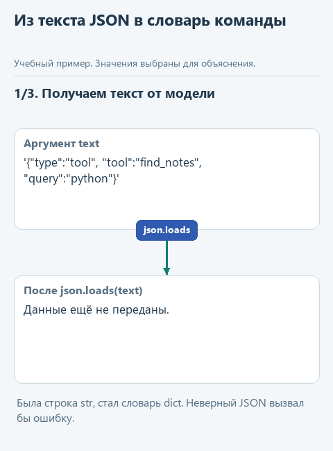
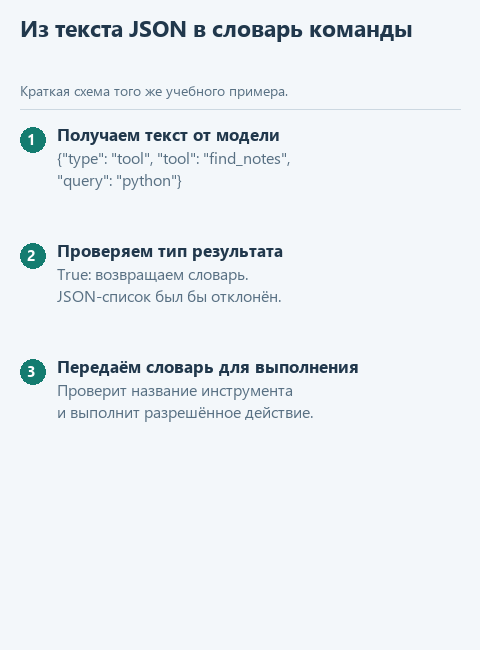

# Как получить команду из текста

[Открыть исходники этого урока](../../exercises/lesson-extra-02-command/README.md) / [Подсказки рядом с кодом](../../exercises/lesson-extra-02-command/TASK.md)

Наш помощник должен найти строки о Python в учебных заметках. Программа уже объяснила модели, что можно запросить чтение или поиск, и получила ответ `{"type":"tool","tool":"find_notes","query":"python"}`. Для нас это понятная просьба выполнить поиск. Для Python пока это строка, из которой ещё нужно получить отдельные значения.

Кроме того, модель может ответить "Сейчас поищу" или прислать JSON-список вместо объекта с полями. Программа не должна принять такой ответ за готовую команду и продолжить выполнение с отсутствующими данными. Нам нужен явный переход: разобрать текст, проверить тип результата и либо передать словарь дальше, либо сообщить об ошибке.

В `parse_decision` мы напишем именно этот переход. На практике увидим, как ответ модели становится данными программы и почему правильный JSON ещё не означает разрешённое действие. Разрешение инструмента проверит основная `dispatch_tool`. В готовой `decide_live` из `decisions.py` эти части стоят рядом; здесь рассматриваем разбор отдельно, чтобы понять, где закончился ответ модели и началась ответственность нашего кода.

## Откроем отдельный каркас

Скачайте [каркас этого урока](../../downloads/lesson-extra-02-command.zip?raw=true), выберите у архива "Извлечь всё" и откройте папку `lesson-extra-02-command` через **File -> Open** в PyCharm. Используйте настроенный для курса интерпретатор Python. Слева в **Project** откройте `decisions.py`: в функции `parse_decision` находится заглушка. Если дерево файлов скрыто, выберите **View -> Tool Windows -> Project**. Папку с предыдущей практикой менять не нужно.

В этом шаге модель вызывать не будем: сначала посмотрим, какие данные подготавливает или разбирает наша программа.

Функция `build_decision_messages` из предыдущего дополнительного урока уже готова. Переносить свою реализацию между папками не требуется.

## Как текст превращается в данные программы

В `demo_check.py` подготовлен такой ответ:

```python
text = '{"type":"tool","tool":"find_notes","query":"python"}'
```

Для Python в переменной `text` пока хранится одна строка. Мы видим в ней слова `tool` и `query`, но у строки нет полей с такими именами. Чтобы прочитать значение конкретного поля, разберём запись функцией `json.loads`:

```python
command = json.loads(text)
command['tool']   # 'find_notes'
command['query']  # 'python'
```

В переменной `command` теперь словарь: по ключу `'tool'` Python находит строку `'find_notes'`, а по ключу `'query'` - строку `'python'`. `json.loads` не придумывает эти значения и не выбирает инструмент. Она читает то, что уже записано в тексте, и создаёт из него данные, с которыми программа может работать по отдельным полям.

Одинаковое слово "команда" здесь относится к одному решению модели в двух формах: сначала оно записано текстом JSON, а после разбора представлено Python-словарём. Ни разбор, ни появление словаря ещё не запускают поиск.

Обратите внимание на имена функций: `dumps` превращает данные в текст, а `loads` читает данные из текста. Во внешней строке Python стоят одинарные кавычки, внутри JSON - двойные кавычки у названий полей и строковых значений. Фрагмент выше поясняет действия внутри нашей функции; переносить его отдельно в модуль не нужно.

## Почему после разбора нужна проверка

Но модель может ответить обычной фразой, например "Сейчас поищу". Тогда `json.loads` вызовет ошибку `JSONDecodeError`. Бывает и другая ситуация: строка `'[]'` содержит правильный JSON, только после разбора получится список, а нашей программе нужен словарь. Эти два случая проверим отдельно.



Схема показывает ожидаемое движение данных, а не запись запуска.

<details>
<summary>Статичный вариант схемы</summary>



</details>

## Соберём функцию с подсказками

В `decisions.py` найдите `parse_decision` и замените её заглушку этим шаблоном:

```python
def parse_decision(text: str) -> dict:
    try:
        command = ...
    except json.JSONDecodeError:
        raise ValueError('Модель вернула текст вместо команды JSON: ' + text[:400]) from None
    if not isinstance(command, ...):
        raise ValueError('Команда должна быть объектом JSON')
    return command
```

В строке `command = ...` нам нужен результат разбора полученного текста. Для этого вызовите `json.loads(text)`: на нашем примере в `command` окажется словарь с полями `type`, `tool` и `query`, как в разобранном выше фрагменте.

После разбора проверим, получили ли именно словарь. Во втором пропуске укажите `dict` - так в Python называется тип словаря. Выражение `isinstance(command, dict)` вернёт `True` для нашей команды и `False` для списка `[]`. Оно ничего не преобразует; вместе с `not` это условие останавливает функцию, если результат оказался другого типа.

Блок `try` содержит действие, которое может завершиться ошибкой. Если возникает именно `JSONDecodeError`, Python переходит к `except`, где мы заменяем техническое сообщение понятным для нашего приложения. Запись `text[:400]` берёт первые 400 символов ответа, чтобы не печатать длинный текст целиком. Добавка `from None` убирает из вывода цепочку исходной ошибки; сама ошибка при этом не превращается в успешный результат.

Отступы связывают строки с блоками: разбор находится внутри `try`, а проверка словаря - уже после `except`. Завершающий `return` должен выполняться только после успешных проверок. Удалите прежнюю строку с `NotImplementedError`.

### Куда попадает значение после return

Посмотрим на вызов из демонстрации:

```python
decision = parse_decision(text)
```

Python сначала выполняет `parse_decision(text)`: передаёт строку в функцию, разбирает её и проверяет результат. Когда выполнение доходит до `return command`, функция завершается, а полученный словарь становится результатом её вызова. Оператор `=` сохраняет этот результат в переменную `decision` уже в демонстрационном файле. Имена переменных здесь различаются: в функции словарь записан в `command`, а в демонстрационном файле результат вызова сохраняется в `decision`.

Поэтому после вызова демонстрация сможет выполнить `decision['tool']` и получить `'find_notes'`. `return` не отправляет команду модели, не печатает её и не выполняет поиск. Он передаёт результат обратно тому Python-коду, который вызвал функцию. Печать выполняет отдельный `print`, а к выполнению команды перейдём в основном проекте через `dispatch_tool`.

## Проверим три разных ответа

В корне `lesson-extra-02-command` найдите `demo_check.py`, щёлкните по нему правой кнопкой и выберите **Run**. Вывод появится внизу, во вкладке **Run**. До реализации там будет просьба дописать функцию. После реализации сначала увидим переход от строки к словарю:

```text
До разбора: <class 'str'>
После разбора: <class 'dict'>
Команда: {'type': 'tool', 'tool': 'find_notes', 'query': 'python'}
Инструмент: find_notes
Запрос: python
```

Готовый вызов `type(...)` показывает тип значения: `str` обозначает строку, `dict` - словарь. Строки "Инструмент" и "Запрос" демонстрация получает обращением к полям возвращённого словаря. Это и есть проверка того, что вызывающий код получил пригодные для дальнейшей работы данные, а не только красиво напечатанный текст.

`demo.py` повторяет этот опыт без сети; для текущего шага достаточно одного запуска.

После удачного запуска можно открыть `tests/test_lesson.py` и выбрать **Run** у имени файла. Эти необязательные проверки помогают сохранить договорённости о данных, если позже вы измените реализацию.

В демонстрации сначала разбирается правильная команда, затем обычная фраза "Сейчас поищу" и, наконец, JSON-список `'[]'`. Так мы меняем только ответ модели и видим, какая именно проверка срабатывает. После ошибочного примера программа не должна выдавать пустой словарь и делать вид, что команда получена.

Если хочется проверить своё понимание, временно замените в своей `parse_decision` только `return command` на `return text` и снова запустите `demo_check.py`. Функция по-прежнему разбирает текст, но теперь возвращает исходную строку. Поэтому в демонстрации `decision` будет иметь тип `str`, а чтение поля `'tool'` завершится ошибкой. Верните `return command`. Этот опыт показывает, что важно не просто вызвать `json.loads`, а передать полученные данные дальше.

Есть важная граница: `parse_decision` проверяет JSON и тип результата, но не разрешает выполнить действие. Например, словарь `{'type': 'tool', 'tool': 'delete_file'}` пройдёт эти две проверки. В основном проекте неизвестное действие отклонит функция `dispatch_tool`. Не будем незаметно переносить её обязанности в разборщик.

Мы поняли, как подготовить данные и прочитать команду. В [следующем уроке](03-request.md) разберём то, что происходит между этими шагами: отправку запроса сервису.
