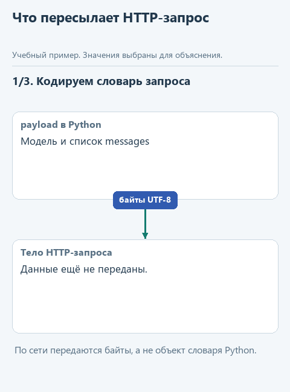
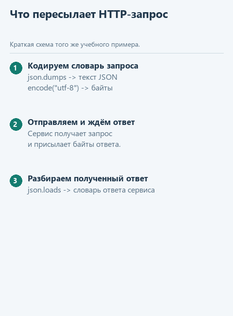

# Как Python отправляет запрос

[Открыть исходники этого урока](../../exercises/lesson-extra-03-request/README.md) / [Подсказки рядом с кодом](../../exercises/lesson-extra-03-request/TASK.md)

Наш помощник получает просьбу найти сведения о Python в заметках. В предыдущих дополнительных уроках мы подготовили сообщения для модели и разобрали текст её команды. Между этими действиями находится обращение к приложению, которое запускает модель: локальной Ollama или облачному сервису.

Для обоих подключений нашего курса Python передаёт данные по HTTP. С Ollama обмен идёт внутри компьютера, с облачным сервисом - через соединение с его сервером. В файле `transport.py` готовая `send_live` выбирает адрес и собирает словарь с именем модели и сообщениями, а затем поручает отправку функции `request_json`.

Напишем её сетевую часть и проследим переход от словаря к переданным байтам, а затем от ответа обратно к данным Python. Это поможет различать неполадки подключения и ошибки содержимого: например, запрос вообще не дошёл до сервиса или ответ получен, но не соответствует ожидаемому формату. Сначала проверим свой код на известных данных без сети, затем используем уже сохранённое подключение к модели.

## Откроем отдельный каркас

Скачайте [каркас этого урока](../../downloads/lesson-extra-03-request.zip?raw=true), выберите у архива "Извлечь всё" и откройте папку `lesson-extra-03-request` через **File -> Open** в PyCharm. Используйте настроенный для курса интерпретатор Python. Слева в **Project** откройте `transport.py`: в функции `request_json` находится заглушка. Если дерево файлов скрыто, выберите **View -> Tool Windows -> Project**. Папку с предыдущей практикой менять не нужно.

Для настоящего запроса понадобится сохранённое подключение из [урока подключения модели](../02-note-assistant/04-connect.md). Сначала запустим пример без сети, затем тот же код с вашей моделью.

Проверки подключения, выбор адреса и преобразование ответа уже готовы. Внутри `request_json` также оставлены обработчики ошибок из основного каркаса: мы допишем только участок между подготовкой заголовков и этими обработчиками.

## Что получает сетевая функция

Начнём с проверки самого обмена, чтобы ошибка соединения или необычный ответ модели не мешали проверить написанную функцию. Для этого временно уберём настоящую задачу и сообщения: в демонстрации будут условный адрес `https://example.invalid/chat`, вымышленное имя модели и пустой список сообщений:

```python
url = 'https://example.invalid/chat'
payload = {'model': 'учебная-модель', 'messages': [], 'stream': False}
```

В этом примере поле `model` называет модель, `messages` содержит список сообщений, а `stream=False` просит вернуть ответ целиком, без выдачи по частям. Пустой список здесь нужен только для проверки передачи данных: он не является полезным запросом к настоящей модели.

В `demo_check.py` настоящее открытие соединения заменено готовой проверочной функцией. Она примет объект запроса и вернёт байты `b'{"ok": true}'`; обращения к этому адресу не будет. После этого наша функция должна вернуть словарь `{'ok': True}`. Так мы проверим переход от данных Python к передаваемым байтам и обратно, не делая вид, что получили ответ модели.

Затем вернёмся к настоящему подключению. В отдельном `demo.py` уже подготовлены вопрос "Что заметки говорят о Python?" и заметка `Python lists keep item order.`. Здесь намеренно используем обычный ответ по заметке вместо выбора инструмента: для проверки сетевой функции достаточно убедиться, что модель получила вопрос и вернула сведения о сохранении порядка в списках. Подготовку команды снова соединим с настоящим запросом в четвёртом уроке.

Параметр `url` задаёт адрес, `payload` содержит данные запроса, а необязательный `api_key` нужен облачному сервису. Внутри функции уже подготовлены заголовки: `'Content-Type': 'application/json'` сообщает формат данных, а при непустом ключе добавляется `Authorization`. Ни ключ, ни полный объект запроса печатать не будем.



Схема показывает ожидаемое движение данных, а не запись запуска.

<details>
<summary>Статичный вариант схемы</summary>



</details>

## Соберём функцию с подсказками

В `transport.py` сохраните готовые заголовки и все обработчики `except`. Вместо строки с `NotImplementedError` вставьте создание запроса, а строку `pass` внутри `try` замените чтением ответа:

Ниже показаны два фрагмента одной функции. Первый вставьте на место `raise NotImplementedError`, сохранив отступ функции:

```python
request = Request(
    url,
    data=...,
    headers=headers,
    method='POST',
)
```

Второй заменит `pass` внутри уже готового `try`. В файле он должен находиться на один уровень отступа глубже строки `try`:

```python
with urlopen(request, timeout=180) as response:
    text = ...
    return ...
```

Первый пропуск заполните выражением `json.dumps(payload, ensure_ascii=False).encode('utf-8')`. Уже знакомая `json.dumps` создаёт строку JSON, а `encode('utf-8')` превращает её в байты для передачи. В этом же формате записаны русские буквы. `Request` только описывает будущий запрос; фактическое обращение происходит при вызове `urlopen`.

Во втором пропуске используйте `response.read().decode('utf-8')`: `read()` получает байты ответа, а `decode` возвращает текст. В третьем вызовите `json.loads(text)`, чтобы разобрать полученную строку. В нашем учебном договоре сервис возвращает объект JSON, поэтому дальше программа ожидает словарь; сама `json.loads` умеет разбирать и другие значения JSON.

Запись `with ... as response` даёт имя открытому ответу и закрывает его после выхода из блока. `timeout=180` задаёт ожидание блокирующих сетевых операций в секундах; это не обещание, что весь запрос в сумме займёт меньше трёх минут. Отступы под `with` нужны обеим строкам: чтению и возврату результата.

Готовые обработчики различают ответ сервиса с кодом ошибки и отсутствие соединения. Например, HTTP 401 превращается в подсказку проверить API-ключ. Для такого случая не нужно придумывать ответ модели или возвращать пустой словарь.

На проверочном ответе байты `b'{"ok": true}'` после `decode` станут строкой JSON `'{"ok": true}'`, а `json.loads` создаст из неё словарь `{'ok': True}`. Его `return` отдаёт вызывающему коду: поэтому `demo_check.py` может напечатать результат, который вернула наша функция. В настоящем запуске вызывающей стороной будет `send_live`: она получит словарь сервиса, проверит завершение генерации и извлечёт текст ответа. Сетевая функция сама не выбирает инструмент и не выполняет команду модели.

## Сначала проверим обмен данными

В корне `lesson-extra-03-request` найдите `demo_check.py`, щёлкните по нему правой кнопкой и выберите **Run**. Вывод появится внизу, во вкладке **Run**. До реализации там будет просьба дописать функцию; после неё увидим `POST`, адрес `https://example.invalid/chat`, исходные данные запроса и результат `{"ok": true}`.

Затем так же запустите соседний `demo.py`. Он использует сохранённые настройки модели и делает настоящий запрос. Для облачного сервиса этот запрос расходует доступный бюджет API. Если выбранная модель вернёт другой текст, сравните смысл и структуру с ожидаемыми, а не отдельные слова.

После удачного запуска можно открыть `tests/test_lesson.py` и выбрать **Run** у имени файла. Эти необязательные проверки помогают сохранить договорённости о данных, если позже вы измените реализацию.

В настоящем запуске `demo.py` задаёт вопрос "Что заметки говорят о Python?" и передаёт строку `Python lists keep item order.`. Ожидаемый смысл ответа - списки Python сохраняют порядок элементов. Точная формулировка зависит от модели.

## Как разные ответы становятся одним форматом

Вернитесь в готовую `send_live` в этом же `transport.py`. Она вызывает написанную вами `request_json`, но полученный словарь ещё зависит от сервиса. Для Ollama текст берётся из `response['message']['content']`, а для облачных подключений - из первого элемента `choices`. Перед чтением текста программа также проверяет признак нормального завершения ответа.

Затем `course_response` помещает текст в общий формат курса:

```python
{'status': 'completed', 'output': [
    {'type': 'message', 'content': [
        {'type': 'output_text', 'text': 'Списки Python сохраняют порядок элементов.'}
    ]}
]}
```

Этот словарь мы уже читали функцией `extract_answer`. Благодаря такому преобразованию ей не нужно знать, к какому сервису обращались. Подробно пройти по каждой готовой ветке можно в статье [Как устроена send_live](../02-note-assistant/extra-send-live.md). Здесь мы реализовали общий сетевой участок, который используется обеими ветками.

Справка к новым конструкциям: [urllib.request](https://docs.python.org/3.14/library/urllib.request.html) и [преобразование JSON](https://docs.python.org/3.14/library/json.html) в документации Python. Для продолжения достаточно увидеть в Run, что словарь запроса дошёл до проверочного обработчика без изменений, а ответ снова стал Python-словарём.

В [заключительном уроке](04-decision.md) соединим подготовку сообщений, готовый сетевой модуль и разбор команды в одну функцию `decide_live`.
