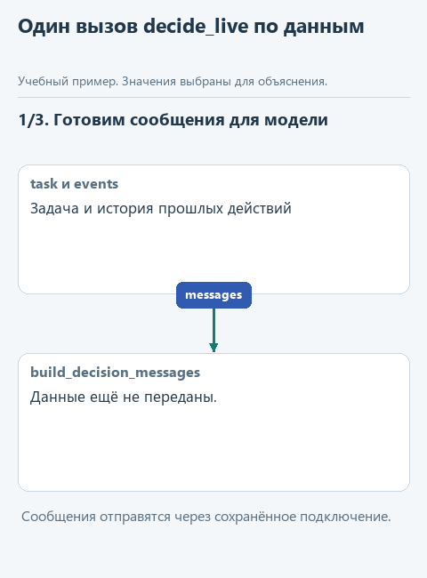
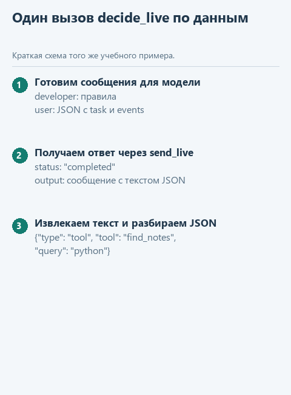

# Собираем decide_live из знакомых функций

[Открыть исходники этого урока](../../exercises/lesson-extra-04-decision/README.md) / [Подсказки рядом с кодом](../../exercises/lesson-extra-04-decision/TASK.md)

Вернёмся к задаче "Найди заметки о Python". Чтобы запросить следующий шаг, программа должна передать модели правила, задачу и результаты прежних действий, получить ответ и прочитать предложенную команду. После этого другая часть программы решит, можно ли выполнить выбранное действие.

Мы разобрали эти части по отдельности, а теперь соединим их в `decide_live` из файла `decisions.py`. `build_decision_messages` подготовит сообщения, `send_live` получит ответ через выбранное подключение, а функции чтения и разбора достанут словарь команды. Сама `decide_live` будет делать одно обращение за решением, без выполнения поиска и без повторения цикла.

Так мы увидим целиком тот участок, который в основном курсе был готов заранее. По этому пути можно будет проверить, что отправлено модели, что она вернула и на каком этапе возникла ошибка. При возвращении к агентному циклу станет понятно, какую именно работу выполняет один вызов `decide_live` и какие решения остаются за управляющим кодом.

## Откроем отдельный каркас

Скачайте [каркас этого урока](../../downloads/lesson-extra-04-decision.zip?raw=true), выберите у архива "Извлечь всё" и откройте папку `lesson-extra-04-decision` через **File -> Open** в PyCharm. Используйте настроенный для курса интерпретатор Python. Слева в **Project** откройте `decisions.py`: в функции `decide_live` находится заглушка. Если дерево файлов скрыто, выберите **View -> Tool Windows -> Project**. Папку с предыдущей практикой менять не нужно.

Для настоящего запроса понадобится сохранённое подключение из [урока подключения модели](../02-note-assistant/04-connect.md). Сначала запустим пример без сети, затем тот же код с вашей моделью.

Здесь уже готовы `build_decision_messages`, `parse_decision`, `extract_answer` и весь `transport.py`. Дописать нужно только `decide_live`. Мы вынесли части исходной функции в отдельные именованные функции, чтобы было легче проследить данные; договорённости основного проекта при этом сохранились.

## Проследим один запрос

В `demo_check.py` задача "Найди заметки о Python" передаётся с пустой историей `[]`: представим первое обращение, до выполнения поиска. Вместо настоящего запроса проверочный запуск вернёт заранее подготовленный ответ. Внутри него находится такой текст команды:

```json
{"type":"tool","tool":"find_notes","query":"python"}
```

Вспомним, что означает "общий формат ответа". Ollama и облачные сервисы возвращают разные словари, поэтому готовая `send_live` достаёт текст из ответа выбранного сервиса и помещает его в одинаковую структуру. Для нашего примера она выглядит так:

```python
response = {'status': 'completed', 'output': [
    {'type': 'message', 'content': [
        {'type': 'output_text',
         'text': '{"type":"tool","tool":"find_notes","query":"python"}'}
    ]}
]}
```

Здесь внешний словарь описывает завершённый ответ, а строка в поле `text` содержит саму команду модели. Готовая функция `extract_answer` проходит по `output` и `content`, извлекает эту строку и проверяет, что ответ завершён и текст не пустой. Затем наша `parse_decision` разбирает строку как JSON. В результате вызывающая программа получает `{'type': 'tool', 'tool': 'find_notes', 'query': 'python'}` - словарь с командой, а не словарь, описывающий ответ сервиса. Фрагмент выше служит иллюстрацией данных; в `decide_live` его копировать не нужно.



Это схема ожидаемого движения данных, не запись работы модели. Подсветка показывает текущий шаг; текст команды выбран для примера.

<details>
<summary>Статичный вариант схемы</summary>



</details>

## Соберём функцию с подсказками

В `decisions.py` замените заглушку в `decide_live`:

```python
def decide_live(task: str, events: list[dict]) -> dict:
    messages = ...
    response = ...
    text = ...
    return ...
```

Первая строка должна вызвать `build_decision_messages(task, events)`. Во второй передайте полученный список `messages` в `send_live`. В третьей используйте `extract_answer(response)`, а в последней верните `parse_decision(text)`. Уберите строку с `NotImplementedError`; все четыре строки остаются внутри функции с одинаковым отступом.

Имена переменных помогают не потерять этапы: `messages` - список сообщений до запроса, `response` - общий словарь ответа курса, `text` - строка JSON внутри этого ответа. Только результат последнего вызова является словарём с командой.

Проследим последнюю строку на нашем ответе. В переменной `text` находится строка `'{"type":"tool","tool":"find_notes","query":"python"}'`. Вызов `parse_decision(text)` сначала превратит её в словарь; затем `return` передаст этот словарь из `decide_live` тому коду, который запросил решение. В демонстрации он только печатается, а основной `run_agent` читает поле `type` и при запросе инструмента передаёт словарь в `dispatch_tool`. Поэтому получение решения, выполнение действия и возврат его результата модели - три отдельных шага программы.

## Сравним проверочный ответ с настоящим

В корне `lesson-extra-04-decision` найдите `demo_check.py`, щёлкните по нему правой кнопкой и выберите **Run**. Вывод появится внизу, во вкладке **Run**. До реализации там будет просьба дописать функцию; после неё увидим словарь с запросом `python`.

Затем так же запустите соседний `demo.py`. Он использует сохранённые настройки модели и делает настоящий запрос. Для облачного сервиса этот запрос расходует доступный бюджет API. Если выбранная модель вернёт другой текст, сравните смысл и структуру с ожидаемыми, а не отдельные слова.

После удачного запуска можно открыть `tests/test_lesson.py` и выбрать **Run** у имени файла. Эти необязательные проверки помогают сохранить договорённости о данных, если позже вы измените реализацию.

Перед настоящим запросом `demo.py` выводит выбранную модель и краткую задачу. Сохранённый ключ API не печатается. Мы просим модель вернуть команду; она может выбрать `find_notes`, `read_notes` или сразу ответить. Если вместо JSON пришла обычная фраза, сработает написанная нами `parse_decision`. Корректный JSON сам по себе ещё не доказывает, что действие выбрано удачно.

После запроса демонстрация печатает словарь, но не выполняет запрошенные действия. Это сделано, чтобы сейчас рассмотреть именно получение решения. В основном курсе словарь поступает в функцию `dispatch_tool`, которая проверяет название инструмента и выполняет разрешённое действие. Путь к файлу заметок задаёт программа; в команде модели его нет.

## Где здесь продолжается агентный цикл

После исполнения инструмента основной `run_agent` добавляет результат в список `events` и снова вызывает `decide_live` с той же задачей. Наша функция заново собирает сообщения, поэтому модель получает уже дополненную историю и может решить, нужен ли ещё один инструмент или пора вернуть ответ. Таким образом, `decide_live` делает один запрос за решением, а повторением шагов управляет `run_agent`.

Откройте `decisions.py` в каркасе основного [урока с инструментами](../03-tool-agent/01-tools.md). В нём те же операции находятся внутри одной функции: правила и сборка сообщений, `send_live`, `extract_answer`, затем `json.loads` и проверка словаря. Сопоставьте их с четырьмя строками своей реализации. Возвращаться в основной маршрут можно без копирования файлов из дополнительной практики.
